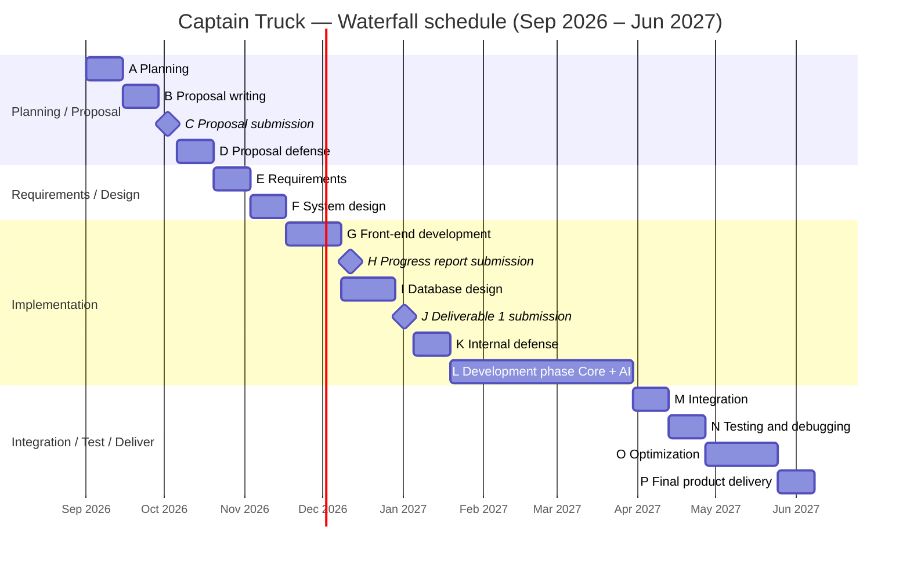

# Chapter 1: Project Feasibility Report

**Captain Truck — Real-Time Logistics and Dispatch Platform**

Department of Software Engineering  
University of Gujrat  

**Session:** BSSE-2023-2027  

**Project Advisor:** Mr. Touqeer Ul Ameen  

**Submitted By:**

| Name | Roll No. |
|------|----------|
| Muhammad Umair | 23011598-062 |
| Muhammad Ali | *[Roll No. — fill in]* |
| Muhammad Shahzaib | *[Roll No. — fill in]* |

---

## Statement of Submission

This is to certify that Muhammad Umair, Muhammad Ali and Muhammad Shahzaib have successfully completed Chapter 1 of the Final Year Project named **Captain Truck** at the Department of Software Engineering, University of Gujrat, to fulfill the requirement of the degree of BS in Software Engineering.

| | |
|--|--|
| ______________________ | _____________________ |
| Project Supervisor | Project Coordination Office |
| | Faculty of C&IT — UOG |
| _____________________ | |
| Head of the Department | |

---

## Table of Contents

| Section | Title |
|--------:|-------|
| **1** | **Project Feasibility Report** |
| 1.1 | Introduction |
| 1.2 | Project/Product Feasibility Report |
| 1.2.1 | Technical Feasibility |
| 1.2.2 | Operational Feasibility |
| 1.2.3 | Economic Feasibility |
| 1.2.4 | Schedule Feasibility |
| 1.2.5 | Specification Feasibility |
| 1.2.6 | Information Feasibility |
| 1.2.7 | Motivational Feasibility |
| 1.2.8 | Legal & Ethical Feasibility |
| 1.3 | Project/Product Scope |
| 1.4 | Project/Product Costing |
| 1.4.1 | Project Cost Estimation By Function Point Analysis |
| 1.4.2 | Project Cost Estimation by using COCOMO II (Constructive Cost Model) |
| 1.4.3 | Activity Based Costing |
| 1.4.4 | LOC-Oriented Estimation Models |
| 1.4.5 | Function Point-Oriented Estimation Models |
| 1.4.6 | Comparative Analysis of Estimation Results |
| 1.5 | Task Dependency Table |
| 1.6 | CPM — Critical Path Method |
| 1.7 | Gantt chart |
| 1.8 | Introduction to Team member and their skill set |
| 1.9 | Task and Member Assignment Table |
| 1.10 | Tools and Technology with reasoning |
| 1.11 | Vision Document |
| 1.12 | Risk List |
| 1.13 | Product Features / Product Decomposition |

---

# Chapter 1: Project Feasibility Report

## 1.1 Introduction

Road freight in Pakistan is large but highly fragmented: most operators own only a few trucks, and shippers still depend on informal brokers for load matching, pricing and cash settlement. Customers lack a single place to request a truck, compare routes, see a clear trip cost and track the vehicle live. Drivers lack a reliable assignment and navigation workflow. Administrators have no central panel for approve/reject decisions, driver–truck assignment, live GPS oversight, chat moderation, cash confirmation and commission reconciliation.

**Captain Truck** is a comprehensive real-time logistics and dispatch platform with four surfaces: a Flutter **Customer** app (Android), a Flutter **Driver** app (Android), a React **Admin** web panel (Vite + Tailwind, hosted on Vercel), and a shared NestJS **API** (TypeScript) on an Oracle Cloud Always Free VM. Customers create dispatch requests with pickup/drop, truck type and count; the server offers 2–3 OSM route options with on-device AI trip-cost estimates; an administrator reviews, approves or rejects, and assigns a driver and truck; the trip is tracked over Socket.IO GPS; customer and driver chat (text, image, voice) with Smart Reply on mobile and 90-day auto-delete; payment is Cash-on-Pickup or Stripe **Test Mode**; and a commission ledger records what each driver owes the platform.

Data lives in PostgreSQL (Neon free tier), with Redis for live location and locks, Cloudinary for media, FCM for push, and OpenStreetMap services (Nominatim, Photon, OSRM) for maps and routing — all chosen to keep FYP cash spend near zero.

This chapter assesses whether the project is feasible, fixes its scope, estimates its cost and schedule, and introduces the team, tools, vision, risks and product features. Development follows the **Waterfall Model**: work proceeds in sequential phases — planning and proposal, requirements, system design, implementation (front-end, database, then core modules and AI), integration, testing and debugging, optimization, and final product delivery — with university milestones (proposal defense, progress report, Deliverable 1, internal defense) placed on that linear plan.

---

## 1.2 Project/Product Feasibility Report

Feasibility measures how practical the system is to build and use with the staff, skills, equipment and time available. Captain Truck was assessed in eight areas: technical, operational, economic, schedule, specification, information, motivational, and legal and ethical.

### 1.2.1 Technical Feasibility

Every component of Captain Truck uses mature, available technology, as summarised below.

**Table 1.1: Technical requirements and availability**

| Need | Technology | Availability |
|------|------------|--------------|
| Customer & Driver mobile apps | Flutter (Dart), Android only | Stable; team already builds Flutter screens |
| Admin web panel | React 19 + Vite + Tailwind → Vercel | Stable; free hosting |
| API / business logic | NestJS + TypeScript | Stable; REST + OpenAPI/Swagger |
| Realtime GPS & chat events | Socket.IO (`/realtime`) | Mature; JWT on handshake |
| Relational database | PostgreSQL on Neon (Prisma) | Managed free tier; pooled connections |
| Cache / live location | Redis (Upstash free or Oracle VM) | Free tier; in-memory fallback for local demos |
| Authentication | Custom JWT + refresh tokens (roles: customer, driver, admin) | Standard patterns; argon2/bcrypt hashing |
| Push notifications | FCM only (not full Firebase BaaS) | Free for Android |
| Media (chat images/voice) | Cloudinary | Free tier; signed uploads |
| Maps & routing | OSM: Nominatim, Photon, OSRM; `flutter_map` on mobile | Public/open services; rate-limit etiquette |
| On-device AI | TFLite trip-cost model + ML Kit Smart Reply | On-device; no paid AI API required |
| Payments | Cash-on-Pickup + Stripe **Test Mode** | Test keys free; no live charges in FYP |
| API host | Oracle Cloud Always Free VM + Nginx + PM2 | Free always-on VM (avoids cold starts) |

All members have studied OOP, databases, web engineering and mobile development. The NestJS domain (dispatch → assign → trip → pay → commission) is well documented in the phase plan. The main technical risks — public OSRM/Nominatim latency and free-tier Neon sleep — are mitigated with timeouts, retries, connection pooling and fail-open policies for demos.

> **Verdict:** Technically feasible.

### 1.2.2 Operational Feasibility

Customers need to request a truck, pick a route and cost, pay or choose cash, and watch the trip without calling a broker. Drivers need clear assignments, navigation-oriented GPS updates and a way to confirm cash. Administrators work in a browser (nothing to install) to approve/reject, assign, watch live trips, manage users/truck types/rates and confirm commissions. Unlike pure load-board apps that only match loads, Captain Truck keeps a human admin in the assignment loop — the core operational differentiator for trust and FYP scope control.

> **Verdict:** Operationally feasible.

### 1.2.3 Economic Feasibility

Function Point Analysis (Section 1.4.1) values the development effort at **26.09 person-months**, or **PKR 2,348,190** at market rates. For an FYP this labour is provided by the team, so actual spending is limited to a Google Play developer account, internet, electricity and printing. Cloud services are planned on free tiers (Neon, Upstash/Redis, Cloudinary, Vercel, Oracle Always Free, FCM, Stripe Test). On the benefit side, transparent route/cost options reduce broker opacity, admin mediation improves assignment quality, cash + commission ledgers cut reconciliation losses, and realtime tracking raises customer trust. Intangible benefits include industry-ready skills for the team and a demonstrable full-stack logistics product.

> **Verdict:** Economically feasible.

### 1.2.4 Schedule Feasibility

The project runs from **September 2026** to **June 2027** on the Waterfall Gantt (Section 1.7). The critical path (Section 1.6) is **40 weeks**, ending with final product delivery in June 2027. University milestones sit on the linear plan: proposal submission (late September), proposal defense (early October), progress report (December), Deliverable 1 and internal defense (January), then core development through March, integration and testing in April, optimization in May, and final delivery in June.

> **Verdict:** Feasible within the academic calendar.

### 1.2.5 Specification Feasibility

Behaviour is fixed by the locked product stack and the backend/admin phase plans (Phases 0–16 API; Admin A0–A7). Boundaries are explicit: no iOS apps, no live Stripe production charges, no automated bidding/matching, no IoT trackers/NADRA, no GraphQL, and Flutter apps live in separate repositories from this API/admin monorepo.

> **Verdict:** Requirements are clear and bounded.

### 1.2.6 Information Feasibility

Pickup/drop coordinates and addresses come from the customer (with OSM geocode helpers). Route distance/duration/polylines come from OSRM. AI trip cost is computed on-device and validated server-side against distance sanity checks; the **server bill** (`lockedBaseRate + aiTripCost`, times `truckCount`) is authoritative. User, dispatch, trip, chat, payment and commission records sit in PostgreSQL with defined keys and constraints. Live GPS is held in Redis with periodic/last-known snapshots. Calculator and AI costs are labelled as estimates where appropriate.

> **Verdict:** Information is available and reliable.

### 1.2.7 Motivational Feasibility

The team is building a real multi-client logistics product with industry-relevant NestJS, Flutter, React and realtime skills. Customers gain transparent cost and live tracking; drivers gain structured assignments; administrators replace phone/WhatsApp coordination with one panel. Regular supervisor reviews keep progress steady.

> **Verdict:** All stakeholders are motivated to use the system.

### 1.2.8 Legal & Ethical Feasibility

- Personal data is handled in line with Pakistan’s **Prevention of Electronic Crimes Act 2016** (and good practice for location/chat data).
- Stripe card details are entered on Stripe’s hosted Checkout / Elements; **Captain Truck never stores raw card numbers**. Cash flows are confirmed by drivers and visible to admins without storing unnecessary payment secrets.
- Permissions (location, microphone, notifications, storage for media) are requested only when needed, as Play Store policies require.
- Licences: NestJS, React, Flutter and packages used are open source (MIT, Apache, BSD); OSM services are used under their usage policies; Stripe and Cloudinary under their terms (Test Mode / free tier for FYP).
- Safety / fairness: the admin remains in the assignment loop; chat messages older than **90 days** are auto-deleted; abuse reporting is supported on messages.

> **Verdict:** No infringement or liability is expected.

---

## 1.3 Project/Product Scope

Scope lists what is inside the system boundary; anything outside it is treated as a change request.

**Table 1.2: Captain Truck project scope**

| Component | Description |
|-----------|-------------|
| **Objective** | A real-time logistics and dispatch platform: Customer & Driver Android apps, Admin web panel, and NestJS API for admin-mediated truck assignment, OSM routing, AI cost, GPS tracking, chat, cash/Stripe payment and commission ledger. |
| **Core features** | JWT role-based auth; truck types & base rates; dispatch create; 2–3 OSM routes + AI trip cost; admin approve/reject/assign; trips + Socket.IO GPS; chat (text/image/voice) + Smart Reply + 90-day TTL; Cash-on-Pickup + Stripe Test Mode; commission ledger; FCM push; React Admin ops. |
| **Deliverables** | NestJS API (this repo), React Admin on Vercel (this repo), Flutter Customer app (separate repo), Flutter Driver app (separate repo), documentation and test reports. |
| **Stakeholders** | Customers (shippers), drivers, administrators, supervisor, project team. |
| **Timeline** | September 2026 to June 2027 (Waterfall plan). |
| **Process model** | Waterfall Model (sequential phases with gated milestones). |
| **Exclusions** | iOS apps; live Stripe production charges; automated load bidding/matching; IoT trackers / NADRA; GraphQL; hardware/fleet ownership; ISO 27001 certification. |
| **Optional units** | Advanced admin analytics, multi-driver assignment for `truckCount > 1` beyond lead-driver policy, production Stripe go-live. |

---

## 1.4 Project/Product Costing

We estimated cost with three main methods, Function Point Analysis, COCOMO II and Activity Based Costing, and then cross-checked the effort with the LOC-oriented and FP-oriented empirical models taught in SPM Lecture 6. All amounts are in Pakistani rupees (PKR) and effort is in person-months (PM). Intermediate values are rounded to four decimal places, effort and schedule to two, and each cost is worked out from the rounded effort and rounded to the nearest rupee.

### 1.4.1 Project Cost Estimation By Function Point Analysis

Function points measure the functionality delivered to users. Five information domain values are counted and weighted; every item was rated at **average** complexity.

**Table 1.3: Unadjusted function point count**

| Domain value | Captain Truck items counted | Count | Weight | Total |
|--------------|----------------------------|------:|-------:|------:|
| External Inputs (EI) | Login/profile; create dispatch; select route; admin approve/reject/assign; driver status + GPS publish; chat send; payment initiate (cash/Stripe); cash collected confirm; admin truck types/rates; admin commission confirm | 10 | 4 | 40 |
| External Outputs (EO) | Live trip/GPS status; bill breakdown; push notification; route options + AI cost; payment confirmation; commission / admin summary | 6 | 5 | 30 |
| External Inquiries (EQ) | My dispatches list; truck types + rates; trip track/history; chat history; driver assignments; admin pending queue/search; payment/commission status | 7 | 4 | 28 |
| Internal Logical Files (ILF) | SQL: users (+ refresh tokens); driver_profiles; truck_types + base_rates; dispatch_requests; route_options; trips; chats/messages; payments; commission_ledger | 9 | 10 | 90 |
| External Interface Files (EIF) | OSRM/Nominatim/Photon; Stripe Test Mode; Cloudinary; FCM; Redis (live GPS / locks) | 5 | 7 | 35 |
| **Count total** | | | | **223** |

**Table 1.4: Value adjustment factors** (0 = no influence, 5 = essential)

| # | General system characteristic | Fi | Reason |
|--:|-------------------------------|---:|--------|
| 1 | Data communications | 5 | REST, Socket.IO, OSM, FCM, Stripe, Cloudinary |
| 2 | Distributed data processing | 5 | Customer app, Driver app, Admin, NestJS, Neon, Redis |
| 3 | Performance | 4 | Live GPS and chat must feel immediate; not hard real-time control |
| 4 | Heavily used configuration | 2 | Ordinary phones and browsers |
| 5 | Transaction rate | 3 | Moderate: dispatches, GPS ticks, chats, payments |
| 6 | On-line data entry | 4 | Almost all data entered on-line |
| 7 | End-user efficiency | 4 | Route choices, AI cost, Smart Reply, admin queue |
| 8 | On-line update | 5 | Live location, status, chat and ledger updates |
| 9 | Complex processing | 4 | Routing, pricing formula, commission, realtime authz |
| 10 | Reusability | 3 | One API shared by three clients |
| 11 | Installation ease | 3 | Play Store apps; browser Admin on Vercel |
| 12 | Operational ease | 4 | Push alerts, admin ops, reconnect handling |
| 13 | Multiple sites | 2 | One product; no multi-site enterprise rollout |
| 14 | Facilitate change | 4 | Rates, truck types and ops managed from Admin |
| | **Σ Fi** | **52** | |

\[
FP_{est} = Count\ Total \times \bigl[0.65 + 0.01 \times \Sigma(F_i)\bigr]
\]

\[
FP_{est} = 223 \times [0.65 + 0.01 \times 52] = 223 \times 1.17 = 260.91
\]

We used a labour rate of **PKR 90,000** per person-month (a junior full-stack / mobile developer’s salary in Pakistan) and a productivity of **10 FP** per person-month.

\[
Cost / FP = 90{,}000 / 10 = PKR\ 9{,}000
\]

\[
Total\ Project\ Cost = 260.91 \times 9{,}000 = PKR\ 2{,}348{,}190
\]

\[
Total\ Estimated\ Effort = 260.91 / 10 = 26.09\ person\text{-}months
\]

> **Result:** **260.91 FP**, **26.09 person-months**, **PKR 2,348,190**. Shared by three members, this is about **8.7 months** each, which fits our academic window with parallel work inside each Waterfall phase.

### 1.4.2 Project Cost Estimation by using COCOMO II (Constructive Cost Model)

COCOMO II replaces the COCOMO’81 model of our earlier draft (Basic, organic mode, 28.16 person-months), because it is the version taught in Lecture 6 and it allows for reuse and modern tools. It has three submodels. Table 1.5 shows why we chose the Early Design model.

**Table 1.5: Choice of COCOMO II submodel**

| Submodel | Stage | Inputs required | Decision |
|----------|-------|-----------------|----------|
| Application Composition | Early prototyping of screens, reports and components | Object points, % reuse, PROD rating | Not used — object counts not recorded; avoid once architecture is settled |
| Early Design | Requirements stabilised and basic architecture established | Size (KLOC or FP), 5 scale factors, 7 effort multipliers | Selected — size 10.4364 KLOC; nominal factors assumed |
| Post-Architecture | Detailed design and construction | Size, 5 scale factors, 17 effort multipliers | Not used yet — detailed EM ratings not measured for all modules |

Size was derived from the function points at **40 LOC per FP**, which is lower than the 53 LOC/FP common for object-oriented languages because NestJS modules, Prisma, React and Flutter widgets replace much of the hand-written infrastructure code. Early Design fits Captain Truck: the requirements and architecture are fixed in the Waterfall requirements and system-design phases, Nest API contracts and Prisma models are settled, and construction continues under that baseline. The model is:

\[
PM = A \times Size^{E} \times \prod EM_i,\quad E = B + 0.01 \times \Sigma SF_j
\]

\[
TDEV = C \times PM^{(D + 0.2 \times 0.01 \times \Sigma SF_j)}
\]

PM is effort in person-months and Size is new code in KLOC. \(A = 2.94\) and \(B = 0.91\) are calibration constants, \(SF_j\) are the five scale factors (PREC, FLEX, RESL, TEAM, PMAT) and \(EM_i\) the seven Early Design effort multipliers (RCPX, RUSE, PDIF, PERS, PREX, FCIL, SCED). TDEV is the schedule in months, with \(C = 3.67\) and \(D = 0.28\). These equations and the nominal values below are the published COCOMO II.2000 calibration (Boehm et al., *Software Cost Estimation with COCOMO II*, Prentice Hall, 2000).

With all scale factors and effort multipliers at Nominal (\(\Sigma SF = 18.96\), \(\prod EM = 1.00\)):

\[
KLOC = 260.91 \times 40 / 1000 = 10.4364
\]

\[
E = 0.91 + 0.01 \times 18.96 = 1.0996
\]

\[
PM = 2.94 \times (10.4364)^{1.0996} = 38.76\ person\text{-}months
\]

\[
TDEV = 3.67 \times (38.76)^{0.3179} = 11.74\ months
\]

\[
People = PM / TDEV = 38.76 / 11.74 = 3.30 \approx 3
\]

> **Result:** COCOMO II Early Design (nominal): **10.4364 KLOC**, **38.76 person-months**, **PKR 3,488,400**, **11.74 months**, about **3 people**.

### 1.4.3 Activity Based Costing

Each activity is costed from its resources, cost rate, duration and overhead. The weekly rate is:

\[
90{,}000 \times 12 / 52 \approx PKR\ 20{,}769\ per\ person\text{-}week
\]

Activities follow the **Waterfall** phases on the Gantt (planning → requirements → design → implementation → integration → test → optimize → deliver).

**Table 1.6: Activity based costing**

| Activity | People | Weeks | Labour (PKR) | Overhead (PKR) | Overhead item | Cost (PKR) |
|----------|-------:|------:|-------------:|---------------:|---------------|-----------:|
| Planning + proposal writing/submission (A–C) | 3 | 5 | 311,535 | 6,000 | Printing | 317,535 |
| Proposal defense + requirements (D–E) | 3 | 4 | 249,228 | — | — | 249,228 |
| System design (F) | 2 | 2 | 83,076 | — | — | 83,076 |
| Front-end + database design (G–I) | 2 | 6 | 249,228 | 7,000 | Google Play ($25) | 256,228 |
| D1 + internal defense (J–K) | 3 | 3 | 186,921 | — | — | 186,921 |
| Development phase: core modules + AI (L) | 3 | 10 | 623,070 | — | — | 623,070 |
| Integration + testing & debugging (M–N) | 3 | 4 | 249,228 | — | Free-tier cloud | 249,228 |
| Optimization + final delivery (O–P) | 2 | 6 | 249,228 | 8,000 | Printing | 257,228 |
| Shared overhead | — | — | — | 115,500 | Internet, electricity | 115,500 |
| **Total** | | | **2,201,514** | **136,500** | | **2,338,014** |

Overheads use **PKR 280 per US dollar**: Google Play developer account **$25** (PKR **7,000**); Neon, Redis/Upstash, Cloudinary, Vercel, Oracle Always Free, FCM and Stripe Test Mode are **PKR 0** on free tiers; internet and electricity of **PKR 5,500** per member per month for seven months (**PKR 115,500**); printing (**PKR 14,000**). Cash the team actually spends is essentially the overhead: **PKR 136,500**.

### 1.4.4 LOC-Oriented Estimation Models

Lecture 6 (slide 23) gives four empirical models that predict effort \(E\) in person-months from size in KLOC. We applied them to the same **10.4364 KLOC** used for COCOMO II. Slide 33 states when each model should be avoided; where Captain Truck breaks that condition the equation still produces a number, but we show it in brackets and do not cost it.

**Table 1.7: LOC-oriented estimates (KLOC = 10.4364)**

| Model | Equation | Calculation | Effort (PM) | Applicability |
|-------|----------|-------------|------------:|---------------|
| Walston–Felix | \(E = 5.2 \times (KLOC)^{0.91}\) | \(5.2 \times (10.4364)^{0.91} = 5.2 \times 8.4505\) | (43.94) | Not fully applicable: not advised for small projects; not costed |
| Bailey–Basili | \(E = 5.5 + 0.73 \times (KLOC)^{1.16}\) | \(5.5 + 0.73 \times 15.1886 = 16.59\) | 16.59 | Applicable; PKR 1,493,100 |
| Boehm simple | \(E = 3.2 \times (KLOC)^{1.05}\) | \(3.2 \times 11.7349 = 37.55\) | 37.55 | Applicable; PKR 3,379,500 |
| Doty | \(E = 5.288 \times (KLOC)^{1.047}\) | \(5.288 \times 11.6526 = 61.62\) | 61.62 | Applicable (KLOC > 9); PKR 5,545,800 |

### 1.4.5 Function Point-Oriented Estimation Models

The FP-oriented models on slide 23 take the adjusted function point count. Our **260.91 FP** from Section 1.4.1 is the same measure.

**Table 1.8: FP-oriented estimates (FP = 260.91)**

| Model | Equation | Calculation | Effort (PM) | Applicability |
|-------|----------|-------------|------------:|---------------|
| Albrecht and Gaffney | \(E = -91.4 + 0.355\,FP\) | \(-91.4 + 92.62 = 1.22\) | 1.22 | Unrealistically low — not used for budgeting |
| Kemerer | \(E = -37 + 0.96\,FP\) | \(-37 + 250.47 = 213.47\) | (213.47) | Not fully applicable; overestimates small projects; not costed |
| Small project regression | \(E = -12.88 + 0.405\,FP\) | \(-12.88 + 105.67 = 92.79\) | 92.79 | Applicable upper bound; PKR 8,351,100 |

### 1.4.6 Comparative Analysis of Estimation Results

**Table 1.9: Comparison of estimates**

| Model | Category | Size input | Effort (PM) | Labour cost (PKR) | Status |
|-------|----------|------------|------------:|------------------:|--------|
| Function Point Analysis | FPA | 260.91 FP | 26.09 | 2,348,190 | Applicable — own productivity 10 FP/PM |
| COCOMO II Early Design | COCOMO II | 10.4364 KLOC | 38.76 | 3,488,400 | Applicable; nominal SF/EM; TDEV 11.74 months |
| Walston–Felix | LOC-oriented | 10.4364 KLOC | (43.94) | — | Not fully applicable — small project |
| Bailey–Basili | LOC-oriented | 10.4364 KLOC | 16.59 | 1,493,100 | Applicable — uncalibrated |
| Boehm simple | LOC-oriented | 10.4364 KLOC | 37.55 | 3,379,500 | Applicable — uncalibrated |
| Doty | LOC-oriented | 10.4364 KLOC | 61.62 | 5,545,800 | Applicable (KLOC > 9) |
| Albrecht and Gaffney | FP-oriented | 260.91 FP | 1.22 | — | Not used — unrealistically low |
| Kemerer | FP-oriented | 260.91 FP | (213.47) | — | Not fully applicable — overestimates |
| Small project regression | FP-oriented | 260.91 FP | 92.79 | 8,351,100 | Applicable — upper bound |
| Activity Based Costing | ABC | Waterfall person-weeks | — | 2,338,014 (with overhead) | Applicable (different scope); cash overhead PKR 136,500 |

**FPA (PKR 2,348,190)** stays the planning baseline; **COCOMO II** is the cross-check. Doty and the small-project regression are upper bounds and are not used for budgeting.

---

## 1.5 Task Dependency Table

Tasks follow the **Waterfall** Gantt. Durations are in weeks; **week 0** starts at the beginning of **September 2026** (Gantt week W1).

**Table 1.10: Task dependency table**

| ID | Task | Waterfall phase | Weeks | Depends on |
|----|------|-----------------|------:|------------|
| A | Planning | Planning | 2 | — |
| B | Proposal writing | Planning / Proposal | 2 | A |
| C | Proposal submission | Proposal | 1 | B |
| D | Proposal defense | Proposal | 2 | C |
| E | Requirements | Requirements | 2 | D |
| F | System design | Design | 2 | E |
| G | Front-end development | Implementation | 3 | F |
| H | Progress report submission | Milestone | 1 | G |
| I | Database design | Implementation | 3 | G |
| J | Deliverable 1 submission | Milestone | 1 | H, I |
| K | Internal defense | Milestone | 2 | J |
| L | Development phase (core modules, AI model) | Implementation | 10 | K |
| M | Integration | Integration | 2 | L |
| N | Testing and debugging | Testing | 2 | M |
| O | Optimization | Optimization | 4 | N |
| P | Final product delivery | Delivery | 2 | O |

---

## 1.6 CPM — Critical Path Method

For each activity we computed earliest start/finish (ES, EF), latest start/finish (LS, LF) and total slack (\(TS = LS - ES\)). Activities with **zero slack** form the critical path. Finish-to-start dependencies are used (each phase completes before the next begins), matching the instructor-required **Waterfall** ordering.

**Table 1.11: CPM calculations (weeks)**

| Activity | Dur. | ES | EF | LS | LF | TS | Critical |
|----------|-----:|---:|---:|---:|---:|---:|----------|
| A | 2 | 0 | 2 | 0 | 2 | 0 | Yes |
| B | 2 | 2 | 4 | 2 | 4 | 0 | Yes |
| C | 1 | 4 | 5 | 4 | 5 | 0 | Yes |
| D | 2 | 5 | 7 | 5 | 7 | 0 | Yes |
| E | 2 | 7 | 9 | 7 | 9 | 0 | Yes |
| F | 2 | 9 | 11 | 9 | 11 | 0 | Yes |
| G | 3 | 11 | 14 | 11 | 14 | 0 | Yes |
| H | 1 | 14 | 15 | 16 | 17 | 2 | No |
| I | 3 | 14 | 17 | 14 | 17 | 0 | Yes |
| J | 1 | 17 | 18 | 17 | 18 | 0 | Yes |
| K | 2 | 18 | 20 | 18 | 20 | 0 | Yes |
| L | 10 | 20 | 30 | 20 | 30 | 0 | Yes |
| M | 2 | 30 | 32 | 30 | 32 | 0 | Yes |
| N | 2 | 32 | 34 | 32 | 34 | 0 | Yes |
| O | 4 | 34 | 38 | 34 | 38 | 0 | Yes |
| P | 2 | 38 | 40 | 38 | 40 | 0 | Yes |

**Critical path:** **A → B → C → D → E → F → G → I → J → K → L → M → N → O → P** (**40 weeks**).

Progress report (**H**) has **2 weeks** of slack because Deliverable 1 waits on database design (**I**). Any delay on a critical activity moves final delivery.

**Figure 1.1: CPM network diagram (activity on node)**

```mermaid
flowchart LR
  classDef crit fill:#c62828,stroke:#7f0000,color:#fff,stroke-width:2px
  classDef slack fill:#1565c0,stroke:#0d47a1,color:#fff

  A["A Planning<br/>0|2|2"]:::crit
  B["B Proposal writing<br/>2|2|4"]:::crit
  C["C Proposal submit<br/>4|1|5"]:::crit
  D["D Proposal defense<br/>5|2|7"]:::crit
  E["E Requirements<br/>7|2|9"]:::crit
  F["F System design<br/>9|2|11"]:::crit
  G["G Front-end<br/>11|3|14"]:::crit
  H["H Progress report<br/>14|1|15<br/>TS=2"]:::slack
  I["I Database design<br/>14|3|17"]:::crit
  J["J D1 submit<br/>17|1|18"]:::crit
  K["K Internal defense<br/>18|2|20"]:::crit
  L["L Dev + AI<br/>20|10|30"]:::crit
  M["M Integration<br/>30|2|32"]:::crit
  N["N Testing<br/>32|2|34"]:::crit
  O["O Optimization<br/>34|4|38"]:::crit
  P["P Final delivery<br/>38|2|40"]:::crit

  A --> B --> C --> D --> E --> F --> G
  G --> H --> J
  G --> I --> J
  J --> K --> L --> M --> N --> O --> P
```

---

## 1.7 Gantt chart

The Gantt chart follows the **Waterfall Model**. Phases are sequential: planning and proposal, requirements, system design, implementation (front-end, database, then core modules and AI), integration, testing and debugging, optimization, and final product delivery. University milestones are shown as short bars on the same timeline.

**Figure 1.2: Captain Truck Waterfall Gantt chart**

**Table 1.12: Waterfall phase plan and milestones**

| Phase | Content | Gantt weeks | Calendar |
|-------|---------|-------------|----------|
| Planning / Proposal | Planning, proposal writing, submission, defense | W1–W6 | Sep–Oct 2026 |
| Requirements | Requirements analysis | W7–W8 | Oct 2026 |
| System design | Architecture and detailed design | W9–W10 | Nov 2026 |
| Implementation (UI / DB) | Front-end development; progress report; database design | W11–W16 | Nov 2026–Jan 2027 |
| Milestones | Deliverable 1; internal defense | W17–W18 | Jan 2027 |
| Implementation (core) | Core modules and AI trip-cost model | W19–W28 | Jan–Mar 2027 |
| Integration | System integration | W29–W30 | Apr 2027 |
| Testing | Testing and debugging | W31–W32 | Apr 2027 |
| Optimization | Performance and polish | W33–W36 | May 2027 |
| Delivery | Final product delivery | W37–W38 | Jun 2027 |

---

## 1.8 Introduction to Team member and their skill set

The Captain Truck team has three members (University of Gujrat), supervised by **Mr. Touqeer Ul Ameen**.

**Table 1.13: Team members and skills**

| Member | Role | Skill set |
|--------|------|-----------|
| Muhammad Umair 23011598-062 | Team lead; NestJS API, realtime, payments, commission | TypeScript, NestJS, Prisma/PostgreSQL, Socket.IO, JWT auth, Stripe Test Mode, Redis, Git, Oracle/PM2 deploy |
| Muhammad Ali *[Roll No.]* | Flutter Customer & Driver apps; maps & on-device AI | Flutter/Dart, `flutter_map`, TFLite cost model, ML Kit Smart Reply, FCM client, Android release builds |
| Muhammad Shahzaib *[Roll No.]* | React Admin Panel; documentation; testing | React + Vite + Tailwind, Leaflet/OSM admin maps, technical writing, e2e/smoke testing, Vercel |

Each module has a primary owner and a second member who reviews it, so no part of the system depends on one person.

---

## 1.9 Task and Member Assignment Table

**Table 1.14: Task and member assignment**

| ID | Task | Weeks | Assigned to |
|----|------|------:|-------------|
| A | Planning | 2 | All (lead: Umair) |
| B | Proposal writing | 2 | All |
| C | Proposal submission | 1 | All |
| D | Proposal defense | 2 | All |
| E | Requirements | 2 | All (lead: Umair) |
| F | System design | 2 | Umair, Shahzaib |
| G | Front-end development | 3 | Ali, Shahzaib |
| H | Progress report submission | 1 | Shahzaib (all contribute) |
| I | Database design | 3 | Umair |
| J | Deliverable 1 submission | 1 | All |
| K | Internal defense | 2 | All |
| L | Development phase (core modules, AI model) | 10 | Umair (API), Ali (apps/AI), Shahzaib (admin) |
| M | Integration | 2 | All (lead: Umair) |
| N | Testing and debugging | 2 | All (lead: Shahzaib) |
| O | Optimization | 4 | Umair, Ali |
| P | Final product delivery | 2 | All (lead: Umair) |

---

## 1.10 Tools and Technology with reasoning

**Table 1.15: Technologies**

| Technology | Reason |
|------------|--------|
| NestJS + TypeScript | Typed, modular API; OpenAPI; clear Controller → Service → Prisma layering |
| PostgreSQL (Neon) + Prisma | Relational SQL with migrations; free managed DB; money as integer cents |
| Socket.IO | Authenticated realtime GPS and chat without GraphQL |
| Redis (Upstash / Oracle) | Live location, pub/sub and job locks; free tier |
| Flutter (Dart), Android | Customer and Driver apps; `flutter_map` matches OSM stack |
| React + Vite + Tailwind | Admin panel; fast Vercel deploy |
| OSM (Nominatim, Photon, OSRM) | Free routing/geocoding; 2–3 route alternatives |
| TFLite + ML Kit Smart Reply | On-device AI cost and replies; no paid OpenAI bill |
| Cloudinary | Chat image/voice media on free tier |
| FCM | Android push only (no full Firebase BaaS) |
| Cash-on-Pickup + Stripe Test Mode | Dual payment; no live charges required for FYP |
| Oracle Always Free + Nginx + PM2 | Always-on API host; avoids serverless cold starts |
| Vercel | Free Admin hosting with SPA rewrites |

**Table 1.16: Tools**

| Tool | Reason |
|------|--------|
| VS Code / Android Studio | Development, emulators and debugging |
| Git / GitHub | Version control and collaboration |
| Prisma Studio / Neon Console | Inspect schema and data |
| Swagger UI (`/api/docs`) | Contract for Flutter teams |
| Figma | UI/UX mockups and prototypes |
| Draw.io / Mermaid | UML, CPM, Waterfall Gantt and decomposition diagrams |
| Postman / REST Client | API smoke tests |
| Microsoft Word / Canva | Documentation and presentation material |

---

## 1.11 Vision Document

**Table 1.17: Problem statement**

| | |
|--|--|
| **The problem of** | fragmented truck dispatch, opaque pricing, weak live tracking and manual cash/commission settlement |
| **affects** | shippers (customers), small truck drivers and the administrators who coordinate them |
| **the impact of which is** | broker dependence, empty or poorly matched trips, unclear bills, lost cash reconciliation and low trust |
| **a successful solution would** | let customers request trucks with clear OSM routes and AI costs, keep an admin in the assignment loop, track trips live, support chat and dual payment, and maintain a commission ledger in one platform |

**Product position.** For shippers and small fleet drivers in Pakistan who need trustworthy, admin-mediated dispatch with transparent cost and live tracking, **Captain Truck** is a real-time logistics platform that combines Customer/Driver Android apps, a React Admin panel and a NestJS API. Unlike informal broker WhatsApp workflows or pure load boards without human assignment control, it offers OSM multi-route choice, on-device AI trip cost, Socket.IO GPS, chat with retention policy, Cash-on-Pickup **and** Stripe Test Mode, and an auditable commission ledger — built entirely on free-tier infrastructure suitable for an FYP.

**Table 1.18: Stakeholders and needs**

| Stakeholder | Key needs |
|-------------|-----------|
| Customer (shipper) | Create dispatch, choose route/cost, pay or choose cash, live track, chat |
| Driver | See assignments, update GPS/status, chat, confirm cash collected |
| Administrator | Pending queue, approve/reject/assign, live map, users, rates, commissions |
| Supervisor / university | Working system and complete documentation on time |

**Constraints:** Android-only mobile clients; FYP budget ≈ **$0** beyond Play account and utilities; free-tier cloud only; delivery within one academic year; admin-mediated assignment (no automated bidding); **Waterfall** process as required by the instructor.

---

## 1.12 Risk List

Probability (P) and impact (I) are rated 1–5; the list is sorted by exposure (\(P \times I\)) and reviewed after each Waterfall phase gate.

**Table 1.19: Risk list**

| # | Risk | P | I | P×I | Mitigation |
|---|------|--:|--:|----:|------------|
| R1 | Public OSRM/Nominatim downtime or high latency | 4 | 4 | 16 | Configurable timeouts; circuit-breaker style errors; client lat/lng pin override; cached last good geocode |
| R2 | Scope creep across API + two Flutter apps + Admin | 4 | 4 | 16 | Scope frozen after requirements phase; exclusions listed; phase exit checklists |
| R3 | Neon free-tier cold start / connection limits | 3 | 4 | 12 | Pooled URL; retry with backoff; health checks; connection hygiene |
| R4 | Realtime GPS abuse or unauthorized room join | 3 | 5 | 15 | JWT on Socket.IO handshake; trip-room authz; location throttle (2–5 s) |
| R5 | Stripe Test / webhook ordering failures | 3 | 4 | 12 | Signature verify; idempotency keys; cash path independent of Stripe |
| R6 | Chat media or PII misuse | 2 | 5 | 10 | Cloudinary host allowlist; participant-only chat; 90-day TTL delete |
| R7 | Unauthorized cross-role access (IDOR) | 2 | 5 | 10 | Role guards + ownership checks; IDOR sweep before delivery |
| R8 | Team member unavailable during exams | 3 | 3 | 9 | Second owner per module; slack on progress-report task (H) |
| R9 | On-device AI cost outliers vs distance | 3 | 3 | 9 | Server clamps/rejects outliers; bill uses locked base rate only |
| R10 | Late discovery of defects (Waterfall late testing) | 3 | 4 | 12 | Design reviews at system-design gate; unit tests during development phase; dedicated testing phase W31–W32 |

---

## 1.13 Product Features / Product Decomposition

Captain Truck is decomposed into **nine modules**. Under the **Waterfall** plan, modules are specified in requirements/design, built mainly in the implementation phases (front-end, database, then core + AI), then integrated and tested.

**Figure 1.3: Product decomposition of Captain Truck**

```mermaid
flowchart TB
  CT[Captain Truck]

  M1[1. Authentication and Access]
  M2[2. Dispatch Requests]
  M3[3. Routing and AI Cost]
  M4[4. Admin Assignment]
  M5[5. Trips and Live GPS]
  M6[6. Chat and Media]
  M7[7. Payments]
  M8[8. Commission Ledger]
  M9[9. Admin Panel and Push]

  CT --> M1 & M2 & M3 & M4 & M5 & M6 & M7 & M8 & M9

  M1 --> M1a[1.1 Customer register / login]
  M1 --> M1b[1.2 Driver login after admin create]
  M1 --> M1c[1.3 Admin login]
  M1 --> M1d[1.4 JWT + refresh rotation]
  M1 --> M1e[1.5 Role-based guards]

  M2 --> M2a[2.1 Pickup / drop + truck type]
  M2 --> M2b[2.2 Truck count]
  M2 --> M2c[2.3 Locked base rate]
  M2 --> M2d[2.4 Status machine]

  M3 --> M3a[3.1 OSRM 2–3 alternatives]
  M3 --> M3b[3.2 Nominatim / Photon geocode]
  M3 --> M3c[3.3 TFLite AI trip cost]
  M3 --> M3d[3.4 Server bill breakdown]

  M4 --> M4a[4.1 Pending admin queue]
  M4 --> M4b[4.2 Approve / reject with reason]
  M4 --> M4c[4.3 Assign driver + truck]
  M4 --> M4d[4.4 Audit log]

  M5 --> M5a[5.1 Trip lifecycle statuses]
  M5 --> M5b[5.2 Socket.IO GPS rooms]
  M5 --> M5c[5.3 Redis live location]
  M5 --> M5d[5.4 Customer / admin track]

  M6 --> M6a[6.1 Text / image / voice / preset]
  M6 --> M6b[6.2 Cloudinary media]
  M6 --> M6c[6.3 Smart Reply on device]
  M6 --> M6d[6.4 90-day auto-delete]

  M7 --> M7a[7.1 Cash-on-Pickup]
  M7 --> M7b[7.2 Stripe Test Checkout]
  M7 --> M7c[7.3 Webhooks + idempotency]
  M7 --> M7d[7.4 Driver cash confirm]

  M8 --> M8a[8.1 Expected commission snapshot]
  M8 --> M8b[8.2 Collected / pending]
  M8 --> M8c[8.3 Admin confirm]
  M8 --> M8d[8.4 Per-driver summary]

  M9 --> M9a[9.1 Dispatch queue UI]
  M9 --> M9b[9.2 Live trip map]
  M9 --> M9c[9.3 Users / rates / ledger UI]
  M9 --> M9d[9.4 FCM event pushes]
```

### Module summary (maps to Waterfall phases)

| Modules | Main Waterfall phase | Focus |
|--------:|----------------------|-------|
| 1–2 | Requirements → Design → Implementation | Auth + dispatch foundation |
| 3–4 | Implementation (core) | Routes/AI cost + admin assignment |
| 5–7 | Implementation (core) | GPS, chat, payments |
| 8–9 | Implementation + Integration | Commission + Admin/FCM |
| All | Testing → Optimization → Delivery | Verify, harden, release |

---

## Process model (summary)

| Item | Choice |
|------|--------|
| **Process / SDLC model** | **Waterfall Model** (instructor requirement) |
| **Not used as SDLC** | Incremental, Agile/Scrum, Spiral |
| **Schedule tools** | CPM + Gantt (Figure 1.2 matches the approved Waterfall chart) |
| **Calendar** | September 2026 → June 2027 |
| **Critical path length** | 40 weeks |

---

## Calculation appendix (cost models — unchanged maths)

| Quantity | Value |
|----------|------:|
| Unadjusted FP count | 223 |
| Σ Fi | 52 |
| FP est. | 260.91 |
| FP effort / cost | 26.09 PM / PKR 2,348,190 |
| KLOC (40 LOC/FP) | 10.4364 |
| COCOMO II Early Design PM / cost | 38.76 PM / PKR 3,488,400 |
| Bailey–Basili | 16.59 PM |
| Boehm simple | 37.55 PM |
| Doty | 61.62 PM |
| Small project regression | 92.79 PM |
| ABC total (with overhead) | PKR 2,338,014 |
| Cash overhead | PKR 136,500 |

---

*End of Chapter 1 — Captain Truck Project Feasibility Report (Waterfall)*
