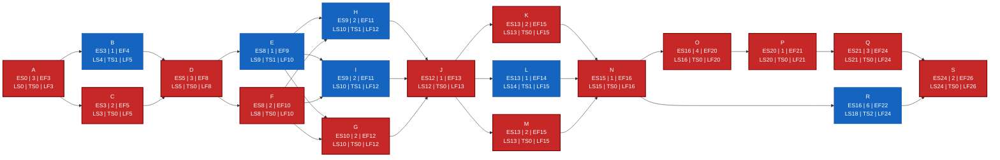
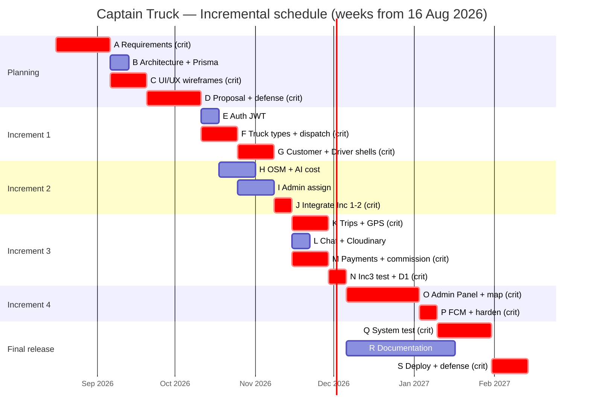
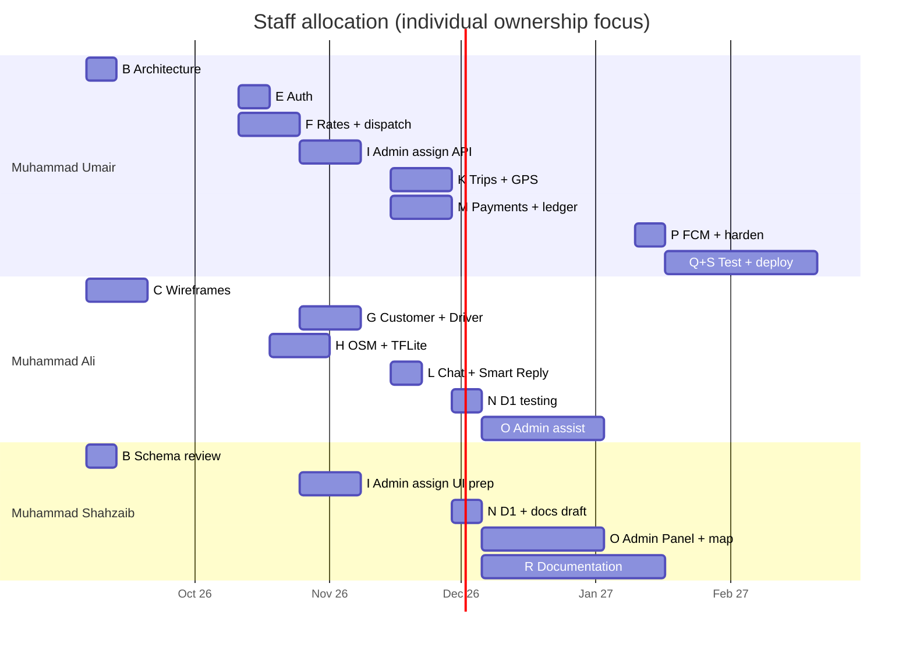

# Chapter 1: Project Feasibility Report

**Captain Truck — Real-Time Logistics and Dispatch Platform**

Department of Software Engineering  
University of Gujrat  

**Session:** BSSE-2023-2027  

**Project Advisor:** *[Supervisor name — fill in]*  

**Submitted By:**

| Name | Roll No. |
|------|----------|
| Muhammad Umair | *[Roll No. — fill in]* |
| Muhammad Ali | *[Roll No. — fill in]* |
| Muhammad Shahzaib | *[Roll No. — fill in]* |

---

## Statement of Submission

This is to certify that Muhammad Umair, Muhammad Ali and Muhammad Shahzaib have successfully completed Chapter 1 of the Final Year Project named **Captain Truck** at the Department of Software Engineering, University of Gujrat, to fulfill the requirement of the degree of BS in Software Engineering.

| | |
|--|--|
| ______________________ | _____________________ |
| Project Supervisor | Project Coordination Office |
| | Faculty of C&IT — UOG |
| _____________________ | |
| Head of the Department | |

---

## Table of Contents

| Section | Title |
|--------:|-------|
| **1** | **Project Feasibility Report** |
| 1.1 | Introduction |
| 1.2 | Project/Product Feasibility Report |
| 1.2.1 | Technical Feasibility |
| 1.2.2 | Operational Feasibility |
| 1.2.3 | Economic Feasibility |
| 1.2.4 | Schedule Feasibility |
| 1.2.5 | Specification Feasibility |
| 1.2.6 | Information Feasibility |
| 1.2.7 | Motivational Feasibility |
| 1.2.8 | Legal & Ethical Feasibility |
| 1.3 | Project/Product Scope |
| 1.4 | Project/Product Costing |
| 1.4.1 | Project Cost Estimation By Function Point Analysis |
| 1.4.2 | Project Cost Estimation by using COCOMO'81 (Constructive Cost Model) |
| 1.4.3 | Activity Based Costing |
| 1.5 | Task Dependency Table |
| 1.6 | CPM — Critical Path Method |
| 1.7 | Gantt chart |
| 1.8 | Introduction to Team member and their skill set |
| 1.9 | Task and Member Assignment Table |
| 1.10 | Tools and Technology with reasoning |
| 1.11 | Vision Document |
| 1.12 | Risk List |
| 1.13 | Product Features / Product Decomposition |

---

# Chapter 1: Project Feasibility Report

## 1.1 Introduction

Road freight in Pakistan is large but highly fragmented: most operators own only a few trucks, and shippers still depend on informal brokers for load matching, pricing and cash settlement. Customers lack a single place to request a truck, compare routes, see a clear trip cost and track the vehicle live. Drivers lack a reliable assignment and navigation workflow. Administrators have no central panel for approve/reject decisions, driver–truck assignment, live GPS oversight, chat moderation, cash confirmation and commission reconciliation.

**Captain Truck** is a comprehensive real-time logistics and dispatch platform with four surfaces: a Flutter **Customer** app (Android), a Flutter **Driver** app (Android), a React **Admin** web panel (Vite + Tailwind, hosted on Vercel), and a shared NestJS **API** (TypeScript) on an Oracle Cloud Always Free VM. Customers create dispatch requests with pickup/drop, truck type and count; the server offers 2–3 OSM route options with on-device AI trip-cost estimates; an administrator reviews, approves or rejects, and assigns a driver and truck; the trip is tracked over Socket.IO GPS; customer and driver chat (text, image, voice) with Smart Reply on mobile and 90-day auto-delete; payment is Cash-on-Pickup or Stripe **Test Mode**; and a commission ledger records what each driver owes the platform.

Data lives in PostgreSQL (Neon free tier), with Redis for live location and locks, Cloudinary for media, FCM for push, and OpenStreetMap services (Nominatim, Photon, OSRM) for maps and routing — all chosen to keep FYP cash spend near zero.

This chapter assesses whether the project is feasible, fixes its scope, estimates its cost and schedule, and introduces the team, tools, vision, risks and product features. Development follows the **Incremental Model**: after a planning phase, the system is delivered in four increments, each designed, built and tested before the next is added.

---

## 1.2 Project/Product Feasibility Report

Feasibility measures how practical the system is to build and use with the staff, skills, equipment and time available. Captain Truck was assessed in eight areas: technical, operational, economic, schedule, specification, information, motivational, and legal and ethical.

### 1.2.1 Technical Feasibility

Every component of Captain Truck uses mature, available technology, as summarised below.

**Table 1.1: Technical requirements and availability**

| Need | Technology | Availability |
|------|------------|--------------|
| Customer & Driver mobile apps | Flutter (Dart), Android only | Stable; team already builds Flutter screens |
| Admin web panel | React 19 + Vite + Tailwind → Vercel | Stable; free hosting |
| API / business logic | NestJS + TypeScript | Stable; REST + OpenAPI/Swagger |
| Realtime GPS & chat events | Socket.IO (`/realtime`) | Mature; JWT on handshake |
| Relational database | PostgreSQL on Neon (Prisma) | Managed free tier; pooled connections |
| Cache / live location | Redis (Upstash free or Oracle VM) | Free tier; in-memory fallback for local demos |
| Authentication | Custom JWT + refresh tokens (roles: customer, driver, admin) | Standard patterns; argon2/bcrypt hashing |
| Push notifications | FCM only (not full Firebase BaaS) | Free for Android |
| Media (chat images/voice) | Cloudinary | Free tier; signed uploads |
| Maps & routing | OSM: Nominatim, Photon, OSRM; `flutter_map` on mobile | Public/open services; rate-limit etiquette |
| On-device AI | TFLite trip-cost model + ML Kit Smart Reply | On-device; no paid AI API required |
| Payments | Cash-on-Pickup + Stripe **Test Mode** | Test keys free; no live charges in FYP |
| API host | Oracle Cloud Always Free VM + Nginx + PM2 | Free always-on VM (avoids cold starts) |

All members have studied OOP, databases, web engineering and mobile development. The NestJS domain (dispatch → assign → trip → pay → commission) is well documented in the phase plan. The main technical risks — public OSRM/Nominatim latency and free-tier Neon sleep — are mitigated with timeouts, retries, connection pooling and fail-open policies for demos.

> **Verdict:** Technically feasible.

### 1.2.2 Operational Feasibility

Customers need to request a truck, pick a route and cost, pay or choose cash, and watch the trip without calling a broker. Drivers need clear assignments, navigation-oriented GPS updates and a way to confirm cash. Administrators work in a browser (nothing to install) to approve/reject, assign, watch live trips, manage users/truck types/rates and confirm commissions. Unlike pure load-board apps that only match loads, Captain Truck keeps a human admin in the assignment loop — the core operational differentiator for trust and FYP scope control.

> **Verdict:** Operationally feasible.

### 1.2.3 Economic Feasibility

Function Point Analysis (Section 1.4.1) values the development effort at **26.09 person-months**, or **PKR 2,348,190** at market rates. For an FYP this labour is provided by the team, so actual spending is limited to a Google Play developer account, internet, electricity and printing. Cloud services are planned on free tiers (Neon, Upstash/Redis, Cloudinary, Vercel, Oracle Always Free, FCM, Stripe Test). On the benefit side, transparent route/cost options reduce broker opacity, admin mediation improves assignment quality, cash + commission ledgers cut reconciliation losses, and realtime tracking raises customer trust. Intangible benefits include industry-ready skills for the team and a demonstrable full-stack logistics product.

> **Verdict:** Economically feasible.

### 1.2.4 Schedule Feasibility

The project runs from **16 August 2026** to the final defense in **March 2027**. The critical path (Section 1.6) is **26 weeks**, ending around **14 February 2027**, which leaves buffer before the final defense. University milestones fall inside the plan: proposal around late September, defense late September / early October, first progress report on **11 November** and Deliverable 1 on **3 December 2026**.

> **Verdict:** Feasible within the academic calendar.

### 1.2.5 Specification Feasibility

Behaviour is fixed by the locked product stack and the backend/admin phase plans (Phases 0–16 API; Admin A0–A7). Boundaries are explicit: no iOS apps, no live Stripe production charges, no automated bidding/matching, no IoT trackers/NADRA, no GraphQL, and Flutter apps live in separate repositories from this API/admin monorepo.

> **Verdict:** Requirements are clear and bounded.

### 1.2.6 Information Feasibility

Pickup/drop coordinates and addresses come from the customer (with OSM geocode helpers). Route distance/duration/polylines come from OSRM. AI trip cost is computed on-device and validated server-side against distance sanity checks; the **server bill** (`lockedBaseRate + aiTripCost`, times `truckCount`) is authoritative. User, dispatch, trip, chat, payment and commission records sit in PostgreSQL with defined keys and constraints. Live GPS is held in Redis with periodic/last-known snapshots. Calculator and AI costs are labelled as estimates where appropriate.

> **Verdict:** Information is available and reliable.

### 1.2.7 Motivational Feasibility

The team is building a real multi-client logistics product with industry-relevant NestJS, Flutter, React and realtime skills. Customers gain transparent cost and live tracking; drivers gain structured assignments; administrators replace phone/WhatsApp coordination with one panel. Regular supervisor reviews keep progress steady.

> **Verdict:** All stakeholders are motivated to use the system.

### 1.2.8 Legal & Ethical Feasibility

- Personal data is handled in line with Pakistan’s **Prevention of Electronic Crimes Act 2016** (and good practice for location/chat data).
- Stripe card details are entered on Stripe’s hosted Checkout / Elements; **Captain Truck never stores raw card numbers**. Cash flows are confirmed by drivers and visible to admins without storing unnecessary payment secrets.
- Permissions (location, microphone, notifications, storage for media) are requested only when needed, as Play Store policies require.
- Licences: NestJS, React, Flutter and packages used are open source (MIT, Apache, BSD); OSM services are used under their usage policies; Stripe and Cloudinary under their terms (Test Mode / free tier for FYP).
- Safety / fairness: the admin remains in the assignment loop; chat messages older than **90 days** are auto-deleted; abuse reporting is supported on messages.

> **Verdict:** No infringement or liability is expected.

---

## 1.3 Project/Product Scope

Scope lists what is inside the system boundary; anything outside it is treated as a change request.

**Table 1.2: Captain Truck project scope**

| Component | Description |
|-----------|-------------|
| **Objective** | A real-time logistics and dispatch platform: Customer & Driver Android apps, Admin web panel, and NestJS API for admin-mediated truck assignment, OSM routing, AI cost, GPS tracking, chat, cash/Stripe payment and commission ledger. |
| **Core features** | JWT role-based auth; truck types & base rates; dispatch create; 2–3 OSM routes + AI trip cost; admin approve/reject/assign; trips + Socket.IO GPS; chat (text/image/voice) + Smart Reply + 90-day TTL; Cash-on-Pickup + Stripe Test Mode; commission ledger; FCM push; React Admin ops. |
| **Deliverables** | NestJS API (this repo), React Admin on Vercel (this repo), Flutter Customer app (separate repo), Flutter Driver app (separate repo), documentation and test reports. |
| **Stakeholders** | Customers (shippers), drivers, administrators, supervisor, project team. |
| **Timeline** | 16 August 2026 to March 2027. |
| **Exclusions** | iOS apps; live Stripe production charges; automated load bidding/matching; IoT trackers / NADRA; GraphQL; hardware/fleet ownership; ISO 27001 certification. |
| **Optional units** | Advanced admin analytics, multi-driver assignment for `truckCount > 1` beyond lead-driver policy, production Stripe go-live. |

---

## 1.4 Project/Product Costing

We estimated cost with three methods — Function Point Analysis, COCOMO'81 and Activity Based Costing — and compared the results. All amounts are in Pakistani rupees (PKR).

### 1.4.1 Project Cost Estimation By Function Point Analysis

Function points measure the functionality delivered to users. Five information domain values are counted and weighted; every item was rated at **average** complexity.

**Table 1.3: Unadjusted function point count**

| Domain value | Captain Truck items counted | Count | Weight | Total |
|--------------|----------------------------|------:|-------:|------:|
| External Inputs (EI) | Login/profile; create dispatch; select route; admin approve/reject/assign; driver status + GPS publish; chat send; payment initiate (cash/Stripe); cash collected confirm; admin truck types/rates; admin commission confirm | 10 | 4 | 40 |
| External Outputs (EO) | Live trip/GPS status; bill breakdown; push notification; route options + AI cost; payment confirmation; commission / admin summary | 6 | 5 | 30 |
| External Inquiries (EQ) | My dispatches list; truck types + rates; trip track/history; chat history; driver assignments; admin pending queue/search; payment/commission status | 7 | 4 | 28 |
| Internal Logical Files (ILF) | SQL: users (+ refresh tokens); driver_profiles; truck_types + base_rates; dispatch_requests; route_options; trips; chats/messages; payments; commission_ledger | 9 | 10 | 90 |
| External Interface Files (EIF) | OSRM/Nominatim/Photon; Stripe Test Mode; Cloudinary; FCM; Redis (live GPS / locks) | 5 | 7 | 35 |
| **Count total** | | | | **223** |

**Table 1.4: Value adjustment factors** (0 = no influence, 5 = essential)

| # | General system characteristic | Fi | Reason |
|--:|-------------------------------|---:|--------|
| 1 | Data communications | 5 | REST, Socket.IO, OSM, FCM, Stripe, Cloudinary |
| 2 | Distributed data processing | 5 | Customer app, Driver app, Admin, NestJS, Neon, Redis |
| 3 | Performance | 4 | Live GPS and chat must feel immediate; not hard real-time control |
| 4 | Heavily used configuration | 2 | Ordinary phones and browsers |
| 5 | Transaction rate | 3 | Moderate: dispatches, GPS ticks, chats, payments |
| 6 | On-line data entry | 4 | Almost all data entered on-line |
| 7 | End-user efficiency | 4 | Route choices, AI cost, Smart Reply, admin queue |
| 8 | On-line update | 5 | Live location, status, chat and ledger updates |
| 9 | Complex processing | 4 | Routing, pricing formula, commission, realtime authz |
| 10 | Reusability | 3 | One API shared by three clients |
| 11 | Installation ease | 3 | Play Store apps; browser Admin on Vercel |
| 12 | Operational ease | 4 | Push alerts, admin ops, reconnect handling |
| 13 | Multiple sites | 2 | One product; no multi-site enterprise rollout |
| 14 | Facilitate change | 4 | Rates, truck types and ops managed from Admin |
| | **Σ Fi** | **52** | |

\[
FP_{est} = Count\ Total \times \bigl[0.65 + 0.01 \times \Sigma(F_i)\bigr]
\]

\[
FP_{est} = 223 \times [0.65 + 0.01 \times 52] = 223 \times 1.17 = 260.91
\]

We used a labour rate of **PKR 90,000** per person-month (a junior full-stack / mobile developer’s salary in Pakistan) and a productivity of **10 FP** per person-month.

\[
Cost / FP = 90{,}000 / 10 = PKR\ 9{,}000
\]

\[
Total\ Project\ Cost = 260.91 \times 9{,}000 = PKR\ 2{,}348{,}190
\]

\[
Total\ Estimated\ Effort = 260.91 / 10 = 26.09\ person\text{-}months
\]

> **Result:** **260.91 FP**, **26.09 person-months**, **PKR 2,348,190**. Shared by three members, this is about **8.7 months** each, which fits our eight-to-nine-month FYP window.

### 1.4.2 Project Cost Estimation by using COCOMO'81 (Constructive Cost Model)

COCOMO'81 estimates effort from code size. Basic COCOMO is used for early estimates. Each level has organic, semi-detached and embedded modes.

**Table 1.5: Basic COCOMO equations**

| Mode | Effort (Basic) | Schedule |
|------|----------------|----------|
| Organic | \(PM = 2.4\,(KLOC)^{1.05}\) | \(T_D = 2.5\,(PM)^{0.38}\) |
| Semi-detached | \(PM = 3.0\,(KLOC)^{1.12}\) | \(T_D = 2.5\,(PM)^{0.35}\) |
| Embedded | \(PM = 3.6\,(KLOC)^{1.20}\) | \(T_D = 2.5\,(PM)^{0.32}\) |

Size was derived from the function points at **40 LOC per FP**. That is lower than the ~53 LOC/FP often quoted for object-oriented languages because Neon, Redis, Cloudinary, public OSRM, Stripe SDK and FCM replace a large amount of hand-written infrastructure code. Captain Truck is **organic**: a small team, familiar tools (TypeScript / Flutter), and free-tier managed services rather than custom firmware or novel algorithms.

\[
KLOC = 260.91 \times 40 / 1000 = 10.4364
\]

\[
PM = 2.4 \times (10.4364)^{1.05} = 28.16\ person\text{-}months
\]

\[
T_D = 2.5 \times (28.16)^{0.38} = 8.89\ months
\]

\[
People = PM / T_D = 28.16 / 8.89 = 3.17 \approx 3
\]

COCOMO suggests about **3 people for 8.9 months**, which matches our team of three. Its effort of **28.16 person-months** is close to the function-point estimate of **26.09**, so the two models support each other.

Implied market labour cost at PKR 90,000 / PM:

\[
28.16 \times 90{,}000 = PKR\ 2{,}534{,}732
\]

### 1.4.3 Activity Based Costing

Each activity is costed from its resources, cost rate, duration and overhead. The weekly rate is:

\[
90{,}000 \times 12 / 52 \approx PKR\ 20{,}769\ per\ person\text{-}week
\]

**Table 1.6: Activity based costing**

| Activity | People | Weeks | Labour (PKR) | Overhead (PKR) | Overhead item | Cost (PKR) |
|----------|-------:|------:|-------------:|---------------:|---------------|-----------:|
| Planning: requirements, design, wireframes (A–C) | 3 | 5 | 311,535 | — | — | 311,535 |
| Proposal and defense (D) | 3 | 3 | 186,921 | 6,000 | Printing | 192,921 |
| Increment 1: auth, rates, dispatch + app shells (E–G) | 2 | 4 | 166,152 | — | — | 166,152 |
| Increment 2: OSM/AI cost, admin assign (H–J) | 2 | 3 | 124,614 | — | — | 124,614 |
| Increment 3: GPS, chat, payments, commission (K–N) | 3 | 3 | 186,921 | 7,000 | Google Play ($25) | 193,921 |
| Increment 4: Admin Panel, FCM, hardening (O–P) | 2 | 5 | 207,690 | — | — | 207,690 |
| System testing and release (Q, S) | 3 | 5 | 311,535 | — | Free-tier cloud | 311,535 |
| Documentation (R) | 1 | 6 | 124,614 | 8,000 | Printing | 132,614 |
| Shared overhead | — | — | — | 115,500 | Internet, electricity | 115,500 |
| **Total** | | | **1,619,982** | **136,500** | | **1,756,482** |

Overheads use **PKR 280 per US dollar**: Google Play developer account **$25** (PKR **7,000**); Neon, Redis/Upstash, Cloudinary, Vercel, Oracle Always Free, FCM and Stripe Test Mode are **PKR 0** on free tiers; internet and electricity of **PKR 5,500** per member per month for seven months (**PKR 115,500**); printing for proposal and final docs (**PKR 14,000**). The ABC total of **PKR 1,756,482** is below the FP estimate because it counts only the scheduled person-weeks. The cash the team actually has to spend is the overhead, **PKR 136,500**.

**Table 1.7: Summary of estimates**

| Method | Effort | Cost |
|--------|--------|------|
| Function Point Analysis | 26.09 person-months | PKR 2,348,190 |
| Basic COCOMO'81 (organic) | 28.16 person-months | PKR 2,534,732 |
| Activity Based Costing | 78 person-weeks | PKR 1,756,482 |

---

## 1.5 Task Dependency Table

Tasks are grouped by the planning phase and the four increments. Durations are in weeks; week 0 starts on **16 August 2026**.

**Table 1.8: Task dependency table**

| ID | Task | Phase | Weeks | Depends on |
|----|------|-------|------:|------------|
| A | Requirements and scope finalization | Planning | 3 | — |
| B | System architecture and Prisma/Neon data model | Planning | 1 | A |
| C | UI/UX wireframes (Customer, Driver, Admin) | Planning | 2 | A |
| D | Proposal review, submission and defense | Planning | 3 | B, C |
| E | Authentication and role-based access (JWT) | Increment 1 | 1 | D |
| F | Truck types, base rates, dispatch request create | Increment 1 | 2 | D |
| G | Customer request flow + Driver app shell | Increment 1 | 2 | E, F |
| H | OSM routing (OSRM) + AI trip cost (TFLite) | Increment 2 | 2 | E |
| I | Admin review, approve/reject, driver assignment | Increment 2 | 2 | F |
| J | Integration and testing of Increments 1–2 | Increment 2 | 1 | G, H, I |
| K | Trips lifecycle + realtime GPS (Socket.IO) | Increment 3 | 2 | J |
| L | Chat (text/image/voice) + Cloudinary + Smart Reply | Increment 3 | 1 | J |
| M | Cash-on-Pickup + Stripe Test + commission ledger | Increment 3 | 2 | J |
| N | Increment 3 testing and D1 submission | Increment 3 | 1 | K, L, M |
| O | Admin Panel (React/Vite) + live map | Increment 4 | 4 | N |
| P | FCM push, security hardening, Increment 4 testing | Increment 4 | 1 | O |
| Q | System testing and bug fixing | Final release | 3 | P |
| R | Documentation (SRS, design, final report) | Final release | 6 | N |
| S | Oracle deploy, release builds and final defense prep | Final release | 2 | Q, R |

---

## 1.6 CPM — Critical Path Method

For each activity we computed the earliest start and finish (ES, EF), latest start and finish (LS, LF), total slack (\(TS = LS - ES\)) and free slack (\(FS =\) earliest ES of successors \(-\) EF). Activities with **zero slack** form the critical path.

**Table 1.9: CPM calculations (weeks)**

| Activity | Dur. | ES | EF | LS | LF | TS | FS | Critical |
|----------|-----:|---:|---:|---:|---:|---:|---:|----------|
| A | 3 | 0 | 3 | 0 | 3 | 0 | 0 | Yes |
| B | 1 | 3 | 4 | 4 | 5 | 1 | 1 | No |
| C | 2 | 3 | 5 | 3 | 5 | 0 | 0 | Yes |
| D | 3 | 5 | 8 | 5 | 8 | 0 | 0 | Yes |
| E | 1 | 8 | 9 | 9 | 10 | 1 | 0 | No |
| F | 2 | 8 | 10 | 8 | 10 | 0 | 0 | Yes |
| G | 2 | 10 | 12 | 10 | 12 | 0 | 0 | Yes |
| H | 2 | 9 | 11 | 10 | 12 | 1 | 1 | No |
| I | 2 | 9 | 11 | 10 | 12 | 1 | 1 | No |
| J | 1 | 12 | 13 | 12 | 13 | 0 | 0 | Yes |
| K | 2 | 13 | 15 | 13 | 15 | 0 | 0 | Yes |
| L | 1 | 13 | 14 | 14 | 15 | 1 | 1 | No |
| M | 2 | 13 | 15 | 13 | 15 | 0 | 0 | Yes |
| N | 1 | 15 | 16 | 15 | 16 | 0 | 0 | Yes |
| O | 4 | 16 | 20 | 16 | 20 | 0 | 0 | Yes |
| P | 1 | 20 | 21 | 20 | 21 | 0 | 0 | Yes |
| Q | 3 | 21 | 24 | 21 | 24 | 0 | 0 | Yes |
| R | 6 | 16 | 22 | 18 | 24 | 2 | 2 | No |
| S | 2 | 24 | 26 | 24 | 26 | 0 | 0 | Yes |

The critical paths are:

- **A → C → D → F → G → J → K → N → O → P → Q → S**
- **A → C → D → F → G → J → M → N → O → P → Q → S**

each **26 weeks** long. They split after **J** because trips/GPS (**K**) and payments/commission (**M**) both take two weeks. **B, E, H, I** and **L** have one week of slack and documentation (**R**) has two, so these can absorb small delays. Any delay on a critical activity moves the end date.

**Figure 1.1: CPM network diagram (activity on node)**

*Node key (weeks): top = ES | Duration | EF; bottom = LS | Total Slack | LF. Red = critical; blue = slack.*

---

## 1.7 Gantt chart

The Gantt chart follows the Incremental Model. Each increment is analysed, designed, coded and tested, then integrated with the earlier ones. Critical activities are marked.

**Figure 1.2: Captain Truck Gantt chart by increment**

The Gantt chart above shows the schedule of each increment. The table below lists the content of each increment with its duration in weeks and its delivery milestone.

**Table 1.10: Increment plan and milestones**

| Increment | Content | Weeks | Delivered |
|-----------|---------|-------|-----------|
| Planning | Requirements, architecture, Prisma/Neon model, wireframes, proposal | 0–8 | ~10 Oct 2026 |
| Increment 1 | Auth/roles, truck types & rates, dispatch create, Customer/Driver shells | 8–12 | ~08 Nov 2026 |
| Increment 2 | OSM routes + AI cost, admin approve/reject/assign, integration | 9–13 | Progress report, 11 Nov 2026 |
| Increment 3 | Trips + GPS, chat/media, cash + Stripe Test, commission ledger | 13–16 | D1, 3 Dec 2026 |
| Increment 4 | React Admin Panel + live map, FCM, security hardening | 16–21 | ~10 Jan 2027 |
| Final release | System testing, documentation, Oracle deploy, release builds | 16–26 | Final defense, March 2027 |

---

## 1.8 Introduction to Team member and their skill set

The Captain Truck team has three members (University of Gujrat). The table below lists each member’s role and main skills.

**Table 1.11: Team members and skills**

| Member | Role | Skill set |
|--------|------|-----------|
| Muhammad Umair *[Roll No.]* | Team lead; NestJS API, realtime, payments, commission | TypeScript, NestJS, Prisma/PostgreSQL, Socket.IO, JWT auth, Stripe Test Mode, Redis, Git, Oracle/PM2 deploy |
| Muhammad Ali *[Roll No.]* | Flutter Customer & Driver apps; maps & on-device AI | Flutter/Dart, `flutter_map`, TFLite cost model, ML Kit Smart Reply, FCM client, Android release builds |
| Muhammad Shahzaib *[Roll No.]* | React Admin Panel; documentation; testing | React + Vite + Tailwind, Leaflet/OSM admin maps, technical writing, e2e/smoke testing, Vercel |

The project is supervised by *[Supervisor name — fill in]*. Each module has a primary owner and a second member who reviews it, so no part of the system depends on one person.

---

## 1.9 Task and Member Assignment Table

Each task from the dependency table is assigned to the member best suited to it, so that the workload is shared fairly. The table below shows the duration and the responsible member for every task.

**Table 1.12: Task and member assignment**

| ID | Task | Weeks | Assigned to |
|----|------|------:|-------------|
| A | Requirements and scope finalization | 3 | All (lead: Umair) |
| B | System architecture and Prisma/Neon data model | 1 | Umair, Shahzaib |
| C | UI/UX wireframes (Customer, Driver, Admin) | 2 | Ali |
| D | Proposal review, submission and defense | 3 | All |
| E | Authentication and role-based access (JWT) | 1 | Umair |
| F | Truck types, base rates, dispatch request create | 2 | Umair |
| G | Customer request flow + Driver app shell | 2 | Ali |
| H | OSM routing (OSRM) + AI trip cost (TFLite) | 2 | Ali (app) + Umair (API) |
| I | Admin review, approve/reject, driver assignment | 2 | Umair, Shahzaib |
| J | Integration and testing of Increments 1–2 | 1 | All (lead: Ali) |
| K | Trips lifecycle + realtime GPS (Socket.IO) | 2 | Umair |
| L | Chat (text/image/voice) + Cloudinary + Smart Reply | 1 | Ali |
| M | Cash-on-Pickup + Stripe Test + commission ledger | 2 | Umair |
| N | Increment 3 testing and D1 submission | 1 | Ali, Shahzaib |
| O | Admin Panel (React/Vite) + live map | 4 | Shahzaib, Ali |
| P | FCM push, security hardening, Increment 4 testing | 1 | Umair |
| Q | System testing and bug fixing | 3 | All (lead: Umair) |
| R | Documentation (SRS, design, final report) | 6 | Shahzaib (all contribute) |
| S | Oracle deploy, release builds and final defense prep | 2 | All (lead: Umair) |

Including shared tasks, the workload is approximately **23 weeks** for Umair, **24** for Ali and **24** for Shahzaib. The chart shows each member’s individual tasks over time.

**Figure 1.3: Staff allocation**

---

## 1.10 Tools and Technology with reasoning

The technologies and tools below were chosen to match the team’s skills, the university’s SQL requirement, free-tier constraints, and mobile-ready REST + Socket.IO APIs. The first table lists the technologies and the second lists the supporting tools, each with its reason.

**Table 1.13: Technologies**

| Technology | Reason |
|------------|--------|
| NestJS + TypeScript | Typed, modular API; OpenAPI; clear Controller → Service → Prisma layering |
| PostgreSQL (Neon) + Prisma | Relational SQL with migrations; free managed DB; money as integer cents |
| Socket.IO | Authenticated realtime GPS and chat without GraphQL |
| Redis (Upstash / Oracle) | Live location, pub/sub and job locks; free tier |
| Flutter (Dart), Android | Customer and Driver apps; `flutter_map` matches OSM stack |
| React + Vite + Tailwind | Admin panel; fast Vercel deploy |
| OSM (Nominatim, Photon, OSRM) | Free routing/geocoding; 2–3 route alternatives |
| TFLite + ML Kit Smart Reply | On-device AI cost and replies; no paid OpenAI bill |
| Cloudinary | Chat image/voice media on free tier |
| FCM | Android push only (no full Firebase BaaS) |
| Cash-on-Pickup + Stripe Test Mode | Dual payment; no live charges required for FYP |
| Oracle Always Free + Nginx + PM2 | Always-on API host; avoids serverless cold starts |
| Vercel | Free Admin hosting with SPA rewrites |

**Table 1.14: Tools**

| Tool | Reason |
|------|--------|
| VS Code / Android Studio | Development, emulators and debugging |
| Git / GitHub | Version control and collaboration |
| Prisma Studio / Neon Console | Inspect schema and data |
| Swagger UI (`/api/docs`) | Contract for Flutter teams |
| Figma | UI/UX mockups and prototypes |
| Draw.io / Mermaid | UML, CPM, architecture and decomposition diagrams |
| Postman / REST Client | API smoke tests |
| Microsoft Word / Canva | Documentation and presentation material |

---

## 1.11 Vision Document

The vision document states what Captain Truck is for, who it serves and what each user group needs from it. The tables below give the problem statement and the stakeholders with their key needs.

**Table 1.15: Problem statement**

| | |
|--|--|
| **The problem of** | fragmented truck dispatch, opaque pricing, weak live tracking and manual cash/commission settlement |
| **affects** | shippers (customers), small truck drivers and the administrators who coordinate them |
| **the impact of which is** | broker dependence, empty or poorly matched trips, unclear bills, lost cash reconciliation and low trust |
| **a successful solution would** | let customers request trucks with clear OSM routes and AI costs, keep an admin in the assignment loop, track trips live, support chat and dual payment, and maintain a commission ledger in one platform |

**Product position.** For shippers and small fleet drivers in Pakistan who need trustworthy, admin-mediated dispatch with transparent cost and live tracking, **Captain Truck** is a real-time logistics platform that combines Customer/Driver Android apps, a React Admin panel and a NestJS API. Unlike informal broker WhatsApp workflows or pure load boards without human assignment control, it offers OSM multi-route choice, on-device AI trip cost, Socket.IO GPS, chat with retention policy, Cash-on-Pickup **and** Stripe Test Mode, and an auditable commission ledger — built entirely on free-tier infrastructure suitable for an FYP.

**Table 1.16: Stakeholders and needs**

| Stakeholder | Key needs |
|-------------|-----------|
| Customer (shipper) | Create dispatch, choose route/cost, pay or choose cash, live track, chat |
| Driver | See assignments, update GPS/status, chat, confirm cash collected |
| Administrator | Pending queue, approve/reject/assign, live map, users, rates, commissions |
| Supervisor / university | Working system and complete documentation on time |

**Constraints:** Android-only mobile clients; FYP budget ≈ **$0** beyond Play account and utilities; free-tier cloud only; delivery within one academic year; admin-mediated assignment (no automated bidding). **Checkpoints:** the problem, stakeholders, system boundary, actors, constraints and key features have all been identified and agreed with the supervisor.

---

## 1.12 Risk List

Probability (P) and impact (I) are rated 1–5; the list is sorted by exposure (\(P \times I\)) and reviewed after each increment.

**Table 1.17: Risk list**

| # | Risk | P | I | P×I | Mitigation |
|---|------|--:|--:|----:|------------|
| R1 | Public OSRM/Nominatim downtime or high latency | 4 | 4 | 16 | Configurable timeouts; circuit-breaker style errors; client lat/lng pin override; cached last good geocode |
| R2 | Scope creep across API + two Flutter apps + Admin | 4 | 4 | 16 | Scope frozen per increment; exclusions listed; phase exit checklists |
| R3 | Neon free-tier cold start / connection limits | 3 | 4 | 12 | Pooled URL; retry with backoff; health checks; connection hygiene |
| R4 | Realtime GPS abuse or unauthorized room join | 3 | 5 | 15 | JWT on Socket.IO handshake; trip-room authz; location throttle (2–5 s) |
| R5 | Stripe Test / webhook ordering failures | 3 | 4 | 12 | Signature verify; idempotency keys; cash path independent of Stripe |
| R6 | Chat media or PII misuse | 2 | 5 | 10 | Cloudinary host allowlist; participant-only chat; 90-day TTL delete |
| R7 | Unauthorized cross-role access (IDOR) | 2 | 5 | 10 | Role guards + ownership checks; IDOR sweep in Phase 16 |
| R8 | Team member unavailable during exams | 3 | 3 | 9 | Second owner per module; slack on documentation (R) |
| R9 | On-device AI cost outliers vs distance | 3 | 3 | 9 | Server clamps/rejects outliers; bill uses locked base rate only |
| R10 | Free-tier quota exceeded (Cloudinary/Redis) | 2 | 2 | 4 | Usage monitoring; fail-open documented for demos; trim media sizes |

---

## 1.13 Product Features / Product Decomposition

Captain Truck is decomposed into **nine modules** taken from the proposal’s high-level components. Modules **1–2** form Increment 1, modules **3–4** form Increment 2, modules **5–7** form Increment 3, and modules **8–9** form Increment 4 (Admin Panel + notifications/hardening), so the decomposition maps directly onto the delivery plan.

**Figure 1.4: Product decomposition of Captain Truck**

```mermaid
flowchart TB
  CT[Captain Truck]

  M1[1. Authentication and Access]
  M2[2. Dispatch Requests]
  M3[3. Routing and AI Cost]
  M4[4. Admin Assignment]
  M5[5. Trips and Live GPS]
  M6[6. Chat and Media]
  M7[7. Payments]
  M8[8. Commission Ledger]
  M9[9. Admin Panel and Push]

  CT --> M1 & M2 & M3 & M4 & M5 & M6 & M7 & M8 & M9

  M1 --> M1a[1.1 Customer register / login]
  M1 --> M1b[1.2 Driver login after admin create]
  M1 --> M1c[1.3 Admin login]
  M1 --> M1d[1.4 JWT + refresh rotation]
  M1 --> M1e[1.5 Role-based guards]

  M2 --> M2a[2.1 Pickup / drop + truck type]
  M2 --> M2b[2.2 Truck count]
  M2 --> M2c[2.3 Locked base rate]
  M2 --> M2d[2.4 Status machine]

  M3 --> M3a[3.1 OSRM 2–3 alternatives]
  M3 --> M3b[3.2 Nominatim / Photon geocode]
  M3 --> M3c[3.3 TFLite AI trip cost]
  M3 --> M3d[3.4 Server bill breakdown]

  M4 --> M4a[4.1 Pending admin queue]
  M4 --> M4b[4.2 Approve / reject with reason]
  M4 --> M4c[4.3 Assign driver + truck]
  M4 --> M4d[4.4 Audit log]

  M5 --> M5a[5.1 Trip lifecycle statuses]
  M5 --> M5b[5.2 Socket.IO GPS rooms]
  M5 --> M5c[5.3 Redis live location]
  M5 --> M5d[5.4 Customer / admin track]

  M6 --> M6a[6.1 Text / image / voice / preset]
  M6 --> M6b[6.2 Cloudinary media]
  M6 --> M6c[6.3 Smart Reply on device]
  M6 --> M6d[6.4 90-day auto-delete]

  M7 --> M7a[7.1 Cash-on-Pickup]
  M7 --> M7b[7.2 Stripe Test Checkout]
  M7 --> M7c[7.3 Webhooks + idempotency]
  M7 --> M7d[7.4 Driver cash confirm]

  M8 --> M8a[8.1 Expected commission snapshot]
  M8 --> M8b[8.2 Collected / pending]
  M8 --> M8c[8.3 Admin confirm]
  M8 --> M8d[8.4 Per-driver summary]

  M9 --> M9a[9.1 Dispatch queue UI]
  M9 --> M9b[9.2 Live trip map]
  M9 --> M9c[9.3 Users / rates / ledger UI]
  M9 --> M9d[9.4 FCM event pushes]
```

### Module summary (maps to increments)

| Modules | Increment | Focus |
|--------:|-----------|-------|
| 1–2 | Increment 1 | Auth + dispatch foundation |
| 3–4 | Increment 2 | Routes/AI cost + admin assignment |
| 5–7 | Increment 3 | GPS, chat, payments |
| 8–9 | Increment 4 | Commission ops UI + Admin/FCM polish *(ledger API may start in Inc 3 with M)* |

---

## Calculation appendix (audit trail)

| Quantity | Formula / source | Value |
|----------|------------------|------:|
| Unadjusted FP count | \(40+30+28+90+35\) | 223 |
| Σ Fi | Table 1.4 | 52 |
| VAF | \(0.65 + 0.01\times52\) | 1.17 |
| FP est. | \(223\times1.17\) | 260.91 |
| FP effort | \(260.91/10\) | 26.09 PM |
| FP cost | \(260.91\times9{,}000\) | PKR 2,348,190 |
| KLOC | \(260.91\times40/1000\) | 10.4364 |
| COCOMO PM | \(2.4\times(10.4364)^{1.05}\) | 28.16 PM |
| COCOMO \(T_D\) | \(2.5\times(28.16)^{0.38}\) | 8.89 months |
| COCOMO people | \(28.16/8.89\) | ≈ 3.17 ≈ 3 |
| COCOMO cost | \(28.16\times90{,}000\) | PKR 2,534,732 |
| Person-week rate | \(90{,}000\times12/52\) | PKR 20,769 |
| ABC labour | Table 1.6 | PKR 1,619,982 |
| ABC overhead | \(6{,}000+7{,}000+8{,}000+115{,}500\) | PKR 136,500 |
| ABC total | labour + overhead | PKR 1,756,482 |
| CPM project length | Critical path | 26 weeks |
| FX rate used | Play $25 | PKR 280 / USD |

---

*End of Chapter 1 — Captain Truck Project Feasibility Report*
