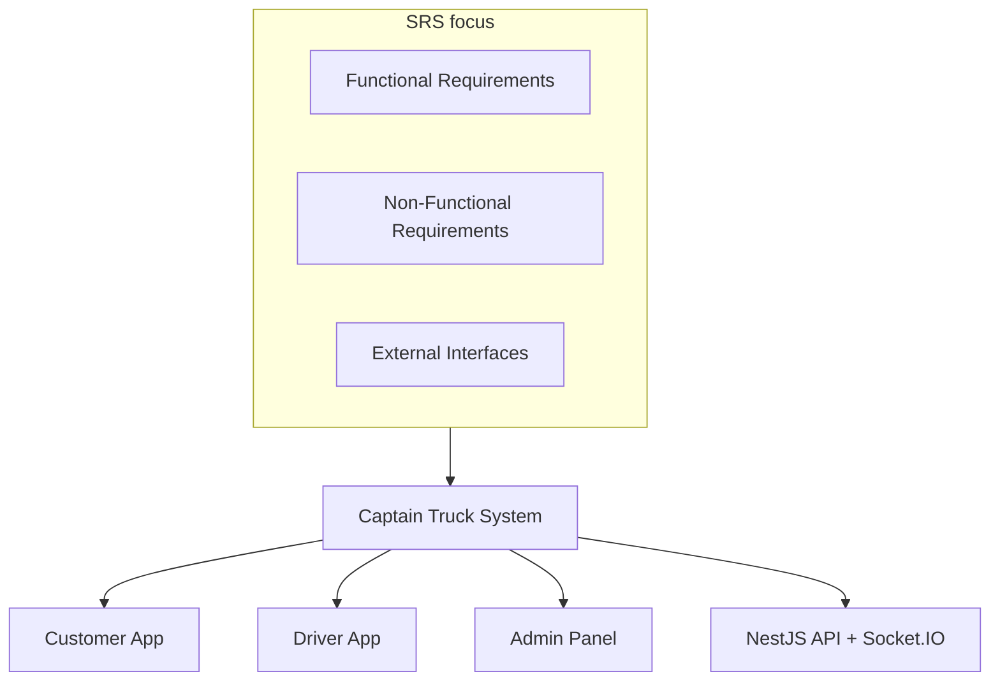
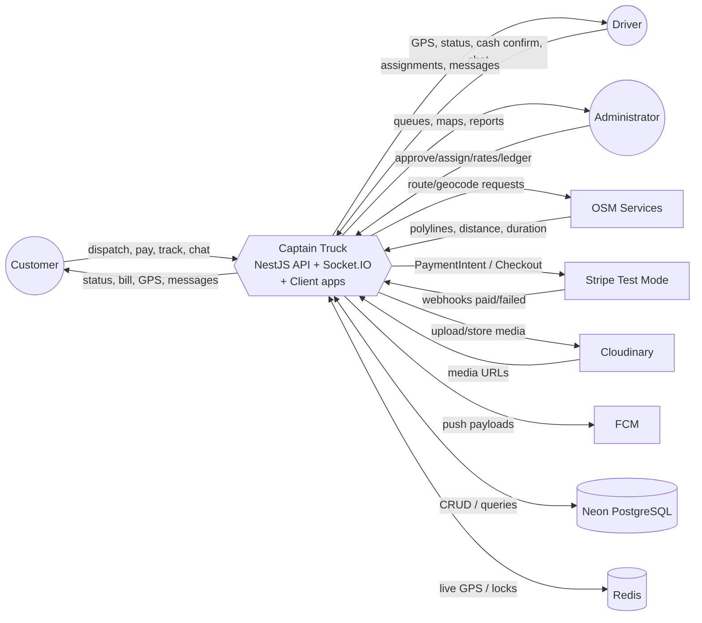
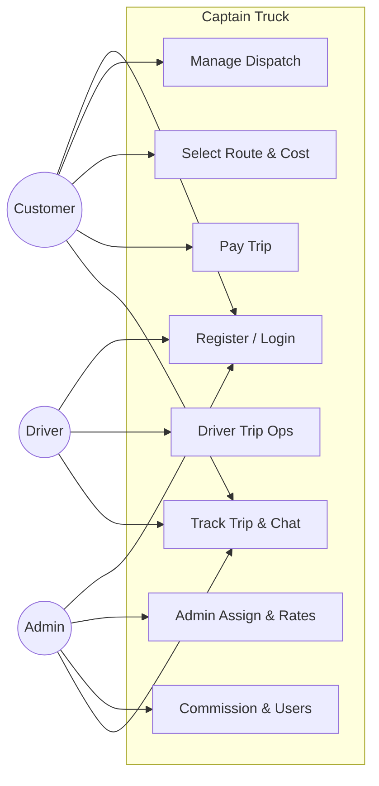

# Chapter 2: Software Requirement Specification (For Object Oriented Approach)

**Captain Truck — Real-Time Logistics and Dispatch Platform**

Department of Software Engineering  
University of Gujrat  

**Session:** BSSE-2023-2027  
**Project Advisor:** Mr. Touqeer Ul Ameen  

**Submitted By:**

| Name | Roll No. |
|------|----------|
| Muhammad Umair | 23011598-062 |
| Muhammad Ali | *[Roll No. — fill in]* |
| Muhammad Shahzaib | *[Roll No. — fill in]* |

**Process model (from Chapter 1):** Waterfall Model  

---

## Table of Contents

| Section | Title |
|--------:|-------|
| **2** | **Software Requirement Specification (OO Approach)** |
| 2.1 | Introduction |
| 2.1.1 | Systems Specifications |
| 2.1.2 | Identifying External Entities |
| 2.1.3 | Context Level Data Flow Diagram |
| 2.1.4 | Capture “shall” Statements |
| 2.1.5 | Allocate Requirements |
| 2.1.6 | Prioritize Requirements |
| 2.1.7 | Requirements Traceability Matrix |
| 2.2.10 | High Level Usecase Diagram |
| 2.2.11 | Analysis Level Usecase Diagram |
| 2.2.12 | Usecase Description |

---

# Chapter 2: Software Requirement Specification (For Object Oriented Approach)

## 2.1 Introduction

A Software Requirements Specification (SRS) for an object-oriented project like **Captain Truck** covers functional, non-functional, and interface requirements. This chapter captures, structures, and represents stakeholder needs so they can be correctly embodied in the system. The OO SRS activities used here are:

- Requirements elicitation  
- Requirements analysis and negotiation  
- Requirements specification  
- System modeling  
- Requirements validation  
- Requirements management  

Captain Truck is specified as four cooperating surfaces that share one NestJS API:

1. Flutter **Customer** app (Android)  
2. Flutter **Driver** app (Android)  
3. React **Admin** web panel (Vite + Tailwind → Vercel)  
4. NestJS **API** + Socket.IO realtime (Oracle Always Free VM)  

Core behaviours locked in Chapter 1 and implemented in code: JWT role-based auth; truck types and base rates; dispatch creation; 2–3 OSM routes with on-device AI trip cost; admin approve/reject/assign; trip lifecycle with Socket.IO GPS; chat (text/image/voice) with Cloudinary and 90-day TTL; Cash-on-Pickup and Stripe Test Mode; commission ledger; FCM push.

**Figure 2.1.1: System Specifications (overview)**

---

### 2.1.1 Systems Specifications

The following clauses describe the system specifications for Captain Truck.

#### Introduction

Captain Truck is a real-time logistics and dispatch platform that digitises admin-mediated truck assignment for shippers and drivers in Pakistan. Customers create dispatch requests with pickup/drop, truck type and count; the API returns OSM route alternatives and persists on-device AI cost estimates; an administrator reviews, rejects with reason, or assigns a driver and truck; the trip is tracked live; participants chat; payment is cash-on-pickup or Stripe Test Mode; and a commission ledger records what each driver owes the platform.

#### Area Knowledge

Road freight in Pakistan is fragmented. Small operators and shippers often rely on informal brokers for matching, pricing and cash settlement. Gaps include opaque trip cost, weak live tracking, informal assignment, and poor commission reconciliation. Digital load boards improve discovery but often omit a human admin assignment loop, dual cash/card settlement, and a full ops panel. Captain Truck fills that gap with OSM multi-route choice, TFLite AI trip cost (on device), Socket.IO GPS, chat with retention policy, Cash + Stripe Test Mode, and an auditable commission ledger on free-tier infrastructure.

#### Organization Overview

Captain Truck is developed by students of the Department of Software Engineering, University of Gujrat, under **Mr. Touqeer Ul Ameen**. The team applies NestJS, Flutter, React, PostgreSQL (Prisma/Neon), Redis, Socket.IO, Cloudinary, FCM and Stripe Test Mode. Development follows the **Waterfall Model** (Chapter 1): planning → requirements → design → implementation → integration → testing → optimization → delivery (September 2026 – June 2027).

#### Current Market Status

Informal WhatsApp/broker workflows remain common. Commercial logistics apps exist but may be costly, closed, or mismatched to FYP constraints (free tiers, Android-only, admin mediation). Captain Truck targets an academic, free-tier, admin-mediated MVP that is still mobile-ready via versioned REST (`/api/v1`) and Socket.IO (`/realtime`).

#### Functional Requirements — Captain Truck

| ID | Area | Summary |
|----|------|---------|
| FR-01 | Auth | Customer self-register; all roles login; JWT access + refresh rotation; logout/revoke; admin creates drivers |
| FR-02 | Profiles | Users update safe profile fields; admin list/search/enable-disable users |
| FR-03 | Catalog | Admin CRUD truck types; set base rates with history; customers list active types + current rate |
| FR-04 | Dispatch | Customer creates dispatch (addresses, coords, truck type/count, notes); status machine enforced server-side; base rate locked at create |
| FR-05 | Routing | Server generates 2–3 OSRM alternatives; customer selects route → `PENDING_ADMIN` |
| FR-06 | Pricing | Accept AI cost per route; server bill = `(lockedBaseRate + aiTripCost) × truckCount` (PKR cents) |
| FR-07 | Admin assign | Admin queue; approve + assign driver/truck; reject with required reason; audit log |
| FR-08 | Trips / GPS | Trip on assignment; status lifecycle; driver publishes GPS (throttled); customer/admin subscribe via Socket.IO |
| FR-09 | Chat / media | Trip threads; text/image/voice/preset; Cloudinary URLs; report flag; lock on complete/cancel; 90-day delete job |
| FR-10 | Payments | Cash-on-Pickup or Stripe Test Mode; webhooks; cash confirm by driver; amount = server bill |
| FR-11 | Commission | Ledger on trip complete; expected/collected/pending; admin confirm; driver cannot self-confirm |
| FR-12 | Push | FCM on assign/reject/status/chat/payment (Android) |
| FR-13 | Admin web | Login, dashboard, dispatch queue, trips + live map, users, truck types/rates, commissions |

#### Non-Functional Requirements — Captain Truck

| ID | Category | Requirement |
|----|----------|-------------|
| NFR-01 | Security | JWT + role guards + ownership checks; no client-trusted `userId`; Stripe secrets server-side; no raw card storage |
| NFR-02 | Performance | GPS throttle 2–5 s; Neon pooled connections; Redis for live location |
| NFR-03 | Reliability | Typed errors for OSM failures; idempotent payments/assign; fail-open rate-limit policy for FYP demos when Redis down |
| NFR-04 | Usability | Clear status flows for three roles; admin reject requires reason |
| NFR-05 | Scalability (FYP) | Single Oracle Always Free API instance; free-tier Neon/Redis/Cloudinary/Vercel/FCM |
| NFR-06 | Maintainability | NestJS layering; Prisma migrations; OpenAPI at `/api/docs`; integer cents for money |
| NFR-07 | Privacy | Chat TTL 90 days; participant-only chat; PECA-aligned handling of personal/location data |
| NFR-08 | Portability | Android-only mobile clients; Admin is browser SPA; API is HTTP/WebSocket |

#### Operating Environment

| Layer | Choice |
|-------|--------|
| Mobile | Flutter (Dart), Android |
| Admin | React 19 + Vite + Tailwind → Vercel |
| API | NestJS + TypeScript on Oracle Always Free + Nginx + PM2 |
| DB | PostgreSQL on Neon (Prisma) |
| Cache / live GPS | Redis (Upstash or Oracle VM) |
| Maps | OSM: Nominatim, Photon, OSRM; `flutter_map` / Leaflet |
| AI | On-device TFLite cost + ML Kit Smart Reply |
| Media | Cloudinary |
| Push | FCM only |
| Payments | Cash-on-Pickup + Stripe **Test Mode** |

#### Assumptions and Constraints

- Drivers do **not** self-register publicly; admin creates driver accounts.  
- Multi-truck policy (FYP): one **lead driver** for `truckCount ≥ 1`; billing still uses `truckCount`.  
- No iOS, no live Stripe production, no automated bidding, no GraphQL, no IoT/NADRA.  
- Server bill is authoritative; client totals are validated/ignored on mismatch.  
- Refunds out of scope for FYP.

---

### 2.1.2 Identifying External Entities

External entities are identified in two phases.

#### a. Over-specify entities from the product description

1. **Customer (shipper)** — creates dispatches, selects routes, pays, tracks, chats.  
2. **Driver** — receives assignments, updates GPS/status, chats, confirms cash.  
3. **Administrator** — manages users/drivers, rates, approve/reject/assign, ledger, live ops.  
4. **OSM services** — Nominatim/Photon geocode; OSRM routing.  
5. **Stripe** — Test Mode Checkout / PaymentIntent + webhooks.  
6. **Cloudinary** — chat image/voice storage.  
7. **FCM** — Android push delivery.  
8. **Neon PostgreSQL** — persistent data store.  
9. **Redis** — live GPS and job locks.  
10. **Play Store / device OS** — app install and runtime (Android).

#### b. Refined external entities (used on context DFD)

| Entity | Type | Interaction with Captain Truck |
|--------|------|--------------------------------|
| Customer | Human actor | REST + Socket.IO via Customer app |
| Driver | Human actor | REST + Socket.IO via Driver app |
| Administrator | Human actor | REST + Socket.IO via Admin web |
| OSM (Nominatim / Photon / OSRM) | External system | Server-side geocode and route alternatives |
| Stripe Test Mode | External system | Payment create + webhook callbacks |
| Cloudinary | External system | Signed media URLs for chat |
| FCM | External system | Push notifications to devices |
| Neon PostgreSQL | External system | Persistent relational storage |
| Redis | External system | Live location cache / pub-sub / locks |

Internal processes (auth, dispatch state machine, bill formula, commission math, chat TTL job) are **inside** the Captain Truck system boundary.

---

### 2.1.3 Context Level Data Flow Diagram

**Figure 2.1.3.1: Context Level DFD — Captain Truck**

---

### 2.1.4 Capture “shall” Statements

**Table 2.1.4.1: Capture “shall” Requirements**

| Para # | Initial requirement |
|--------|---------------------|
| **1. Auth & session** | |
| 1.0 | The system shall allow a customer to create an account with email, phone (optional), full name and password, storing a hashed password and assigning role `CUSTOMER` server-side. |
| 1.1 | The system shall authenticate customer, driver and admin users with email/password and issue a JWT access token plus a rotatable refresh token. |
| 1.2 | The system shall allow authenticated users to refresh sessions and logout by revoking refresh tokens; refresh-token reuse shall revoke the token family. |
| 1.3 | The system shall expose `GET /auth/me` so a client can retrieve the authenticated user profile and role. |
| 1.4 | The system shall allow only an admin to create driver accounts; public self-registration as driver or admin shall be impossible. |
| 1.5 | The system shall prevent login for `DISABLED`, `PENDING` or `REJECTED` users as applicable to drivers/admins. |
| **2. Users & profiles** | |
| 2.0 | The system shall allow a user to view and update only safe profile fields for their own account. |
| 2.1 | The system shall allow an admin to list/search users and enable or disable accounts, except the last active admin. |
| 2.2 | The system shall block disabling a driver who has active trips. |
| **3. Truck types & rates** | |
| 3.0 | The system shall allow an admin to create, update and deactivate truck types. |
| 3.1 | The system shall allow an admin to set a base rate in PKR cents per truck type with effective dating / history. |
| 3.2 | The system shall expose active truck types and current rates to customers. |
| 3.3 | The system shall reject zero or negative rates and shall not mutate `lockedBaseRateCents` on existing dispatches when rates change. |
| **4. Dispatch requests** | |
| 4.0 | The system shall allow a customer to create a dispatch with pickup/drop addresses, optional lat/lng, truck type, truck count (≥ 1, capped), optional pickup time and notes. |
| 4.1 | The system shall capture `lockedBaseRateCents` from the current rate at create time and enforce the dispatch status machine (`DRAFT` → `AWAITING_ROUTE_SELECTION` → `PENDING_ADMIN` → …). |
| 4.2 | The system shall reject past pickup times, identical pickup/drop, invalid coordinates, unauthenticated create, and over-limit truck counts. |
| 4.3 | The system shall allow a customer to list and view only their own dispatch requests; admin may view any. |
| **5. Routing & AI cost** | |
| 5.0 | The system shall generate 2–3 OSRM route options (distance, duration, polyline), mark a recommended route, and store options on the request. |
| 5.1 | The system shall allow the customer to select one route, moving the request to `PENDING_ADMIN`, with idempotent re-selection while pending. |
| 5.2 | The system shall accept on-device AI trip cost (cents) per route option, validate ranges/outliers, and compute the authoritative bill: per truck = locked base + AI cost; total = per truck × truckCount. |
| 5.3 | The system shall return a bill breakdown (base, AI, per truck, total) and ignore mismatched client totals. |
| 5.4 | The system shall return typed errors when OSM services time out or fail, without crashing the API process. |
| **6. Admin review & assignment** | |
| 6.0 | The system shall provide an admin pending queue of `PENDING_ADMIN` dispatches. |
| 6.1 | The system shall allow an admin to reject a dispatch only with a non-empty reason. |
| 6.2 | The system shall allow an admin to approve and assign a lead driver (and truck metadata) atomically with status `APPROVED_ASSIGNED`, creating a trip. |
| 6.3 | The system shall prevent assigning unavailable/disabled drivers and shall audit approve/reject/assign actions. |
| **7. Trips & live GPS** | |
| 7.0 | The system shall manage trip status: `ASSIGNED` → `EN_ROUTE_PICKUP` → `ARRIVED_PICKUP` → `IN_TRANSIT` → `DELIVERED` → `COMPLETED` / `CANCELLED` with enforced transitions. |
| 7.1 | The system shall authenticate Socket.IO with JWT and authorize rooms (`trip:{id}`, `user:{id}`, `admin:ops`). |
| 7.2 | The system shall allow the assigned driver to publish GPS updates (throttled), store last-known on the trip, and cache live location in Redis when available. |
| 7.3 | The system shall allow customer and admin to subscribe to trip location; GPS writes shall stop when the trip is sealed (`COMPLETED`/`CANCELLED`). |
| 7.4 | The system shall require settled payment (`PAID` or `CASH_COLLECTED`) before trip completion. |
| **8. Chat & media** | |
| 8.0 | The system shall provide chat threads for customer↔driver (active trip) and driver↔admin. |
| 8.1 | The system shall support message types `TEXT`, `IMAGE`, `VOICE`, `PRESET` with Cloudinary host-allowlisted media URLs. |
| 8.2 | The system shall restrict read/write to participants only and support abuse reporting. |
| 8.3 | The system shall lock chat when a trip is `COMPLETED` or `CANCELLED`. |
| 8.4 | The system shall delete messages older than 90 days via a scheduled job (`CHAT_TTL_DAYS=90`), with distributed lock when Redis is available. |
| **9. Payments** | |
| 9.0 | The system shall support payment methods `CASH` and `STRIPE` on a dispatch/trip. |
| 9.1 | The system shall create Stripe Test Mode payments with idempotency keys and verify webhook signatures. |
| 9.2 | The system shall support cash flow `CASH_PENDING` → driver confirms `CASH_COLLECTED`. |
| 9.3 | The system shall reject payment amounts that do not equal the server `totalBill` / final bill. |
| **10. Commission ledger** | |
| 10.0 | The system shall create a commission ledger entry on trip complete with snapshot percent, expected, collected and pending cents. |
| 10.1 | The system shall allow only an admin to confirm commission collected and shall audit that action. |
| 10.2 | The system shall prevent a driver from confirming their own commission as received. |
| **11. Notifications** | |
| 11.0 | The system shall allow clients to register/unregister FCM device tokens. |
| 11.1 | The system shall send push notifications on assignment, rejection, trip status changes, new chat and payment results, pruning invalid tokens. |
| **12. Admin panel** | |
| 12.0 | The system shall provide an admin web app supporting login, dispatch queue, approve/reject/assign, trips list, live map, users/drivers, truck types/rates and commission confirmation. |

---

### 2.1.5 Allocate Requirements

**Table 2.1.5.1: Allocate Requirements**

| Para # | Initial requirement (short) | Use Case Name |
|--------|-----------------------------|---------------|
| 1.0 | Customer register | UC_Register_Customer |
| 1.1 | Login (all roles) | UC_Login |
| 1.2 | Refresh / logout | UC_Session_Manage |
| 1.3 | Get current user | UC_Get_Me |
| 1.4 | Admin create driver | UC_Admin_Create_Driver |
| 1.5 | Block disabled login | UC_Login |
| 2.0 | Update own profile | UC_Update_Profile |
| 2.1 | Admin manage users | UC_Admin_Manage_Users |
| 2.2 | Block disable driver with active trips | UC_Admin_Manage_Users |
| 3.0 | Truck type CRUD | UC_Admin_Truck_Types |
| 3.1 | Set base rates | UC_Admin_Base_Rates |
| 3.2 | List active types/rates | UC_List_Truck_Types |
| 3.3 | Lock rates / reject invalid | UC_Admin_Base_Rates |
| 4.0 | Create dispatch | UC_Create_Dispatch |
| 4.1 | Lock rate + status machine | UC_Create_Dispatch |
| 4.2 | Validate dispatch inputs | UC_Create_Dispatch |
| 4.3 | List/view own dispatches | UC_View_Dispatches |
| 5.0 | Generate OSM routes | UC_Generate_Routes |
| 5.1 | Select route | UC_Select_Route |
| 5.2–5.3 | AI cost + server bill | UC_Compute_Bill |
| 5.4 | OSM failure handling | UC_Generate_Routes |
| 6.0 | Admin pending queue | UC_Admin_Review_Dispatch |
| 6.1 | Reject with reason | UC_Admin_Reject_Dispatch |
| 6.2–6.3 | Approve + assign | UC_Admin_Assign_Driver |
| 7.0 | Trip status lifecycle | UC_Update_Trip_Status |
| 7.1–7.3 | Live GPS | UC_Track_Trip_GPS |
| 7.4 | Complete requires payment | UC_Complete_Trip |
| 8.0–8.3 | Chat + media | UC_Chat_Message |
| 8.4 | 90-day TTL job | UC_Chat_Retention_Job |
| 9.0–9.3 | Cash / Stripe pay | UC_Pay_Trip |
| 10.0–10.2 | Commission ledger | UC_Confirm_Commission |
| 11.0–11.1 | FCM tokens + push | UC_Manage_Push_Tokens |
| 12.0 | Admin web operations | UC_Admin_Ops_Panel |

---

### 2.1.6 Prioritize Requirements

Priority ranks: **Highest** (MVP / critical path), **Medium** (important), **Low** (supporting / polish).

**Table 2.1.6.1: Prioritize Requirements**

| Para # | Rank | Use Case ID | Use Case Name |
|--------|------|-------------|---------------|
| 1.0 | Highest | UC_1 | UC_Register_Customer |
| 1.1 | Highest | UC_2 | UC_Login |
| 1.2 | Highest | UC_3 | UC_Session_Manage |
| 1.3 | Medium | UC_4 | UC_Get_Me |
| 1.4 | Highest | UC_5 | UC_Admin_Create_Driver |
| 2.0 | Medium | UC_6 | UC_Update_Profile |
| 2.1 | Highest | UC_7 | UC_Admin_Manage_Users |
| 3.0–3.2 | Highest | UC_8 / UC_9 | UC_Admin_Truck_Types / UC_List_Truck_Types |
| 3.1 | Highest | UC_10 | UC_Admin_Base_Rates |
| 4.0–4.3 | Highest | UC_11 / UC_12 | UC_Create_Dispatch / UC_View_Dispatches |
| 5.0–5.1 | Highest | UC_13 / UC_14 | UC_Generate_Routes / UC_Select_Route |
| 5.2–5.3 | Highest | UC_15 | UC_Compute_Bill |
| 6.0–6.3 | Highest | UC_16 / UC_17 / UC_18 | Review / Reject / Assign |
| 7.0 | Highest | UC_19 | UC_Update_Trip_Status |
| 7.1–7.3 | Highest | UC_20 | UC_Track_Trip_GPS |
| 7.4 | Highest | UC_21 | UC_Complete_Trip |
| 8.0–8.3 | Highest | UC_22 | UC_Chat_Message |
| 8.4 | Medium | UC_23 | UC_Chat_Retention_Job |
| 9.0–9.3 | Highest | UC_24 | UC_Pay_Trip |
| 10.0–10.2 | Highest | UC_25 | UC_Confirm_Commission |
| 11.0–11.1 | Medium | UC_26 | UC_Manage_Push_Tokens |
| 12.0 | Highest | UC_27 | UC_Admin_Ops_Panel |
| 5.4 | Medium | UC_13 | UC_Generate_Routes |
| 2.2 | Medium | UC_7 | UC_Admin_Manage_Users |

---

### 2.1.7 Requirements Traceability Matrix

**Table 2.1.7.1: Requirements Traceability Matrix**

| Sr # | Para # | System specification text (summary) | Build | Use Case Name | Category |
|-----:|--------|-------------------------------------|-------|---------------|----------|
| 1 | 1.0 | Customer self-registration | Build 1.0 | UC_Register_Customer | Auth |
| 2 | 1.1 | JWT login all roles | Build 1.0 | UC_Login | Auth |
| 3 | 1.2 | Refresh rotation / logout | Build 1.0 | UC_Session_Manage | Auth |
| 4 | 1.3 | GET /auth/me | Build 1.0 | UC_Get_Me | Auth |
| 5 | 1.4 | Admin creates driver | Build 1.0 | UC_Admin_Create_Driver | Auth |
| 6 | 2.0 | Own profile update | Build 1.1 | UC_Update_Profile | Users |
| 7 | 2.1 | Admin user management | Build 1.1 | UC_Admin_Manage_Users | Users |
| 8 | 3.0–3.3 | Truck types & base rates | Build 1.2 | UC_Admin_Truck_Types / UC_Admin_Base_Rates | Catalog |
| 9 | 4.0–4.3 | Dispatch create/list | Build 1.2 | UC_Create_Dispatch / UC_View_Dispatches | Dispatch |
| 10 | 5.0–5.1 | OSM routes + select | Build 1.3 | UC_Generate_Routes / UC_Select_Route | Routing |
| 11 | 5.2–5.3 | AI cost + server bill | Build 1.3 | UC_Compute_Bill | Pricing |
| 12 | 6.0–6.3 | Admin review/assign | Build 1.4 | UC_Admin_Assign_Driver | Assignment |
| 13 | 7.0–7.4 | Trips + GPS + complete | Build 1.5 | UC_Update_Trip_Status / UC_Track_Trip_GPS / UC_Complete_Trip | Trips |
| 14 | 8.0–8.4 | Chat, media, TTL | Build 1.6 | UC_Chat_Message / UC_Chat_Retention_Job | Chat |
| 15 | 9.0–9.3 | Cash + Stripe Test | Build 1.7 | UC_Pay_Trip | Payments |
| 16 | 10.0–10.2 | Commission ledger | Build 1.7 | UC_Confirm_Commission | Commission |
| 17 | 11.0–11.1 | FCM push | Build 1.8 | UC_Manage_Push_Tokens | Notifications |
| 18 | 12.0 | Admin web panel | Build 1.8 | UC_Admin_Ops_Panel | Admin UI |

*Build numbers group Waterfall implementation drops aligned with Chapter 1 phases (auth → catalog/dispatch → routes/bill → assign → trips → chat → pay/ledger → push/admin polish).*

---

## 2.2.10 High Level Usecase Diagram

**Figure 2.2.10.1: High Level Use-case Diagram — Captain Truck**

---

## 2.2.11 Analysis Level Usecase Diagram

**Figure 2.2.11.1: Analysis Level Use-case Diagram — Captain Truck**

```mermaid
flowchart TB
  Customer((Customer))
  Driver((Driver))
  Admin((Admin))

  subgraph Auth["Auth"]
    R[UC_Register_Customer]
    L[UC_Login]
    S[UC_Session_Manage]
  end

  subgraph Dispatch["Dispatch & Pricing"]
    CD[UC_Create_Dispatch]
    VD[UC_View_Dispatches]
    GR[UC_Generate_Routes]
    SR[UC_Select_Route]
    CB[UC_Compute_Bill]
  end

  subgraph AdminOps["Admin Ops"]
    AR[UC_Admin_Review_Dispatch]
    AJ[UC_Admin_Reject_Dispatch]
    AA[UC_Admin_Assign_Driver]
    TT[UC_Admin_Truck_Types]
    BR[UC_Admin_Base_Rates]
    AU[UC_Admin_Manage_Users]
    AD[UC_Admin_Create_Driver]
    CC[UC_Confirm_Commission]
    AP[UC_Admin_Ops_Panel]
  end

  subgraph Trip["Trip / Chat / Pay"]
    US[UC_Update_Trip_Status]
    TG[UC_Track_Trip_GPS]
    CT[UC_Complete_Trip]
    CH[UC_Chat_Message]
    PY[UC_Pay_Trip]
  end

  Customer --> R & L & S & CD & VD & GR & SR & CB & TG & CH & PY
  Driver --> L & S & US & TG & CH & PY
  Admin --> L & S & AR & AJ & AA & TT & BR & AU & AD & CC & AP & TG
```

---

## 2.2.12 Usecase Description

Detailed use cases follow the NeoTeach OO template. Actors, pre/post conditions and flows match the implemented NestJS API and client roles.

---

### Table 2.2.12.1: Customer Registration

| Field | Value |
|-------|-------|
| **Use-case Name** | UC_Register_Customer |
| **Use-case ID** | UI_1.0 |
| **Actor** | Customer |
| **Created By** | Muhammad Umair, Muhammad Ali, Muhammad Shahzaib |
| **Date** | 16/11/2026 |
| **Description** | Allows a new shipper to create a customer account. Role is fixed to `CUSTOMER` on the server. |

**Pre-Condition:**
- Customer app is installed and online.
- Email is not already registered.

**Basic Flow:**

| User | System |
|------|--------|
| 1. Opens Register and enters full name, email, password, optional phone. | 2. Validates fields (email format, password rules, phone format). |
| 3. Submits registration. | 4. Rejects duplicate email/phone; otherwise hashes password and creates user with role `CUSTOMER`. |
| | 5. Returns success; customer may login. |

**Alternative Flow:**
- A1: Duplicate email → `AUTH` error, registration refused.
- A2: Validation failure → field errors returned.

**Post-Condition:**
- Customer account exists with status `ACTIVE` (unless otherwise configured).
- Password stored only as hash.

---

### Table 2.2.12.2: Login

| Field | Value |
|-------|-------|
| **Use-case Name** | UC_Login |
| **Use-case ID** | UI_1.1 |
| **Actor** | Customer, Driver, Admin |
| **Created By** | Muhammad Umair, Muhammad Ali, Muhammad Shahzaib |
| **Date** | 16/11/2026 |
| **Description** | Authenticates a user and issues JWT access + refresh tokens. |

**Pre-Condition:**
- User account exists.
- User is not disabled / blocked from login.

**Basic Flow:**

| User | System |
|------|--------|
| 1. Enters email and password. | 2. Verifies credentials and user status/role. |
| | 3. Issues access JWT and refresh token; returns user summary. |
| 4. Client stores tokens securely. | |

**Alternative Flow:**
- A1: Bad password → auth failure (rate limited).
- A2: Disabled/pending/rejected driver → login denied.

**Post-Condition:**
- Valid session tokens issued for authorized API/Socket use.

---

### Table 2.2.12.3: Create Dispatch

| Field | Value |
|-------|-------|
| **Use-case Name** | UC_Create_Dispatch |
| **Use-case ID** | UI_2.0 |
| **Actor** | Customer |
| **Created By** | Muhammad Umair, Muhammad Ali, Muhammad Shahzaib |
| **Date** | 16/11/2026 |
| **Description** | Customer creates a dispatch request with pickup/drop, truck type/count; system locks base rate. |

**Pre-Condition:**
- Customer is authenticated.
- At least one active truck type with a valid base rate exists.

**Basic Flow:**

| User | System |
|------|--------|
| 1. Enters pickup/drop (address ± lat/lng), truck type, truck count, optional notes/pickup time, payment method preference. | 2. Validates inputs (coords, not same points, truckCount cap, pickup not in past). |
| 3. Submits create. | 4. Snapshots `lockedBaseRateCents`; sets status toward route selection (`AWAITING_ROUTE_SELECTION` / draft flow as implemented). |
| | 5. Returns dispatch id and locked rate. |

**Alternative Flow:**
- A1: Validation errors → 4xx with stable error codes.
- A2: Unauthenticated → 401.

**Post-Condition:**
- Dispatch stored; rate locked; customer can proceed to route generation/selection.

---

### Table 2.2.12.4: Generate Routes & Select Route

| Field | Value |
|-------|-------|
| **Use-case Name** | UC_Generate_Routes / UC_Select_Route |
| **Use-case ID** | UI_2.1 |
| **Actor** | Customer |
| **Created By** | Muhammad Umair, Muhammad Ali, Muhammad Shahzaib |
| **Date** | 16/11/2026 |
| **Description** | System fetches 2–3 OSRM alternatives; customer selects one; request moves to `PENDING_ADMIN`. |

**Pre-Condition:**
- Dispatch owned by customer exists in a selectable state.
- OSRM reachable (or graceful error otherwise).

**Basic Flow:**

| User | System |
|------|--------|
| 1. Requests route options for the dispatch. | 2. Calls OSRM; stores alternatives (polyline, distance, duration); marks recommended. |
| 3. Reviews options (and on-device AI costs shown by app). | 4. Accepts AI costs with sanity checks; computes bill breakdown. |
| 5. Selects a route. | 6. Marks option selected; status → `PENDING_ADMIN`. |

**Alternative Flow:**
- A1: OSM timeout/down → typed `OSM_*` error / 503 message.
- A2: Only one route returned → still allowed.
- A3: Re-select while pending → idempotent OK; locked after leave pending.

**Post-Condition:**
- Selected route and bill fields available for admin review.

---

### Table 2.2.12.5: Admin Assign Driver

| Field | Value |
|-------|-------|
| **Use-case Name** | UC_Admin_Assign_Driver |
| **Use-case ID** | UI_3.0 |
| **Actor** | Administrator |
| **Created By** | Muhammad Umair, Muhammad Shahzaib |
| **Date** | 16/11/2026 |
| **Description** | Admin approves a pending dispatch and assigns a lead driver; trip is created. |

**Pre-Condition:**
- Admin authenticated.
- Dispatch in `PENDING_ADMIN`.
- Driver account active/available.

**Basic Flow:**

| User | System |
|------|--------|
| 1. Opens pending queue; opens dispatch detail (route, bill). | 2. Shows request, selected route, bill breakdown. |
| 3. Selects driver and confirms assign. | 4. Atomically sets `APPROVED_ASSIGNED`, creates `Trip` (`ASSIGNED`), writes audit log. |
| | 5. Notifies driver (API + FCM when configured). |

**Alternative Flow:**
- A1: Reject instead → requires non-empty reason; status `REJECTED`.
- A2: Driver unavailable / conflict → error; no partial assign.
- A3: Approve without assignment → invalid.

**Post-Condition:**
- Trip exists; driver can see assignment; customer can track after assignment policies allow.

---

### Table 2.2.12.6: Track Trip GPS

| Field | Value |
|-------|-------|
| **Use-case Name** | UC_Track_Trip_GPS |
| **Use-case ID** | UI_4.0 |
| **Actor** | Driver (publish), Customer & Admin (subscribe) |
| **Created By** | Muhammad Umair, Muhammad Ali, Muhammad Shahzaib |
| **Date** | 16/11/2026 |
| **Description** | Driver publishes live location; customers/admin consume via Socket.IO / REST last-known. |

**Pre-Condition:**
- Trip assigned; actors authorized for the trip room.
- Socket.IO JWT handshake valid.

**Basic Flow:**

| User | System |
|------|--------|
| 1. Driver app connects to `/realtime` with JWT. | 2. Authorizes join to `trip:{id}`. |
| 3. Driver sends location updates. | 4. Throttles updates; writes Redis live location + trip last-known; emits to room. |
| 5. Customer/Admin view map updates. | 6. Serves live events / last-known REST. |

**Alternative Flow:**
- A1: Unauthorized room join → denied.
- A2: Trip sealed → GPS write rejected.
- A3: Driver offline → stale/last-known indicator.

**Post-Condition:**
- Location history policy as designed; last-known persisted on trip.

---

### Table 2.2.12.7: Update Trip Status

| Field | Value |
|-------|-------|
| **Use-case Name** | UC_Update_Trip_Status |
| **Use-case ID** | UI_4.1 |
| **Actor** | Driver, Admin |
| **Created By** | Muhammad Umair, Muhammad Ali |
| **Date** | 16/11/2026 |
| **Description** | Advances trip along the allowed status machine. |

**Pre-Condition:**
- Actor is assigned driver or admin.
- Requested transition is legal from current status.

**Basic Flow:**

| User | System |
|------|--------|
| 1. Selects next status (e.g. en route → arrived → in transit → delivered). | 2. Validates transition; updates trip (+ related dispatch status when applicable). |
| | 3. Emits realtime/push events. |

**Alternative Flow:**
- A1: Illegal transition → error.
- A2: Idempotent if already at target status.

**Post-Condition:**
- Trip reflects new status; clients updated.

---

### Table 2.2.12.8: Chat Message

| Field | Value |
|-------|-------|
| **Use-case Name** | UC_Chat_Message |
| **Use-case ID** | UI_5.0 |
| **Actor** | Customer, Driver, Admin (as participants) |
| **Created By** | Muhammad Umair, Muhammad Ali |
| **Date** | 16/11/2026 |
| **Description** | Send/receive text, image, voice or preset messages on an authorized thread. |

**Pre-Condition:**
- User is a thread participant.
- Trip chat not locked (not completed/cancelled), for writes.

**Basic Flow:**

| User | System |
|------|--------|
| 1. Opens trip chat; optionally uploads media via Cloudinary signed flow. | 2. Validates participant + media host allowlist. |
| 3. Sends message (type + body/URL). | 4. Persists message; emits Socket.IO event; optional FCM. |

**Alternative Flow:**
- A1: Non-participant → 403.
- A2: Chat locked → write denied.
- A3: Report message → `reported` flag set.

**Post-Condition:**
- Message stored; visible to participants; subject to 90-day TTL job.

---

### Table 2.2.12.9: Pay Trip (Cash / Stripe Test)

| Field | Value |
|-------|-------|
| **Use-case Name** | UC_Pay_Trip |
| **Use-case ID** | UI_6.0 |
| **Actor** | Customer; Driver (cash confirm); Stripe (webhook) |
| **Created By** | Muhammad Umair, Muhammad Ali |
| **Date** | 16/11/2026 |
| **Description** | Settles trip fare via Cash-on-Pickup or Stripe Test Mode for the server bill amount. |

**Pre-Condition:**
- Bill known on server.
- Payment not already successfully completed for a conflicting method.

**Basic Flow (Stripe):**

| User | System |
|------|--------|
| 1. Chooses Stripe and starts payment. | 2. Creates PaymentIntent/Checkout with idempotency key for exact bill cents. |
| 3. Completes Stripe Test payment. | 4. Webhook verifies signature; marks `PAID`. |

**Basic Flow (Cash):**

| User | System |
|------|--------|
| 1. Chooses cash. | 2. Marks `CASH_PENDING`. |
| 3. Driver confirms collection. | 4. Marks `CASH_COLLECTED` (idempotent). |

**Alternative Flow:**
- A1: Amount mismatch → reject.
- A2: Stripe decline → `FAILED` surfaced to client.
- A3: Webhook replay → idempotent no-op.

**Post-Condition:**
- Payment settled path recorded; enables trip completion policy.

---

### Table 2.2.12.10: Complete Trip

| Field | Value |
|-------|-------|
| **Use-case Name** | UC_Complete_Trip |
| **Use-case ID** | UI_6.1 |
| **Actor** | Driver, Admin |
| **Created By** | Muhammad Umair |
| **Date** | 16/11/2026 |
| **Description** | Completes trip when payment is settled; seals GPS; creates commission ledger entry. |

**Pre-Condition:**
- Trip in a completable status path.
- Payment `PAID` or `CASH_COLLECTED`.

**Basic Flow:**

| User | System |
|------|--------|
| 1. Requests complete. | 2. Verifies payment settled; sets trip `COMPLETED`, final bill; updates dispatch. |
| | 3. Creates commission ledger row (expected/pending, snapshot %). |
| | 4. Locks chat; stops GPS writes; notifies parties. |

**Alternative Flow:**
- A1: Payment not settled → block complete.
- A2: Double complete → idempotent single ledger row.

**Post-Condition:**
- Trip completed; commission pending admin confirmation.

---

### Table 2.2.12.11: Confirm Commission

| Field | Value |
|-------|-------|
| **Use-case Name** | UC_Confirm_Commission |
| **Use-case ID** | UI_7.0 |
| **Actor** | Administrator |
| **Created By** | Muhammad Umair, Muhammad Shahzaib |
| **Date** | 16/11/2026 |
| **Description** | Admin confirms platform commission collected from driver for a completed trip. |

**Pre-Condition:**
- Ledger entry exists for completed trip.
- Actor is admin (not the driver).

**Basic Flow:**

| User | System |
|------|--------|
| 1. Opens commissions list/summary. | 2. Shows expected/collected/pending. |
| 3. Confirms collection. | 4. Updates ledger; sets `adminConfirmedAt`; audit log. |

**Alternative Flow:**
- A1: Driver attempts confirm → forbidden.
- A2: Confirm without collected path invalid per rules → rejected.

**Post-Condition:**
- Commission marked confirmed for ops reconciliation.

---

### Table 2.2.12.12: Admin Ops Panel

| Field | Value |
|-------|-------|
| **Use-case Name** | UC_Admin_Ops_Panel |
| **Use-case ID** | UI_8.0 |
| **Actor** | Administrator |
| **Created By** | Muhammad Shahzaib, Muhammad Umair |
| **Date** | 16/11/2026 |
| **Description** | Admin uses the React web panel for queue, trips/live map, users, rates and commissions. |

**Pre-Condition:**
- Admin JWT session valid.
- API CORS allows Admin origin (Vercel/local).

**Basic Flow:**

| User | System |
|------|--------|
| 1. Logs into Admin SPA. | 2. Validates admin role; establishes session. |
| 3. Uses dashboard, dispatches, trips map, users, truck types, commissions. | 4. Calls NestJS `/api/v1` and Socket.IO `admin:ops` as needed. |

**Alternative Flow:**
- A1: Non-admin token → rejected by route guard.
- A2: API unreachable → health/error state on dashboard.

**Post-Condition:**
- Ops actions persisted via API with role checks.

---

### Table 2.2.12.13: Admin Create Driver

| Field | Value |
|-------|-------|
| **Use-case Name** | UC_Admin_Create_Driver |
| **Use-case ID** | UI_1.2 |
| **Actor** | Administrator |
| **Created By** | Muhammad Umair, Muhammad Shahzaib |
| **Date** | 16/11/2026 |
| **Description** | Admin registers a driver account (drivers do not self-register). |

**Pre-Condition:**
- Admin authenticated.
- Email/phone not already used.

**Basic Flow:**

| User | System |
|------|--------|
| 1. Opens create-driver form; enters credentials and profile fields. | 2. Validates; creates user role `DRIVER` + driver profile. |
| 3. Saves. | 4. Driver can login and receive assignments. |

**Alternative Flow:**
- A1: Duplicate email → error.
- A2: Invalid fields → validation errors.

**Post-Condition:**
- Driver account available for assignment.

---

## Chapter 2 summary (accuracy anchors)

| Topic | Source of truth used |
|-------|----------------------|
| Roles | `CUSTOMER`, `DRIVER`, `ADMIN` (Prisma) |
| Dispatch statuses | `DRAFT` … `COMPLETED` (Prisma) |
| Trip statuses | `ASSIGNED` … `CANCELLED` (Prisma) |
| Bill formula | `(lockedBaseRate + aiTripCost) × truckCount` (Phase 8) |
| Payments | Cash + Stripe Test; no live charges; no refunds |
| Chat | Types + Cloudinary + 90-day TTL; lock on complete |
| Process | Waterfall (Chapter 1) |
| Stack | NestJS, Flutter Android×2, React Admin, Neon, Redis, OSM, FCM, Cloudinary, Oracle, Vercel |

---

*End of Chapter 2 — Captain Truck Software Requirements Specification (OO Approach)*
