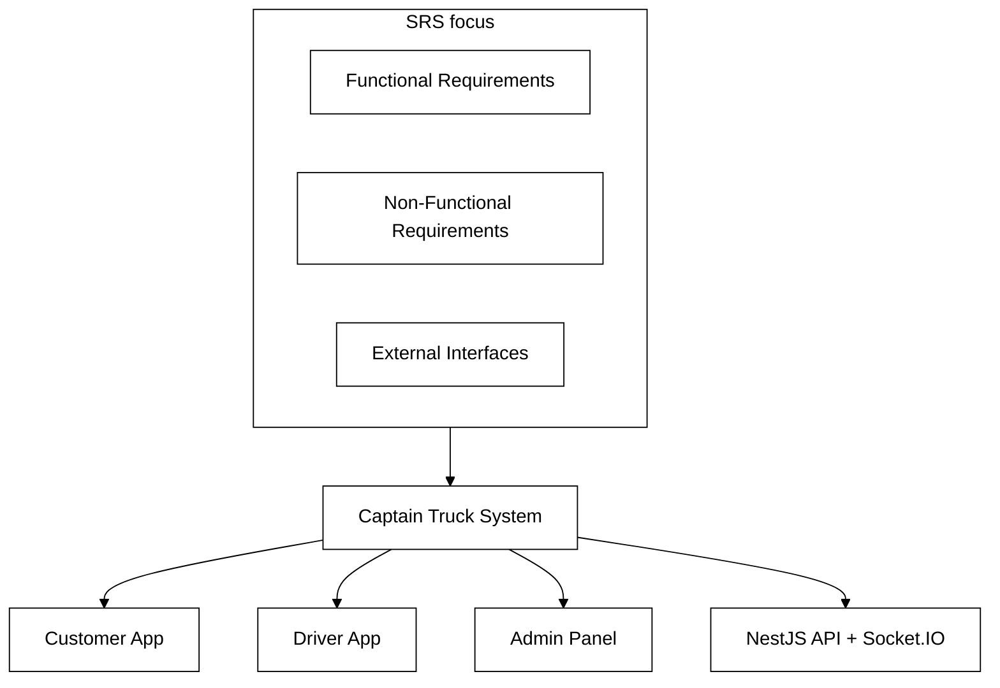
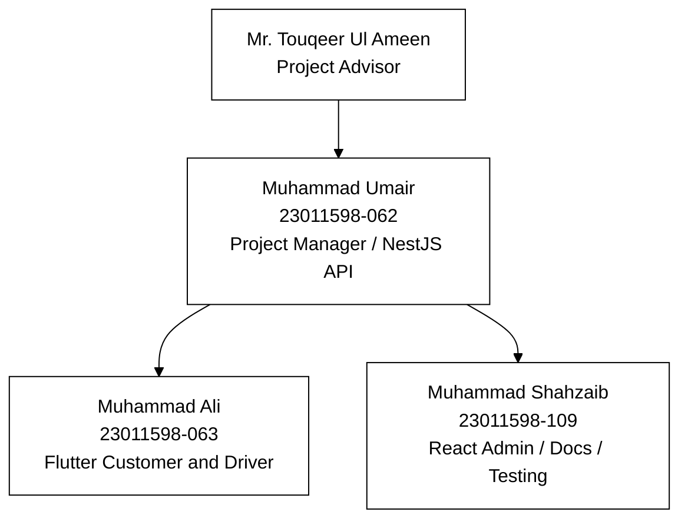
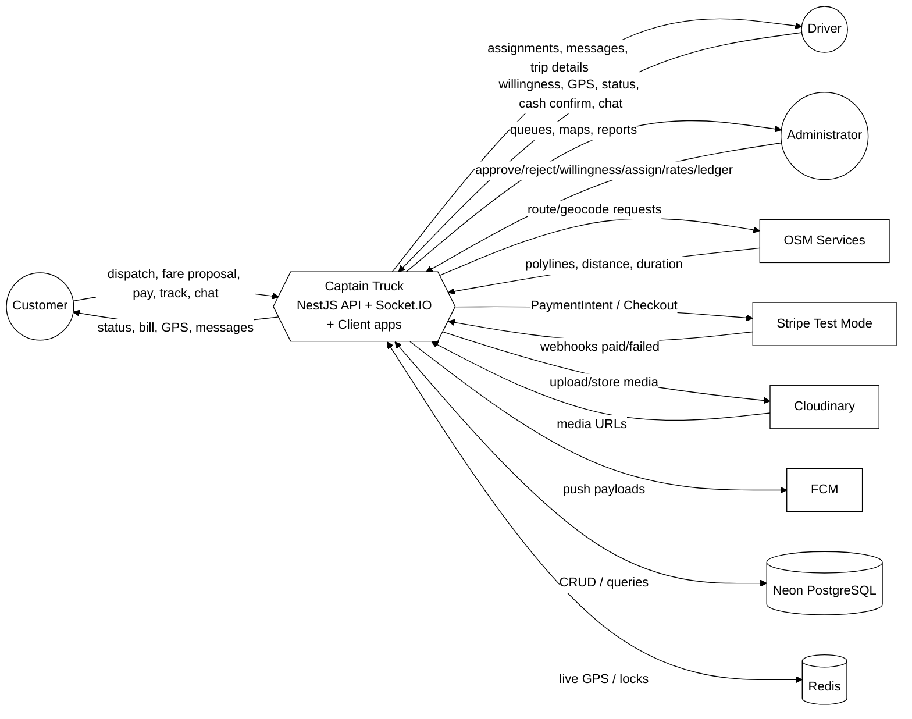
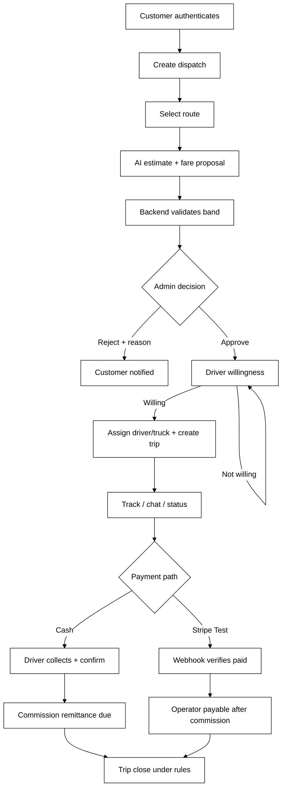
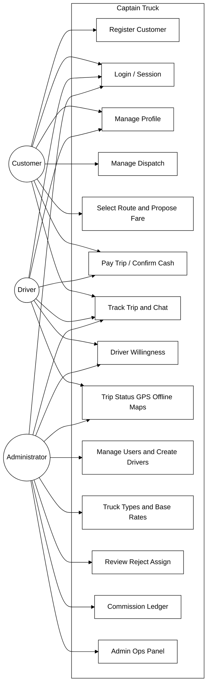

# Chapter 2: Software Requirement Specification (For Object Oriented Approach)

**Captain Truck — A Comprehensive Real-Time Logistics and Dispatch Platform**

Department of Software Engineering  
University of Gujrat  
Faculty of Computing & IT  

**Session:** BSSE-2023-2027  
**Project Advisor:** Mr. Touqeer Ul Ameen  

**Submitted By:**

| Name | Roll No. |
|------|----------|
| Muhammad Umair | 23011598-062 |
| Muhammad Ali | 23011598-063 |
| Muhammad Shahzaib | 23011598-109 |

**Process model (from Chapter 1):** Waterfall Model  

**Requirement sources:** Updated FYP Proposal (15 modules), Chapter 1 Feasibility Report, NestJS API + Admin implementation, Flutter Customer/Driver apps (separate repositories).

---

## Table of Contents

| Section | Title |
|--------:|-------|
| **2** | **Software Requirement Specification (OO Approach)** |
| 2.1 | Introduction |
| 2.1.1 | Systems Specifications |
| 2.1.2 | Identifying External Entities |
| 2.1.3 | Context Level Data Flow Diagram |
| 2.1.4 | Capture “shall” Statements |
| 2.1.5 | Allocate Requirements |
| 2.1.6 | Prioritize Requirements |
| 2.1.7 | Requirements Traceability Matrix |
| 2.2.10 | High Level Usecase Diagram |
| 2.2.11 | Analysis Level Usecase Diagram |
| 2.2.12 | Usecase Description |

---

# Chapter 2: Software Requirement Specification (For Object Oriented Approach)

## 2.1 Introduction

A Software Requirements Specification (SRS) for an object-oriented project like **Captain Truck** covers functional, non-functional, and interface requirements. This chapter captures, structures, and represents stakeholder needs so they can be correctly embodied in the system. The OO SRS activities used here follow the same outline as the NeoTeach sample SRS:

- Requirements elicitation  
- Requirements analysis and negotiation  
- Requirements specification  
- System modeling  
- Requirements validation  
- Requirements management  

Captain Truck is specified as four cooperating surfaces that share one NestJS API:

1. Flutter **Customer** app (Android)  
2. Flutter **Driver** app (Android)  
3. React **Admin** web panel (Vite + Tailwind → Vercel)  
4. NestJS **API** + Socket.IO realtime (Oracle Always Free VM) with PostgreSQL (Neon)

Core behaviours required by the updated proposal: JWT role-based auth; truck types and versioned base rates; dispatch lifecycle; up to three OSM routes; on-device AI trip cost with customer fare proposal inside an admin-configured band; admin approve/reject; driver willingness then assignment; trip lifecycle with Socket.IO GPS and offline map caching; chat (text/image/voice) with Smart Reply on mobile and 90-day TTL; Cash-on-Pickup and Stripe Test Mode with distinct reconciliation; commission ledger; FCM push; Admin operational dashboard.

**Figure 2.1.1: System Specifications (overview)**

*All diagrams in this chapter are black-and-white for print. Mermaid source (diagram code) is shown under each figure.*



**Diagram code (Figure 2.1.1):**

```text
flowchart TB
  subgraph Specs["SRS focus"]
    FR[Functional Requirements]
    NFR[Non-Functional Requirements]
    IF[External Interfaces]
  end
  CT[Captain Truck System]
  Specs --> CT
  CT --> C[Customer App]
  CT --> D[Driver App]
  CT --> A[Admin Panel]
  CT --> API[NestJS API + Socket.IO]
```

---

### 2.1.1 Systems Specifications

The following clauses describe the system specifications for Captain Truck (NeoTeach-style clauses).

#### Introduction

Captain Truck is a real-time logistics and dispatch platform that digitises admin-mediated full-truckload booking for shippers and drivers in Pakistan. Customers create dispatch requests with pickup/drop, truck type and count; the platform returns OSM route alternatives; an on-device AI model estimates trip cost; the customer proposes a fare within an administrator-configured adjustment band; an administrator reviews, rejects with reason, confirms driver willingness, and assigns a driver and truck; the trip is tracked live (with offline map support for drivers); participants chat; payment is cash-on-pickup or Stripe Test Mode; and a commission ledger records platform commission and method-specific payables/remittances.

#### Area Knowledge

Road freight in Pakistan is fragmented. Small operators and shippers often rely on informal brokers for matching, pricing and cash settlement. Gaps include opaque trip cost, weak live tracking, informal assignment, unclear driver willingness, and poor commission reconciliation across cash versus online collection. Digital load boards improve discovery but often omit a human admin assignment loop, customer-adjustable AI pricing, dual cash/card settlement with separate accounting directions, and a full ops panel. Captain Truck fills that gap with OSM multi-route choice, TFLite AI trip cost (on device), customer fare proposal, Socket.IO GPS, offline-aware driver maps, chat with retention policy, Cash + Stripe Test Mode, and an auditable commission ledger on free-tier infrastructure.

#### Organization Overview

Captain Truck is developed by students of the Department of Software Engineering, University of Gujrat, under **Mr. Touqeer Ul Ameen**.

| Member | Roll No. | Primary ownership |
|--------|----------|-------------------|
| Muhammad Umair (Project Manager) | 23011598-062 | NestJS API, realtime, payments, commission |
| Muhammad Ali | 23011598-063 | Flutter Customer & Driver apps; maps & on-device AI |
| Muhammad Shahzaib | 23011598-109 | React Admin panel; documentation; testing |

The team applies NestJS, Flutter, React, PostgreSQL (Prisma/Neon), Redis (optional/coordination), Socket.IO, Cloudinary, FCM and Stripe Test Mode. Development follows the **Waterfall Model** (Chapter 1): planning → requirements → design → implementation → integration → testing → optimization → delivery (September 2026 – June 2027), with university milestones placed on that linear plan.

#### Current Market Status

Informal WhatsApp/broker workflows remain common. Commercial logistics apps and load boards exist but may be costly, closed, region-limited, or mismatched to FYP constraints (free tiers, Android-first, admin mediation, no automatic matching). Captain Truck targets an academic, free-tier, admin-mediated MVP that is still mobile-ready via versioned REST (`/api/v1`) and Socket.IO (`/realtime`). Named commercial comparisons in the proposal must be verified against current public documentation before final submission.

#### Business Regions Overview

Captain Truck focuses on three regions of capability:

1. **Customer booking and pricing** — request creation, route comparison, AI estimate, fare proposal within band, status visibility, payment choice, live track and chat.  
2. **Driver trip fulfilment** — receive willingness inquiry and assignment, navigate with cached maps, publish GPS, update trip status, chat, confirm cash collection.  
3. **Admin operations and reconciliation** — user/driver management, truck types and rate history, pending queue, approve/reject, willingness, assign, live ops map, payments oversight, commission ledger and adjustments.

#### Existing System

Current practice for many small shippers and operators depends on phone calls, messaging apps, paper notes and separate tracking tools. Route comparison and fare agreement are informal. Driver assignment is verbal. Live location may be shared ad hoc. Cash collected on the road is hard to reconcile with platform commission. Online test/demo payment flows are rarely integrated with the same dispatch record.

These existing approaches cover basic communication but fail to provide a single controlled workflow for routes, AI-informed but customer-adjustable fare, mandatory admin review, driver willingness, offline-aware maps, dual payment accounting and an auditable ledger. Captain Truck addresses that gap within the exclusions listed in the updated proposal (no bilty suite, no auto-matching, no live Stripe production claim, no IoT/NADRA).

#### Organizational Chart

**Figure 2.1.1.1: Organization Chart — Captain Truck FYP Team**



**Diagram code (Figure 2.1.1.1):**

```text
flowchart TB
  ADV[Mr. Touqeer Ul Ameen — Project Advisor]
  PM[Muhammad Umair 23011598-062 — Project Manager / NestJS API]
  ALI[Muhammad Ali 23011598-063 — Flutter Customer and Driver]
  SHAH[Muhammad Shahzaib 23011598-109 — React Admin / Docs / Testing]
  ADV --> PM
  PM --> ALI
  PM --> SHAH
```

#### Scope of the System

The scope covers a secure, real-time full-truckload dispatch platform with the **15 functional modules** of the updated proposal. Under Waterfall, modules are specified here, designed in Chapter 3, implemented mainly in the development phase, then integrated and tested.

**Phase 1 (core path):** Auth/RBAC; user & driver management; truck types & rate versions; dispatch create & lifecycle; OSM geocode/routes; AI estimate + fare proposal band; admin approve/reject; willingness + assign; trip statuses; GPS; basic chat; cash + Stripe Test; commission ledger; admin dashboard shell; FCM registration.

**Phase 2 (hardening & mobile depth):** Offline map tile download/cache; queued timestamped GPS; Smart Reply; media signed uploads polish; ledger dual directions (cash remittance vs online operator payable) and discrepancy adjustments; AI training/evaluation documentation (≤20 recent completed trips window); security/idempotency and usability testing.

**Out of scope (proposal exclusions):** Live Stripe production claim; in-app wallet/escrow/auto payout; automatic driver matching/bidding; hardware telematics/IoT; NADRA/biometrics; multi-stop route editing; production-grade AI price guarantee; full bilty/consignment/WMS; multilingual UI (Smart Reply English-only); deferred advanced analytics/ratings if core modules need more time.

#### Summary of Requirements (Initial Requirements)

**Functional Requirements — Captain Truck**

| ID | Module | Summary |
|----|--------|---------|
| FR-01 | Auth | Customer self-register; all roles login; JWT access + refresh; logout/revoke; lockout/rate limit; admin creates drivers |
| FR-02 | Users | Profile update; driver licence/availability; admin search/filter/enable-disable |
| FR-03 | Catalog | Admin CRUD truck types; versioned base rates with effective date; lock rate on dispatch create |
| FR-04 | Dispatch | Create request (addresses, pins, type, count, notes, pickup date); controlled lifecycle; cancel only in pre-trip states |
| FR-05 | Routing | Nominatim/Photon + OSRM up to 3 alternatives; Recommended label; retry/fallback on failure |
| FR-06 | Pricing | TFLite AI estimate; locked base × truckCount formula; customer proposal within admin band; not approved until admin accepts |
| FR-07 | Assignment | Admin review; reject with reason; driver willingness then assign; no auto-match; approved fare locked |
| FR-08 | Trips | Trip after assign; status machine with timestamps; payment vs completion separated |
| FR-09 | GPS / Offline | Socket.IO GPS; last-known + stale; offline tiles/cache; queued timestamped updates |
| FR-10 | Chat | Text/image/voice/preset; Smart Reply optional; report; 90-day TTL; read-only when trip closed |
| FR-11 | Media | Signed Cloudinary upload; secrets server-side; validated metadata |
| FR-12 | Payments | Cash collect + Stripe Test webhooks; idempotent; redirect alone ≠ paid |
| FR-13 | Ledger | Commission separate from fare; cash remittance vs online operator payable; adjustments with reason; integer cents |
| FR-14 | Push | FCM token lifecycle; event notifications with minimal sensitive payload |
| FR-15 | Admin UI | React dashboard for all ops views via API only; realtime ops channels |

**Non-Functional Requirements — Captain Truck**

| ID | Category | Requirement |
|----|----------|-------------|
| NFR-01 | Security | JWT + role/object guards; hashed passwords; Stripe webhook signatures; no client-trusted userId or payment status; secrets in env |
| NFR-02 | Performance | GPS throttle (e.g. 2–5 s); Neon pooled connections; Redis for live location when available |
| NFR-03 | Reliability | Typed OSM failures; idempotent payments/webhooks/assign; fail-open rate-limit policy for FYP demos when Redis down |
| NFR-04 | Usability | Clear status flows for three roles; admin reject requires reason; AI labelled as estimate |
| NFR-05 | Scalability (FYP) | Single Oracle Always Free API instance; free-tier Neon/Redis/Cloudinary/Vercel/FCM |
| NFR-06 | Maintainability | NestJS layering; Prisma migrations; OpenAPI at `/api/docs`; integer minor units for money |
| NFR-07 | Privacy | Chat TTL 90 days; participant-only chat/GPS; PECA-aligned handling of personal/location data |
| NFR-08 | Portability | Android-first mobile clients; Admin is browser SPA; API is HTTP/WebSocket |
| NFR-09 | Offline | Driver map caching uses a tile provider whose licence permits intended caching |

#### Operating Environment

| Layer | Choice |
|-------|--------|
| Mobile | Flutter (Dart), Android (iOS only if testing resources allow) |
| Admin | React + Vite + Tailwind → Vercel |
| API | NestJS + TypeScript on Oracle Always Free + Nginx + PM2 |
| DB | PostgreSQL on Neon (Prisma) |
| Cache / live GPS | Redis (Upstash or Oracle VM; optional for single-instance) |
| Maps | OSM: Nominatim, Photon, OSRM; `flutter_map` / Leaflet; offline tiles per licence |
| AI | On-device TFLite cost + ML Kit Smart Reply |
| Media | Cloudinary |
| Push | FCM only |
| Payments | Cash-on-Pickup + Stripe **Test Mode** |

#### Assumptions and Constraints

- Drivers do **not** self-register publicly; admin creates driver accounts.  
- Multi-truck policy (FYP): one **lead driver** for `truckCount ≥ 1`; billing still uses `truckCount`.  
- No automatic matching/bidding; admin willingness then assign.  
- Server validates fare proposal band and bill; client totals are validated/ignored on mismatch.  
- Stripe is Test Mode for FYP demonstration unless production eligibility is independently confirmed.  
- Refunds / live merchant payouts out of scope for FYP.  
- AI output is advisory; training/retraining is a separate documented process (not automatic from TFLite inference alone).

---

### 2.1.2 Identifying External Entities

External entities are identified in two phases (NeoTeach method).

#### a. Over-specify entities from the product description

1. **Customer (shipper)** — creates dispatches, selects routes, proposes fare, pays, tracks, chats.  
2. **Driver** — responds to willingness, receives assignments, updates GPS/status, chats, confirms cash, uses offline maps.  
3. **Administrator** — manages users/drivers, rates, approve/reject, willingness, assign, ledger, live ops.  
4. **OSM services** — Nominatim/Photon geocode; OSRM routing; map tiles (subject to provider terms).  
5. **Stripe** — Test Mode Checkout / PaymentIntent + webhooks.  
6. **Cloudinary** — chat image/voice storage.  
7. **FCM** — Android push delivery.  
8. **Neon PostgreSQL** — persistent data store.  
9. **Redis** — live GPS and job locks / Socket.IO coordination (when used).  
10. **On-device AI (TFLite / ML Kit)** — local inference on the mobile device (logical external capability to the API).  
11. **Play Store / device OS** — app install and runtime (Android).  
12. **System maintenance team** — developers deploying/monitoring the API (refined out of context DFD as internal).

#### b. Refined external entities (used on context DFD)

| Entity | Type | Interaction with Captain Truck |
|--------|------|--------------------------------|
| Customer | Human actor | REST + Socket.IO via Customer app |
| Driver | Human actor | REST + Socket.IO via Driver app |
| Administrator | Human actor | REST + Socket.IO via Admin web |
| OSM (Nominatim / Photon / OSRM / tiles) | External system | Server/client geocode, routes, map tiles |
| Stripe Test Mode | External system | Payment create + webhook callbacks |
| Cloudinary | External system | Signed media URLs for chat |
| FCM | External system | Push notifications to devices |
| Neon PostgreSQL | External system | Persistent relational storage |
| Redis | External system | Live location cache / locks / optional adapter |

Internal processes (auth, dispatch state machine, fare-band validation, bill formula, willingness/assign rules, commission math, chat TTL job) are **inside** the Captain Truck system boundary. On-device TFLite/ML Kit run on the client device but are shown in architecture as on-device capabilities rather than separate human actors.

---

### 2.1.3 Context Level Data Flow Diagram

**Figure 2.1.3.1: Context Level DFD — Captain Truck**



**Diagram code (Figure 2.1.3.1):**

```text
flowchart LR
  Customer((Customer))
  Driver((Driver))
  Admin((Administrator))
  OSM[OSM Services]
  Stripe[Stripe Test Mode]
  Cloudinary[Cloudinary]
  FCM[FCM]
  Neon[(Neon PostgreSQL)]
  Redis[(Redis)]
  CT{{Captain Truck NestJS API + Socket.IO + Client apps}}
  Customer -->|dispatch, fare proposal, pay, track, chat| CT
  CT -->|status, bill, GPS, messages| Customer
  Driver -->|willingness, GPS, status, cash confirm, chat| CT
  CT -->|assignments, messages, trip details| Driver
  Admin -->|approve/reject/willingness/assign/rates/ledger| CT
  CT -->|queues, maps, reports| Admin
  CT -->|route/geocode requests| OSM
  OSM -->|polylines, distance, duration| CT
  CT -->|PaymentIntent / Checkout| Stripe
  Stripe -->|webhooks paid/failed| CT
  CT -->|upload/store media| Cloudinary
  Cloudinary -->|media URLs| CT
  CT -->|push payloads| FCM
  CT <-->|CRUD / queries| Neon
  CT <-->|live GPS / locks| Redis
```

**Figure 2.1.3.2: High-level dispatch and payment flow (proposal)**



**Diagram code (Figure 2.1.3.2):**

```text
flowchart TD
  A[Customer authenticates] --> B[Create dispatch]
  B --> C[Select route]
  C --> D[AI estimate + fare proposal]
  D --> E[Backend validates band]
  E --> F{Admin decision}
  F -->|Reject + reason| G[Customer notified]
  F -->|Approve| H[Driver willingness]
  H -->|Willing| I[Assign driver/truck + create trip]
  H -->|Not willing| H
  I --> J[Track / chat / status]
  J --> K{Payment path}
  K -->|Cash| L[Driver collects + confirm]
  K -->|Stripe Test| M[Webhook verifies paid]
  L --> N[Commission remittance due]
  M --> O[Operator payable after commission]
  N --> P[Trip close under rules]
  O --> P
```

---

### 2.1.4 Capture “shall” Statements

Shall statements are grouped by the **15 updated-proposal modules**. Wording matches the proposal and is refined where Chapter 1 / API behaviour is already locked (integer cents, JWT roles, Socket.IO rooms, Cloudinary signed uploads, Waterfall process).

**Table 2.1.4.1: Capture “shall” Requirements**

| Para # | Initial requirement |
|--------|---------------------|
| **1. Authentication and Authorization** | |
| 1.0 | The system shall allow a customer to create an account with email, phone (optional), full name and password, storing a hashed password and assigning role `CUSTOMER` server-side. |
| 1.1 | The system shall authenticate customer, driver and admin users with email/password and issue a short-lived JWT access token plus a rotatable refresh token. |
| 1.2 | The system shall allow authenticated users to refresh sessions and logout by revoking refresh tokens; refresh-token reuse shall revoke the token family. |
| 1.3 | The system shall expose a current-user endpoint (`GET /auth/me`) so a client can retrieve the authenticated user profile and role. |
| 1.4 | The system shall allow only an admin to create driver accounts; public self-registration as driver or admin shall be impossible. |
| 1.5 | The system shall apply role-based access control for Customer, Driver and Admin on protected REST and Socket.IO actions. |
| 1.6 | The system shall apply temporary lockout or rate limiting after repeated failed logins; passwords and secrets shall not be stored in plaintext. |
| 1.7 | The system shall prevent login for disabled (and where applicable pending/rejected) accounts. |
| **2. User Management** | |
| 2.0 | The system shall allow a user to view and update only permitted profile fields for their own account. |
| 2.1 | The system shall support driver profiles including licence details and availability information. |
| 2.2 | The system shall allow an admin to search and filter users and drivers, enable or disable accounts, edit administrative profile fields, and create driver accounts. |
| 2.3 | The system shall ensure disabled accounts cannot start new authenticated sessions or perform protected actions; the last active admin shall not be disabled; a driver with active trips shall not be disabled. |
| **3. Truck Types and Base Rates** | |
| 3.0 | The system shall allow an admin to create, update and deactivate truck categories. |
| 3.1 | The system shall version base-rate changes with an effective date / history. |
| 3.2 | The system shall copy the applicable rate version into a dispatch request at create time so later rate changes do not silently alter an existing proposal (`lockedBaseRateCents`). |
| 3.3 | The system shall expose active truck types and current rates to customers; example rates are configurable demonstration data, not fixed market prices. |
| 3.4 | The system shall reject zero or negative rates. |
| **4. Dispatch Request Management** | |
| 4.0 | The system shall allow a customer to enter truck count, truck type, pickup and drop-off addresses, optional map pins, desired pickup date, and notes when creating a request. |
| 4.1 | The system shall enforce a controlled lifecycle including Draft (if implemented), Awaiting Route Selection, Pending Admin, Approved or Rejected, and Assigned once a driver/truck is confirmed. |
| 4.2 | The system shall permit cancellation only in defined pre-trip states. |
| 4.3 | The system shall create a trip record only after the request has been approved and assigned. |
| 4.4 | The system shall reject past pickup times, identical pickup/drop, invalid coordinates, unauthenticated create, and over-limit truck counts; customers shall list/view only their own requests (admin may view any). |
| **5. Route Selection and OSM Integration** | |
| 5.0 | The system shall use geocoding/autocomplete services such as Nominatim and Photon and request route alternatives from OSRM. |
| 5.1 | The system shall display up to three alternatives with distance, estimated duration and route geometry when available; the fastest route may be labelled Recommended while the customer remains able to select another available route. |
| 5.2 | The system shall, if only one route is returned or routing fails, display the available result or a clear retry/fallback message without crashing the API process. |
| 5.3 | The system shall require public OSM service usage to follow the respective providers’ policies. |
| **6. AI-Assisted Fare Estimation and Customer Proposal** | |
| 6.0 | The system shall provide an estimated trip cost via a TensorFlow Lite-compatible on-device model using available features (initially distance-based), labelled as advisory. |
| 6.1 | The system shall combine the estimate with the locked truck-type base rate and truck count according to the documented pricing formula (authoritative server bill in integer cents). |
| 6.2 | The system shall allow the customer to propose an amount within an administrator-configured adjustment band around the estimate (for example ±10% or ±20%); the backend shall validate the range and record estimate, adjustment limit, customer proposal and rate version. |
| 6.3 | The system shall not treat the submitted proposal as approved until the administrator accepts it. |
| 6.4 | The prototype may use the most recent 20 completed trips as a limited training/evaluation window; training/retraining and model-version distribution shall be a separate documented process (TFLite inference alone shall not automatically train a model). |
| **7. Admin Approval, Driver Willingness and Assignment** | |
| 7.0 | The system shall allow administrators to review route details, truck count/type, AI estimate, customer proposed fare, allowed adjustment band and total bill. |
| 7.1 | The system shall allow an admin to approve or reject a request; rejection shall require a reason visible to the customer. |
| 7.2 | The system shall, for approved requests, allow the admin to ask a candidate driver whether they are willing to accept the trip; only after a positive response shall the admin assign the driver and truck. |
| 7.3 | The system shall not perform automatic driver matching. |
| 7.4 | The system shall lock the approved fare; changes shall require an explicit amendment or reapproval record; approve/reject/assign/willingness actions shall be audited. |
| **8. Trip Management** | |
| 8.0 | The system shall activate a trip only after request approval and assignment; the driver shall receive pickup, destination, route, customer contact/chat and payment instructions. |
| 8.1 | The system shall support defined statuses such as Assigned, En Route to Pickup, Arrived at Pickup, In Transit, Arrived at Destination / Delivered, and Completed, validating allowed transitions and recording timestamps. |
| 8.2 | The system shall treat payment settlement and trip completion as related but separate states; exceptional completion with outstanding payment shall follow an explicit admin-controlled rule. |
| **9. Real-Time GPS Tracking and Offline Maps** | |
| 9.0 | The system shall accept driver GPS updates during permitted trip stages through Socket.IO, associate them with the correct trip, and broadcast to authorized customer and admin views. |
| 9.1 | The system shall store the latest received location and timestamp and show stale status on temporary disconnection. |
| 9.2 | The driver app shall download supported map tiles for the planned route area before departure and cache route geometry and essential trip details, using a tile provider whose licence permits the intended caching. |
| 9.3 | The system shall allow GPS to continue locally without internet; remote users shall not receive live updates until connectivity returns; queued updates shall be timestamped so delayed points are not mistaken for the current location. |
| 9.4 | The system shall authenticate Socket.IO with JWT and authorize rooms (`trip:{id}`, `user:{id}`, `admin:ops`); GPS writes shall stop when the trip is sealed. |
| **10. In-App Chat and Smart Reply** | |
| 10.0 | The system shall support trip-related customer–driver and driver–admin conversations with text, images, voice notes and preset messages. |
| 10.1 | The system shall provide live delivery via Socket.IO where connected while persisting message records in the database. |
| 10.2 | The mobile client may suggest up to three English ML Kit Smart Reply options based on recent messages; suggestions shall be optional and not sent automatically. |
| 10.3 | The system shall include reporting, input validation, access checks and a documented 90-day message-retention/cleanup policy; chat shall become read-only after the relevant trip is closed subject to operational rules. |
| **11. Media Upload** | |
| 11.0 | The system shall allow the client to request a short-lived signed upload configuration from the backend and upload supported images or voice files directly to Cloudinary. |
| 11.1 | The backend shall store only validated metadata and the resulting asset reference; file type, size, access permissions and ownership shall be checked. |
| 11.2 | Secret Cloudinary credentials shall remain on the server and shall never be embedded in mobile or web clients. |
| **12. Payments: Cash and Stripe Test Mode** | |
| 12.0 | The system shall support cash collection by the driver of the agreed fare with platform tracking of expected amount and confirmation/discrepancy. |
| 12.1 | The system shall support online payment through Stripe Test Mode where the platform receives payment and verifies final state through signed webhooks and provider references; a success redirect alone shall not mark payment as paid. |
| 12.2 | The system shall handle repeated webhook events idempotently and keep payment states distinct from trip states. |
| 12.3 | The system shall record agreed fare, payment method, amount, transaction/reference ID, status, timestamps and any failure or test reversal where implemented. |
| 12.4 | Online collection shall create an amount payable to the truck operator after platform commission (and modelled adjustments); cash collection shall create a potential commission remittance due from the driver/operator to the platform. |
| **13. Commission Ledger and Reconciliation** | |
| 13.0 | The system shall calculate platform commission per trip according to configured policy and record it separately from the customer fare using integer minor units (e.g. paisa). |
| 13.1 | For cash trips, the ledger shall record expected commission, amount remitted, outstanding balance and admin confirmation. |
| 13.2 | For online trips, the ledger shall record platform-collected fare, commission and operator payable. |
| 13.3 | The admin shall be able to review discrepancies and record permitted adjustments with a reason and audit trail; a driver shall not confirm their own commission as received. |
| **14. Push Notifications** | |
| 14.0 | The client shall register and refresh its FCM token with the backend and remove it on logout or token rotation. |
| 14.1 | The system shall notify users about request submission, approval/rejection, driver willingness/assignment, trip status changes, payment events and other defined events. |
| 14.2 | Notifications shall contain minimal sensitive information; the app shall retrieve protected details from the API after authorization; FCM shall not be used as the primary database. |
| **15. Admin Dashboard and Operational Controls** | |
| 15.0 | The React/Vite/Tailwind dashboard shall give administrators a central view of dispatch counts, pending requests, request details, routes, fare estimates and proposals, approvals/rejections, driver willingness, assignments, active trips, user/driver management, truck types and rate history, payment records, commission ledgers and operational status. |
| 15.1 | The dashboard shall communicate only with the NestJS API and shall not directly modify PostgreSQL or bypass backend authorization; live trip locations and operational updates shall use authorized real-time channels. |

---

### 2.1.5 Allocate Requirements

**Table 2.1.5.1: Allocate Requirements**

| Para # | Initial requirement (short) | Use Case Name |
|--------|-----------------------------|---------------|
| 1.0 | Customer register | UC_Register_Customer |
| 1.1–1.3, 1.6–1.7 | Login / session / me / lockout | UC_Login / UC_Session_Manage / UC_Get_Me |
| 1.4–1.5 | Admin create driver + RBAC | UC_Admin_Create_Driver |
| 2.0–2.1 | Profile / driver profile | UC_Update_Profile |
| 2.2–2.3 | Admin manage users | UC_Admin_Manage_Users |
| 3.0–3.4 | Truck types & rates | UC_Admin_Truck_Types / UC_Admin_Base_Rates / UC_List_Truck_Types |
| 4.0–4.4 | Create/view/cancel dispatch | UC_Create_Dispatch / UC_View_Dispatches / UC_Cancel_Dispatch |
| 5.0–5.3 | OSM routes | UC_Generate_Routes / UC_Select_Route |
| 6.0–6.4 | AI cost + fare proposal | UC_Compute_Bill / UC_Propose_Fare |
| 7.0–7.1 | Review / reject | UC_Admin_Review_Dispatch / UC_Admin_Reject_Dispatch |
| 7.2–7.4 | Willingness + assign + lock fare | UC_Driver_Willingness / UC_Admin_Assign_Driver |
| 8.0–8.2 | Trip lifecycle | UC_Update_Trip_Status / UC_Complete_Trip |
| 9.0–9.4 | GPS + offline maps | UC_Track_Trip_GPS / UC_Offline_Maps |
| 10.0–10.3 | Chat + Smart Reply | UC_Chat_Message |
| 11.0–11.2 | Media upload | UC_Upload_Media |
| 12.0–12.4 | Cash / Stripe pay | UC_Pay_Trip |
| 13.0–13.3 | Commission ledger | UC_Confirm_Commission / UC_Ledger_Adjust |
| 14.0–14.2 | FCM push | UC_Manage_Push_Tokens |
| 15.0–15.1 | Admin web ops | UC_Admin_Ops_Panel |

---

### 2.1.6 Prioritize Requirements

Priority ranks: **Highest** (MVP / critical path), **Medium** (important), **Low** (supporting / polish).

**Table 2.1.6.1: Prioritize Requirements**

| Para # | Rank | Use Case ID | Use Case Name |
|--------|------|-------------|---------------|
| 1.0 | Highest | UC_1 | UC_Register_Customer |
| 1.1 | Highest | UC_2 | UC_Login |
| 1.2 | Highest | UC_3 | UC_Session_Manage |
| 1.4 | Highest | UC_5 | UC_Admin_Create_Driver |
| 2.2 | Highest | UC_7 | UC_Admin_Manage_Users |
| 3.0–3.2 | Highest | UC_8 / UC_10 | UC_Admin_Truck_Types / UC_Admin_Base_Rates |
| 4.0–4.3 | Highest | UC_11 | UC_Create_Dispatch |
| 5.0–5.1 | Highest | UC_13 / UC_14 | UC_Generate_Routes / UC_Select_Route |
| 6.0–6.3 | Highest | UC_15 / UC_16 | UC_Compute_Bill / UC_Propose_Fare |
| 7.1–7.2 | Highest | UC_17 / UC_18 / UC_19 | Reject / Willingness / Assign |
| 8.1 | Highest | UC_20 | UC_Update_Trip_Status |
| 9.0–9.1 | Highest | UC_21 | UC_Track_Trip_GPS |
| 10.0–10.1 | Highest | UC_22 | UC_Chat_Message |
| 12.0–12.2 | Highest | UC_24 | UC_Pay_Trip |
| 13.0–13.2 | Highest | UC_25 | UC_Confirm_Commission |
| 15.0 | Highest | UC_27 | UC_Admin_Ops_Panel |
| 1.3 | Medium | UC_4 | UC_Get_Me |
| 2.0–2.1 | Medium | UC_6 | UC_Update_Profile |
| 6.4 | Medium | UC_15 | UC_Compute_Bill (training window) |
| 9.2–9.3 | Medium | UC_28 | UC_Offline_Maps |
| 10.2 | Medium | UC_22 | UC_Chat_Message (Smart Reply) |
| 11.0–11.2 | Medium | UC_23 | UC_Upload_Media |
| 12.4 / 13.3 | Medium | UC_26 | UC_Ledger_Adjust |
| 14.0–14.1 | Medium | UC_29 | UC_Manage_Push_Tokens |
| 1.6 | Medium | UC_2 | UC_Login (lockout) |
| 4.2 | Medium | UC_12 | UC_Cancel_Dispatch |
| 5.2–5.3 | Medium | UC_13 | UC_Generate_Routes (fallback/policy) |
| 7.4 | Medium | UC_19 | UC_Admin_Assign_Driver (fare amendment) |
| 8.2 | Medium | UC_30 | UC_Complete_Trip (exceptional payment rule) |
| 10.3 | Medium | UC_22 | UC_Chat_Message (TTL / lock) |
| 3.3–3.4 | Low | UC_9 / UC_10 | List types / reject invalid rates |
| 14.2 | Low | UC_29 | UC_Manage_Push_Tokens (payload hygiene) |

---

### 2.1.7 Requirements Traceability Matrix

**Table 2.1.7.1: Requirements Traceability Matrix**

| Sr # | Para # | System specification text (summary) | Build | Use Case Name | Category |
|-----:|--------|-------------------------------------|-------|---------------|----------|
| 1 | 1.0–1.7 | Auth, JWT, RBAC, lockout, admin-created drivers | Build 1.0 | UC_Register_Customer / UC_Login / UC_Session_Manage / UC_Admin_Create_Driver | Auth |
| 2 | 2.0–2.3 | Profiles; admin search/enable-disable | Build 1.1 | UC_Update_Profile / UC_Admin_Manage_Users | Users |
| 3 | 3.0–3.4 | Truck types; versioned rates; lock on create | Build 1.2 | UC_Admin_Truck_Types / UC_Admin_Base_Rates | Catalog |
| 4 | 4.0–4.4 | Dispatch create/lifecycle/cancel; trip after assign | Build 1.2 | UC_Create_Dispatch / UC_View_Dispatches | Dispatch |
| 5 | 5.0–5.3 | OSM geocode + up to 3 routes + fallback | Build 1.3 | UC_Generate_Routes / UC_Select_Route | Routing |
| 6 | 6.0–6.4 | AI estimate; band; proposal; training window | Build 1.3 | UC_Compute_Bill / UC_Propose_Fare | Pricing |
| 7 | 7.0–7.4 | Approve/reject; willingness; assign; fare lock | Build 1.4 | UC_Driver_Willingness / UC_Admin_Assign_Driver | Assignment |
| 8 | 8.0–8.2 | Trip statuses; payment vs complete | Build 1.5 | UC_Update_Trip_Status / UC_Complete_Trip | Trips |
| 9 | 9.0–9.4 | Socket.IO GPS; stale; offline tiles; queued GPS | Build 1.5 | UC_Track_Trip_GPS / UC_Offline_Maps | Tracking |
| 10 | 10.0–10.3 | Chat; Smart Reply; 90-day TTL; lock | Build 1.6 | UC_Chat_Message | Chat |
| 11 | 11.0–11.2 | Signed Cloudinary media | Build 1.6 | UC_Upload_Media | Media |
| 12 | 12.0–12.4 | Cash + Stripe Test; dual accounting directions | Build 1.7 | UC_Pay_Trip | Payments |
| 13 | 13.0–13.3 | Commission ledger; adjustments; integer cents | Build 1.7 | UC_Confirm_Commission / UC_Ledger_Adjust | Commission |
| 14 | 14.0–14.2 | FCM tokens and event push | Build 1.8 | UC_Manage_Push_Tokens | Notifications |
| 15 | 15.0–15.1 | Admin React dashboard via API only | Build 1.8 | UC_Admin_Ops_Panel | Admin UI |

*Build numbers group Waterfall implementation drops aligned with Chapter 1 phases (auth → users/catalog/dispatch → routes/fare → willingness/assign → trips/GPS → chat/media → pay/ledger → push/admin polish).*

---

## 2.2.10 High Level Usecase Diagram

Actors are the three human roles only: **Customer**, **Driver**, and **Administrator**. External systems (OSM, Stripe, Cloudinary, FCM) are not use-case actors; they appear on the context DFD.

**Actor–module associations (high level):**

| Actor | High-level use cases |
|-------|----------------------|
| Customer | Register; Login/Session; Manage profile; Manage dispatch; Select route & propose fare; Pay trip; Track trip & chat; Push tokens |
| Driver | Login/Session only (**no public register**); Manage driver profile; Respond to willingness; Trip ops (status/GPS/offline maps/complete); Chat & media; Confirm cash; Push tokens |
| Administrator | Login/Session; Create drivers & manage users; Truck types & rates; Review / reject / willingness / assign; Ops panel & live track; Chat; Commission ledger |

**Figure 2.2.10.1: High Level Use-case Diagram — Captain Truck**



**Diagram code (Figure 2.2.10.1):**

```text
flowchart LR
  Customer((Customer))
  Driver((Driver))
  Admin((Administrator))
  subgraph System["Captain Truck"]
    UC_Reg[Register Customer]
    UC_Login[Login / Session]
    UC_Prof[Manage Profile]
    UC_Disp[Manage Dispatch]
    UC_Route[Select Route and Propose Fare]
    UC_Pay[Pay Trip / Confirm Cash]
    UC_Track[Track Trip and Chat]
    UC_Will[Driver Willingness]
    UC_Trip[Trip Status GPS Offline Maps]
    UC_Users[Manage Users and Create Drivers]
    UC_Rates[Truck Types and Base Rates]
    UC_Assign[Review Reject Assign]
    UC_Ledg[Commission Ledger]
    UC_Ops[Admin Ops Panel]
  end
  Customer --> UC_Reg
  Customer --> UC_Login
  Customer --> UC_Prof
  Customer --> UC_Disp
  Customer --> UC_Route
  Customer --> UC_Pay
  Customer --> UC_Track
  Driver --> UC_Login
  Driver --> UC_Prof
  Driver --> UC_Will
  Driver --> UC_Trip
  Driver --> UC_Track
  Driver --> UC_Pay
  Admin --> UC_Login
  Admin --> UC_Users
  Admin --> UC_Rates
  Admin --> UC_Assign
  Admin --> UC_Will
  Admin --> UC_Ops
  Admin --> UC_Track
  Admin --> UC_Ledg
  Admin --> UC_Trip
```

---

## 2.2.11 Analysis Level Usecase Diagram

Analysis-level use cases expand the high-level diagram. Associations below match the updated proposal modules and role rules (drivers do not self-register; willingness is admin-initiated and driver-answered; cash confirm is a driver payment action; chat/media are shared by trip participants).

**Corrected association checklist:**

| Use case | Customer | Driver | Admin |
|----------|:--------:|:------:|:-----:|
| UC_Register_Customer | ✓ | | |
| UC_Login / UC_Session_Manage / UC_Get_Me | ✓ | ✓ | ✓ |
| UC_Update_Profile | ✓ | ✓ | |
| UC_List_Truck_Types | ✓ | | |
| UC_Create / View / Cancel Dispatch | ✓ | | |
| UC_Generate_Routes / Select_Route | ✓ | | |
| UC_Compute_Bill / Propose_Fare | ✓ | | |
| UC_Admin_Create_Driver / Manage_Users | | | ✓ |
| UC_Admin_Truck_Types / Base_Rates | | | ✓ |
| UC_Admin_Review / Reject | | | ✓ |
| UC_Driver_Willingness | | ✓ (respond) | ✓ (ask) |
| UC_Admin_Assign_Driver | | | ✓ |
| UC_Update_Trip_Status / Complete_Trip | | ✓ | ✓ |
| UC_Track_Trip_GPS | ✓ (view) | ✓ (publish) | ✓ (view) |
| UC_Offline_Maps | | ✓ | |
| UC_Chat_Message / Upload_Media | ✓ | ✓ | ✓ |
| UC_Pay_Trip | ✓ (pay) | ✓ (cash confirm) | |
| UC_Confirm_Commission / Ledger_Adjust | | | ✓ |
| UC_Admin_Ops_Panel | | | ✓ |
| UC_Manage_Push_Tokens | ✓ | ✓ | |

**Figure 2.2.11.1: Analysis Level Use-case Diagram — Captain Truck**

```mermaid
%%{init: {'theme': 'base', 'themeVariables': { 'primaryColor': '#ffffff', 'primaryTextColor': '#000000', 'primaryBorderColor': '#000000', 'lineColor': '#000000', 'secondaryColor': '#ffffff', 'tertiaryColor': '#ffffff', 'background': '#ffffff', 'mainBkg': '#ffffff', 'nodeBorder': '#000000', 'clusterBkg': '#ffffff', 'clusterBorder': '#000000', 'titleColor': '#000000', 'edgeLabelBackground': '#ffffff'}}}%%
flowchart TB
  Customer((Customer))
  Driver((Driver))
  Admin((Administrator))

  subgraph Auth["Module 1 — Auth"]
    R[UC_Register_Customer]
    L[UC_Login]
    S[UC_Session_Manage]
    ME[UC_Get_Me]
  end

  subgraph Users["Module 2 — Profiles / Users"]
    UP[UC_Update_Profile]
    AU[UC_Admin_Manage_Users]
    AD[UC_Admin_Create_Driver]
  end

  subgraph Catalog["Module 3 — Truck Types and Rates"]
    LT[UC_List_Truck_Types]
    TT[UC_Admin_Truck_Types]
    BR[UC_Admin_Base_Rates]
  end

  subgraph Dispatch["Modules 4–6 — Dispatch Route Fare"]
    CD[UC_Create_Dispatch]
    VD[UC_View_Dispatches]
    CX[UC_Cancel_Dispatch]
    GR[UC_Generate_Routes]
    SR[UC_Select_Route]
    CB[UC_Compute_Bill]
    PF[UC_Propose_Fare]
  end

  subgraph Assign["Module 7 — Approval Willingness Assign"]
    AR[UC_Admin_Review_Dispatch]
    AJ[UC_Admin_Reject_Dispatch]
    DW[UC_Driver_Willingness]
    AA[UC_Admin_Assign_Driver]
  end

  subgraph Trip["Modules 8–9 — Trip GPS Offline"]
    US[UC_Update_Trip_Status]
    TG[UC_Track_Trip_GPS]
    OM[UC_Offline_Maps]
    CP[UC_Complete_Trip]
  end

  subgraph ChatMedia["Modules 10–11 — Chat and Media"]
    CH[UC_Chat_Message]
    UM[UC_Upload_Media]
  end

  subgraph PayLedg["Modules 12–13 — Payments and Ledger"]
    PY[UC_Pay_Trip]
    CC[UC_Confirm_Commission]
    LA[UC_Ledger_Adjust]
  end

  subgraph NotifyOps["Modules 14–15 — Push and Admin UI"]
    PT[UC_Manage_Push_Tokens]
    AP[UC_Admin_Ops_Panel]
  end

  Customer --> R
  Customer --> L
  Customer --> S
  Customer --> ME
  Customer --> UP
  Customer --> LT
  Customer --> CD
  Customer --> VD
  Customer --> CX
  Customer --> GR
  Customer --> SR
  Customer --> CB
  Customer --> PF
  Customer --> TG
  Customer --> CH
  Customer --> UM
  Customer --> PY
  Customer --> PT

  Driver --> L
  Driver --> S
  Driver --> ME
  Driver --> UP
  Driver --> DW
  Driver --> US
  Driver --> TG
  Driver --> OM
  Driver --> CP
  Driver --> CH
  Driver --> UM
  Driver --> PY
  Driver --> PT

  Admin --> L
  Admin --> S
  Admin --> ME
  Admin --> AU
  Admin --> AD
  Admin --> TT
  Admin --> BR
  Admin --> AR
  Admin --> AJ
  Admin --> DW
  Admin --> AA
  Admin --> US
  Admin --> TG
  Admin --> CP
  Admin --> CH
  Admin --> UM
  Admin --> CC
  Admin --> LA
  Admin --> AP
```



**Diagram code (Figure 2.2.11.1):**

```text
flowchart TB
  Customer((Customer))
  Driver((Driver))
  Admin((Administrator))

  subgraph Auth["Module 1 — Auth"]
    R[UC_Register_Customer]
    L[UC_Login]
    S[UC_Session_Manage]
    ME[UC_Get_Me]
  end
  subgraph Users["Module 2 — Profiles / Users"]
    UP[UC_Update_Profile]
    AU[UC_Admin_Manage_Users]
    AD[UC_Admin_Create_Driver]
  end
  subgraph Catalog["Module 3 — Truck Types and Rates"]
    LT[UC_List_Truck_Types]
    TT[UC_Admin_Truck_Types]
    BR[UC_Admin_Base_Rates]
  end
  subgraph Dispatch["Modules 4–6 — Dispatch Route Fare"]
    CD[UC_Create_Dispatch]
    VD[UC_View_Dispatches]
    CX[UC_Cancel_Dispatch]
    GR[UC_Generate_Routes]
    SR[UC_Select_Route]
    CB[UC_Compute_Bill]
    PF[UC_Propose_Fare]
  end
  subgraph Assign["Module 7 — Approval Willingness Assign"]
    AR[UC_Admin_Review_Dispatch]
    AJ[UC_Admin_Reject_Dispatch]
    DW[UC_Driver_Willingness]
    AA[UC_Admin_Assign_Driver]
  end
  subgraph Trip["Modules 8–9 — Trip GPS Offline"]
    US[UC_Update_Trip_Status]
    TG[UC_Track_Trip_GPS]
    OM[UC_Offline_Maps]
    CP[UC_Complete_Trip]
  end
  subgraph ChatMedia["Modules 10–11 — Chat and Media"]
    CH[UC_Chat_Message]
    UM[UC_Upload_Media]
  end
  subgraph PayLedg["Modules 12–13 — Payments and Ledger"]
    PY[UC_Pay_Trip]
    CC[UC_Confirm_Commission]
    LA[UC_Ledger_Adjust]
  end
  subgraph NotifyOps["Modules 14–15 — Push and Admin UI"]
    PT[UC_Manage_Push_Tokens]
    AP[UC_Admin_Ops_Panel]
  end

  Customer --> R & L & S & ME & UP & LT & CD & VD & CX & GR & SR & CB & PF & TG & CH & UM & PY & PT
  Driver --> L & S & ME & UP & DW & US & TG & OM & CP & CH & UM & PY & PT
  Admin --> L & S & ME & AU & AD & TT & BR & AR & AJ & DW & AA & US & TG & CP & CH & UM & CC & LA & AP
```

---

## 2.2.12 Usecase Description

Detailed use cases follow the NeoTeach OO template: each use case is presented as **one single table** (Use-case Name, Use-case ID, Actor, Created By, Date, Description, Pre-Condition, Basic Flow with nested User|System steps, Alternative Flow, Post-Condition). **Customer** self-registers; **Driver** accounts are admin-created; **Administrator** owns catalog, approval, willingness inquiry, assignment and ledger.

---

### Table 2.2.12.1: Customer Registration

Use Case: Customer Registration

**Table 2.2.12.1: Customer Registration User Description**

| Field | Details |
|-------|---------|
| Use-case Name: | UC_Register_Customer |
| Use-case ID: | UI_1.0 |
| Actor: | Customer |
| Created By: | Muhammad Umair, Muhammad Ali, Muhammad Shahzaib |
| Date: | 17/11/2026 |
| Description: | Allows a new shipper to create a customer account. Role is fixed to `CUSTOMER` on the server. |
| Pre-Condition: | • Customer app is installed and online.<br>• Email is not already registered. |
| Basic Flow: | See User \| System steps below |
| Alternative Flow: | • A1: Duplicate email → auth error, registration refused.<br>• A2: Validation failure → field errors returned. |
| Post-Condition: | • Customer account exists with active status (unless otherwise configured).<br>• Password stored only as hash. |

**Basic Flow (User \| System):**

| User | System |
|------|--------|
| 1. Opens Register and enters full name, email, password, optional phone. | 2. Validates fields (email format, password rules, phone format). |
| 3. Submits registration. | 4. Rejects duplicate email/phone; otherwise hashes password and creates user with role `CUSTOMER`. |
| | 5. Returns success; customer may login. |

---

### Table 2.2.12.2: Login

Use Case: Login

**Table 2.2.12.2: Login User Description**

| Field | Details |
|-------|---------|
| Use-case Name: | UC_Login |
| Use-case ID: | UI_1.1 |
| Actor: | Customer, Driver, Admin |
| Created By: | Muhammad Umair, Muhammad Ali, Muhammad Shahzaib |
| Date: | 17/11/2026 |
| Description: | Authenticates a user and issues JWT access + refresh tokens; applies lockout/rate limit on repeated failures. |
| Pre-Condition: | • User account exists.<br>• User is not disabled / blocked from login. |
| Basic Flow: | See User \| System steps below |
| Alternative Flow: | • A1: Bad password → auth failure; after repeated failures, temporary lockout or rate limit.<br>• A2: Disabled/pending/rejected account → login denied. |
| Post-Condition: | • Valid session tokens issued for authorized API/Socket use. |

**Basic Flow (User \| System):**

| User | System |
|------|--------|
| 1. Enters email and password. | 2. Verifies credentials and user status/role. |
| | 3. Issues access JWT and refresh token; returns user summary. |
| 4. Client stores tokens securely. | |

---

### Table 2.2.12.3: Admin Create Driver

Use Case: Admin Create Driver

**Table 2.2.12.3: Admin Create Driver User Description**

| Field | Details |
|-------|---------|
| Use-case Name: | UC_Admin_Create_Driver |
| Use-case ID: | UI_1.2 |
| Actor: | Administrator |
| Created By: | Muhammad Umair, Muhammad Shahzaib |
| Date: | 17/11/2026 |
| Description: | Admin registers a driver account (drivers do not self-register). |
| Pre-Condition: | • Admin authenticated.<br>• Email/phone not already used. |
| Basic Flow: | See User \| System steps below |
| Alternative Flow: | • A1: Duplicate email → error.<br>• A2: Invalid fields → validation errors. |
| Post-Condition: | • Driver account available for ops. |

**Basic Flow (User \| System):**

| User | System |
|------|--------|
| 1. Opens create-driver form; enters credentials and profile fields (including licence/availability as required). | 2. Validates; creates user role `DRIVER` + driver profile. |
| 3. Saves. | 4. Driver can login and later receive willingness inquiries / assignments. |

---

### Table 2.2.12.4: Create Dispatch

Use Case: Create Dispatch

**Table 2.2.12.4: Create Dispatch User Description**

| Field | Details |
|-------|---------|
| Use-case Name: | UC_Create_Dispatch |
| Use-case ID: | UI_2.0 |
| Actor: | Customer |
| Created By: | Muhammad Umair, Muhammad Ali, Muhammad Shahzaib |
| Date: | 17/11/2026 |
| Description: | Customer creates a dispatch request with pickup/drop, truck type/count; system locks applicable base rate version. |
| Pre-Condition: | • Customer is authenticated.<br>• At least one active truck type with a valid base rate exists. |
| Basic Flow: | See User \| System steps below |
| Alternative Flow: | • A1: Validation errors → 4xx with stable error codes.<br>• A2: Unauthenticated → 401. |
| Post-Condition: | • Dispatch stored; rate locked; customer can proceed to route generation/selection. |

**Basic Flow (User \| System):**

| User | System |
|------|--------|
| 1. Enters pickup/drop (address ± lat/lng), truck type, truck count, optional notes/pickup time, payment method preference. | 2. Validates inputs (coords, not same points, truckCount cap, pickup not in past). |
| 3. Submits create. | 4. Snapshots locked base rate / rate version; sets status toward route selection (`DRAFT` / `AWAITING_ROUTE_SELECTION` as implemented). |
| | 5. Returns dispatch id and locked rate. |

---

### Table 2.2.12.5: Generate Routes and Select Route

Use Case: Generate Routes and Select Route

**Table 2.2.12.5: Generate Routes and Select Route User Description**

| Field | Details |
|-------|---------|
| Use-case Name: | UC_Generate_Routes / UC_Select_Route |
| Use-case ID: | UI_2.1 |
| Actor: | Customer |
| Created By: | Muhammad Umair, Muhammad Ali, Muhammad Shahzaib |
| Date: | 17/11/2026 |
| Description: | System fetches up to three OSRM alternatives; customer selects one; request moves toward admin review after fare proposal. |
| Pre-Condition: | • Dispatch owned by customer exists in a selectable state.<br>• OSRM reachable (or graceful error otherwise). |
| Basic Flow: | See User \| System steps below |
| Alternative Flow: | • A1: OSM timeout/down → typed OSM error / retry message.<br>• A2: Only one route returned → still allowed.<br>• A3: Re-select while still allowed by status → idempotent OK. |
| Post-Condition: | • Selected route available for pricing and admin review. |

**Basic Flow (User \| System):**

| User | System |
|------|--------|
| 1. Requests route options for the dispatch. | 2. Calls OSRM; stores alternatives (polyline, distance, duration); marks recommended when appropriate. |
| 3. Reviews options. | 4. Returns options or single-result/fallback messaging. |
| 5. Selects a route. | 6. Marks option selected for subsequent fare proposal / pending-admin flow. |

---

### Table 2.2.12.6: Compute Bill and Propose Fare

Use Case: Compute Bill and Propose Fare

**Table 2.2.12.6: Compute Bill and Propose Fare User Description**

| Field | Details |
|-------|---------|
| Use-case Name: | UC_Compute_Bill / UC_Propose_Fare |
| Use-case ID: | UI_2.2 |
| Actor: | Customer (estimate on device); Backend (validate); Admin (accept later) |
| Created By: | Muhammad Umair, Muhammad Ali |
| Date: | 17/11/2026 |
| Description: | On-device AI estimate is combined with locked base rate and truck count; customer proposes fare within admin-configured band; proposal is recorded but not approved until admin accepts. |
| Pre-Condition: | • Route selected (or route options available for estimate).<br>• Adjustment band configured by admin.<br>• AI model available on device (or documented fallback). |
| Basic Flow: | See User \| System steps below |
| Alternative Flow: | • A1: Proposal outside band → reject with clear error.<br>• A2: Client total mismatches server → server total authoritative.<br>• A3: AI unavailable → documented fallback/retry (estimate remains advisory when present). |
| Post-Condition: | • Estimate and proposal stored; not treated as approved fare until admin acceptance. |

**Basic Flow (User \| System):**

| User | System |
|------|--------|
| 1. Customer app runs TFLite estimate for selected route features. | 2. Accepts AI cost with sanity checks; computes bill breakdown using locked base and truckCount (integer cents). |
| 3. Customer enters proposed fare within ± band. | 4. Validates proposal against estimate × band; records estimate, band, proposal, rate version. |
| 5. Submits for admin review. | 6. Moves request to `PENDING_ADMIN` (or equivalent); marks proposal awaiting admin decision. |

---

### Table 2.2.12.7: Admin Reject Dispatch

Use Case: Admin Reject Dispatch

**Table 2.2.12.7: Admin Reject Dispatch User Description**

| Field | Details |
|-------|---------|
| Use-case Name: | UC_Admin_Reject_Dispatch |
| Use-case ID: | UI_3.0 |
| Actor: | Administrator |
| Created By: | Muhammad Umair, Muhammad Shahzaib |
| Date: | 17/11/2026 |
| Description: | Admin rejects a pending request with a mandatory reason visible to the customer. |
| Pre-Condition: | • Admin authenticated.<br>• Dispatch in pending-admin state. |
| Basic Flow: | See User \| System steps below |
| Alternative Flow: | • A1: Empty reason → rejected by validation.<br>• A2: Wrong status → error. |
| Post-Condition: | • Customer can see rejection reason; no trip created. |

**Basic Flow (User \| System):**

| User | System |
|------|--------|
| 1. Opens request detail (route, estimate, proposal, band, bill). | 2. Displays review fields. |
| 3. Enters non-empty reason and rejects. | 4. Sets status `REJECTED`; stores reason; audits; notifies customer (API + FCM when configured). |

---

### Table 2.2.12.8: Driver Willingness and Admin Assign

Use Case: Driver Willingness and Admin Assign

**Table 2.2.12.8: Driver Willingness and Admin Assign User Description**

| Field | Details |
|-------|---------|
| Use-case Name: | UC_Driver_Willingness / UC_Admin_Assign_Driver |
| Use-case ID: | UI_3.1 |
| Actor: | Administrator, Driver |
| Created By: | Muhammad Umair, Muhammad Ali, Muhammad Shahzaib |
| Date: | 17/11/2026 |
| Description: | After approval intent, admin asks a candidate driver if willing; only after positive response does admin assign driver/truck and create the trip. No automatic matching. Approved fare is locked. |
| Pre-Condition: | • Admin authenticated.<br>• Dispatch approved or in assignable approved state with accepted fare.<br>• Candidate driver account active/available. |
| Basic Flow: | See User \| System steps below |
| Alternative Flow: | • A1: Driver declines → admin may inquire another driver; no assign.<br>• A2: Assign without positive willingness → forbidden.<br>• A3: Driver unavailable/disabled → error; no partial assign.<br>• A4: Fare change after lock → requires amendment/reapproval record. |
| Post-Condition: | • Trip exists; driver can see assignment; fare locked. |

**Basic Flow (User \| System):**

| User | System |
|------|--------|
| 1. Admin selects candidate driver and sends willingness inquiry. | 2. Notifies driver (in-app + FCM); records inquiry. |
| 3. Driver accepts willingness. | 4. Records positive response. |
| 5. Admin confirms assign of that driver/truck. | 6. Atomically sets assigned status, creates `Trip` (`ASSIGNED`), locks approved fare, writes audit log, notifies parties. |

---

### Table 2.2.12.9: Track Trip GPS

Use Case: Track Trip GPS

**Table 2.2.12.9: Track Trip GPS User Description**

| Field | Details |
|-------|---------|
| Use-case Name: | UC_Track_Trip_GPS |
| Use-case ID: | UI_4.0 |
| Actor: | Driver (publish), Customer & Admin (subscribe) |
| Created By: | Muhammad Umair, Muhammad Ali, Muhammad Shahzaib |
| Date: | 17/11/2026 |
| Description: | Driver publishes live location; customers/admin consume via Socket.IO / REST last-known; stale status when updates stop. |
| Pre-Condition: | • Trip assigned; actors authorized for the trip room.<br>• Socket.IO JWT handshake valid. |
| Basic Flow: | See User \| System steps below |
| Alternative Flow: | • A1: Unauthorized room join → denied.<br>• A2: Trip sealed → GPS write rejected.<br>• A3: Driver offline → stale/last-known indicator; queued points flush with original timestamps when back online. |
| Post-Condition: | • Latest location and timestamp stored; delayed points not treated as “now” without timestamps. |

**Basic Flow (User \| System):**

| User | System |
|------|--------|
| 1. Driver app connects to `/realtime` with JWT. | 2. Authorizes join to `trip:{id}`. |
| 3. Driver sends location updates. | 4. Throttles updates; writes Redis live location + trip last-known; emits to room with timestamp. |
| 5. Customer/Admin view map updates. | 6. Serves live events / last-known REST; shows stale when quiet. |

---

### Table 2.2.12.10: Offline Maps (Driver)

Use Case: Offline Maps (Driver)

**Table 2.2.12.10: Offline Maps (Driver) User Description**

| Field | Details |
|-------|---------|
| Use-case Name: | UC_Offline_Maps |
| Use-case ID: | UI_4.2 |
| Actor: | Driver |
| Created By: | Muhammad Ali |
| Date: | 17/11/2026 |
| Description: | Driver downloads supported map tiles for the planned route area before departure and caches route geometry and essential trip details for offline display. |
| Pre-Condition: | • Trip assigned with route geometry available.<br>• Tile provider licence permits intended caching. |
| Basic Flow: | See User \| System steps below |
| Alternative Flow: | • A1: Download fails / storage full → clear error; trip may proceed online-only.<br>• A2: Provider terms disallow pack → feature disabled for that provider. |
| Post-Condition: | • Offline viewing available for cached area; live remote tracking resumes on reconnect. |

**Basic Flow (User \| System):**

| User | System |
|------|--------|
| 1. Before departure, requests offline pack for route corridor. | 2. Downloads permitted tiles/metadata; caches route and trip essentials on device. |
| 3. Loses connectivity on road. | 4. Still shows cached map/route; local GPS may continue; no remote broadcast until reconnect. |

---

### Table 2.2.12.11: Update Trip Status

Use Case: Update Trip Status

**Table 2.2.12.11: Update Trip Status User Description**

| Field | Details |
|-------|---------|
| Use-case Name: | UC_Update_Trip_Status |
| Use-case ID: | UI_4.1 |
| Actor: | Driver, Admin |
| Created By: | Muhammad Umair, Muhammad Ali |
| Date: | 17/11/2026 |
| Description: | Advances trip along the allowed status machine with timestamps. |
| Pre-Condition: | • Actor is assigned driver or admin.<br>• Requested transition is legal from current status. |
| Basic Flow: | See User \| System steps below |
| Alternative Flow: | • A1: Illegal transition → error.<br>• A2: Idempotent if already at target status. |
| Post-Condition: | • Trip reflects new status; clients updated. |

**Basic Flow (User \| System):**

| User | System |
|------|--------|
| 1. Selects next status (e.g. en route → arrived pickup → in transit → arrived destination/delivered). | 2. Validates transition; updates trip (+ related dispatch status when applicable); records timestamp. |
| | 3. Emits realtime/push events. |

---

### Table 2.2.12.12: Chat Message

Use Case: Chat Message

**Table 2.2.12.12: Chat Message User Description**

| Field | Details |
|-------|---------|
| Use-case Name: | UC_Chat_Message |
| Use-case ID: | UI_5.0 |
| Actor: | Customer, Driver, Admin (as participants) |
| Created By: | Muhammad Umair, Muhammad Ali |
| Date: | 17/11/2026 |
| Description: | Send/receive text, image, voice or preset messages; optional on-device Smart Reply suggestions (not auto-sent). |
| Pre-Condition: | • User is a thread participant.<br>• Trip chat not locked (not completed/cancelled), for writes. |
| Basic Flow: | See User \| System steps below |
| Alternative Flow: | • A1: Non-participant → 403.<br>• A2: Chat locked → write denied (read-only).<br>• A3: Report message → reported flag set. |
| Post-Condition: | • Message stored; visible to participants; subject to 90-day TTL job. |

**Basic Flow (User \| System):**

| User | System |
|------|--------|
| 1. Opens trip chat; optionally uploads media via Cloudinary signed flow. | 2. Validates participant + media host allowlist. |
| 3. Optionally taps a Smart Reply suggestion into the composer. | 4. Does not send suggestions automatically. |
| 5. Sends message (type + body/URL). | 6. Persists message; emits Socket.IO event; optional FCM. |

---

### Table 2.2.12.13: Upload Media

Use Case: Upload Media

**Table 2.2.12.13: Upload Media User Description**

| Field | Details |
|-------|---------|
| Use-case Name: | UC_Upload_Media |
| Use-case ID: | UI_5.1 |
| Actor: | Customer, Driver, Admin (authorized) |
| Created By: | Muhammad Umair, Muhammad Ali |
| Date: | 17/11/2026 |
| Description: | Client obtains short-lived signed upload config and uploads image/voice to Cloudinary; backend stores metadata/reference only. |
| Pre-Condition: | • Authenticated participant for the target thread/trip.<br>• File type/size within policy. |
| Basic Flow: | See User \| System steps below |
| Alternative Flow: | • A1: Invalid type/size → reject.<br>• A2: Expired signature → re-request config. |
| Post-Condition: | • Media reference available for chat message; credentials never in client binaries. |

**Basic Flow (User \| System):**

| User | System |
|------|--------|
| 1. Requests signed upload configuration. | 2. Returns short-lived signed params; secrets stay on server. |
| 3. Uploads file directly to Cloudinary. | 4. Client submits resulting URL/metadata; backend validates host/ownership and stores reference. |

---

### Table 2.2.12.14: Pay Trip (Cash / Stripe Test)

Use Case: Pay Trip (Cash / Stripe Test)

**Table 2.2.12.14: Pay Trip (Cash / Stripe Test) User Description**

| Field | Details |
|-------|---------|
| Use-case Name: | UC_Pay_Trip |
| Use-case ID: | UI_6.0 |
| Actor: | Customer; Driver (cash confirm); Stripe (webhook) |
| Created By: | Muhammad Umair, Muhammad Ali |
| Date: | 17/11/2026 |
| Description: | Settles agreed fare via Cash-on-Pickup or Stripe Test Mode; redirect alone does not mark paid; accounting directions differ by method. |
| Pre-Condition: | • Agreed/approved fare known on server.<br>• Payment not already successfully completed for a conflicting method. |
| Basic Flow: | See User \| System steps below |
| Alternative Flow: | • A1: Amount mismatch → reject.<br>• A2: Stripe decline → `FAILED` surfaced to client.<br>• A3: Webhook replay → idempotent no-op.<br>• A4: Client success redirect without webhook → remains unpaid. |
| Post-Condition: | • Payment path recorded; enables completion policy / ledger entries as designed. |

**Basic Flow (User \| System):**

_(Stripe)_

| User | System |
|------|--------|
| 1. Chooses Stripe and starts payment. | 2. Creates PaymentIntent/Checkout with idempotency key for exact fare cents. |
| 3. Completes Stripe Test payment. | 4. Webhook verifies signature; marks `PAID`; records platform-collected fare leading to operator payable after commission. |

_(Cash)_

| User | System |
|------|--------|
| 1. Chooses cash. | 2. Marks `CASH_PENDING` for expected amount. |
| 3. Driver confirms collection (notes discrepancy if any). | 4. Marks `CASH_COLLECTED`; records potential commission remittance due from driver/operator. |

---

### Table 2.2.12.15: Complete Trip

Use Case: Complete Trip

**Table 2.2.12.15: Complete Trip User Description**

| Field | Details |
|-------|---------|
| Use-case Name: | UC_Complete_Trip |
| Use-case ID: | UI_6.1 |
| Actor: | Driver, Admin |
| Created By: | Muhammad Umair |
| Date: | 17/11/2026 |
| Description: | Completes trip under status rules; payment settlement is separate; exceptional completion with outstanding payment follows admin-controlled rule; seals GPS; creates/updates commission ledger entry. |
| Pre-Condition: | • Trip in a completable status path.<br>• Payment settled **or** admin exceptional rule explicitly applied. |
| Basic Flow: | See User \| System steps below |
| Alternative Flow: | • A1: Payment not settled and no admin exception → block complete.<br>• A2: Double complete → idempotent single ledger outcome. |
| Post-Condition: | • Trip completed; ledger pending admin confirmation/reconciliation as applicable. |

**Basic Flow (User \| System):**

| User | System |
|------|--------|
| 1. Requests complete. | 2. Verifies payment rule; sets trip `COMPLETED`; updates dispatch. |
| | 3. Creates/updates commission ledger (cash remittance or online operator payable path). |
| | 4. Locks chat; stops GPS writes; notifies parties. |

---

### Table 2.2.12.16: Confirm Commission / Ledger Adjust

Use Case: Confirm Commission / Ledger Adjust

**Table 2.2.12.16: Confirm Commission / Ledger Adjust User Description**

| Field | Details |
|-------|---------|
| Use-case Name: | UC_Confirm_Commission / UC_Ledger_Adjust |
| Use-case ID: | UI_7.0 |
| Actor: | Administrator |
| Created By: | Muhammad Umair, Muhammad Shahzaib |
| Date: | 17/11/2026 |
| Description: | Admin confirms commission remittance / reviews operator payable; records permitted discrepancy adjustments with reason and audit trail. |
| Pre-Condition: | • Ledger entry exists for completed (or payable) trip.<br>• Actor is admin (not the driver). |
| Basic Flow: | See User \| System steps below |
| Alternative Flow: | • A1: Driver attempts confirm → forbidden.<br>• A2: Adjustment without reason → rejected. |
| Post-Condition: | • Ledger reflects confirmed or adjusted state for ops reconciliation. |

**Basic Flow (User \| System):**

| User | System |
|------|--------|
| 1. Opens commissions list/summary (cash vs online views). | 2. Shows expected/collected/pending or operator payable fields in integer cents. |
| 3. Confirms collection/remittance or records adjustment with reason. | 4. Updates ledger; sets confirmation timestamps; audit log. |

---

### Table 2.2.12.17: Manage Push Tokens

Use Case: Manage Push Tokens

**Table 2.2.12.17: Manage Push Tokens User Description**

| Field | Details |
|-------|---------|
| Use-case Name: | UC_Manage_Push_Tokens |
| Use-case ID: | UI_7.1 |
| Actor: | Customer, Driver (mobile clients; Admin web panel does not register FCM tokens) |
| Created By: | Muhammad Umair, Muhammad Ali |
| Date: | 17/11/2026 |
| Description: | Register/refresh/remove FCM tokens; receive event pushes with minimal sensitive payload. |
| Pre-Condition: | • User authenticated on a device that can obtain an FCM token. |
| Basic Flow: | See User \| System steps below |
| Alternative Flow: | • A1: Invalid token → pruned.<br>• A2: User disables notifications at OS level → delivery may fail silently; in-app state still authoritative. |
| Post-Condition: | • Push channel maintained without using FCM as primary database. |

**Basic Flow (User \| System):**

| User | System |
|------|--------|
| 1. App obtains FCM token and registers/refreshes with API. | 2. Stores token against user/device. |
| 3. Domain event occurs (assign, reject, willingness, status, payment, chat). | 4. Sends push with minimal data; client loads details via authorized API. |
| 5. Logout or token rotation. | 6. Removes or replaces token; prunes invalid tokens on provider errors. |

---

### Table 2.2.12.18: Admin Ops Panel

Use Case: Admin Ops Panel

**Table 2.2.12.18: Admin Ops Panel User Description**

| Field | Details |
|-------|---------|
| Use-case Name: | UC_Admin_Ops_Panel |
| Use-case ID: | UI_8.0 |
| Actor: | Administrator |
| Created By: | Muhammad Shahzaib, Muhammad Umair |
| Date: | 17/11/2026 |
| Description: | Admin uses the React web panel for queue, fare proposals, willingness, trips/live map, users, rates, payments and commissions — via NestJS API only. |
| Pre-Condition: | • Admin JWT session valid.<br>• API CORS allows Admin origin (Vercel/local). |
| Basic Flow: | See User \| System steps below |
| Alternative Flow: | • A1: Non-admin token → rejected by route guard.<br>• A2: API unreachable → health/error state on dashboard. |
| Post-Condition: | • Ops actions persisted via API with role checks. |

**Basic Flow (User \| System):**

| User | System |
|------|--------|
| 1. Logs into Admin SPA. | 2. Validates admin role; establishes session. |
| 3. Uses dashboard: dispatches, proposals, willingness, trips map, users, truck types, payments, commissions. | 4. Calls NestJS `/api/v1` and Socket.IO `admin:ops` as needed; never writes PostgreSQL directly from the browser. |

---

### Table 2.2.12.19: Admin Manage Users / Update Profile

Use Case: Admin Manage Users / Update Profile

**Table 2.2.12.19: Admin Manage Users / Update Profile User Description**

| Field | Details |
|-------|---------|
| Use-case Name: | UC_Admin_Manage_Users / UC_Update_Profile |
| Use-case ID: | UI_1.3 |
| Actor: | Administrator; User (own profile) |
| Created By: | Muhammad Umair, Muhammad Shahzaib |
| Date: | 17/11/2026 |
| Description: | Users update permitted fields; admin searches/filters, enables/disables accounts and edits administrative fields. |
| Pre-Condition: | • Authenticated actor with appropriate role. |
| Basic Flow: | See User \| System steps below |
| Alternative Flow: | • A1: Attempt to edit forbidden fields → ignored/rejected.<br>• A2: Disable blocked by policy → error. |
| Post-Condition: | • Profile/account state updated; disabled users cannot start new sessions. |

**Basic Flow (User \| System):**

| User | System |
|------|--------|
| 1. Opens profile or admin users list with filters. | 2. Returns permitted fields / search results. |
| 3. Saves profile changes or toggles account status. | 4. Enforces safe-field rules; blocks last-admin disable and disable-driver-with-active-trips. |

---

## Chapter 2 summary (accuracy anchors)

| Topic | Source of truth used |
|-------|----------------------|
| Team / rolls | Updated proposal: Umair 062, Ali 063, Shahzaib 109 |
| Modules | Updated proposal Modules 1–15 |
| Process | Waterfall (Chapter 1) |
| Roles | `CUSTOMER`, `DRIVER`, `ADMIN` |
| Dispatch / trip | Controlled lifecycles; trip only after approve+assign |
| Pricing | AI estimate + locked base × truckCount + customer proposal within band |
| Assignment | Admin-mediated **willingness then assign** (no auto-match) |
| Payments | Cash + Stripe Test; dual accounting directions |
| Chat | Types + Cloudinary + Smart Reply (on-device) + 90-day TTL |
| Stack | NestJS, Flutter Android×2, React Admin, Neon, Redis, OSM, FCM, Cloudinary, Oracle, Vercel |
| Diagrams | Black-and-white Mermaid; diagram code included under each figure |

---

*End of Chapter 2 — Captain Truck Software Requirements Specification (OO Approach)*
