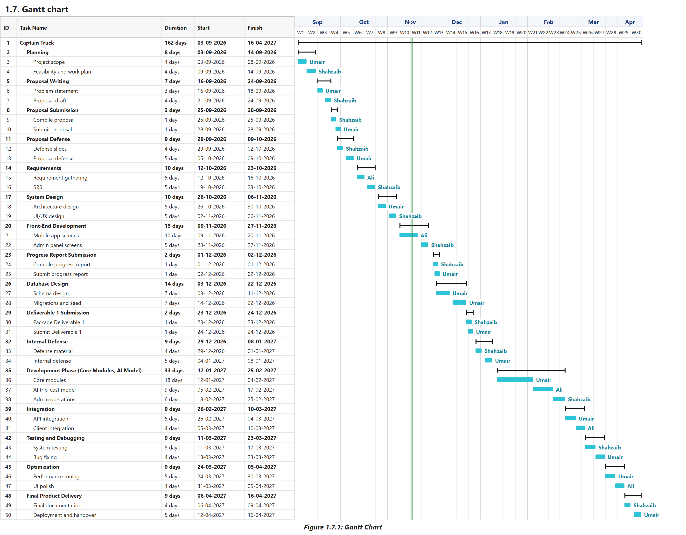
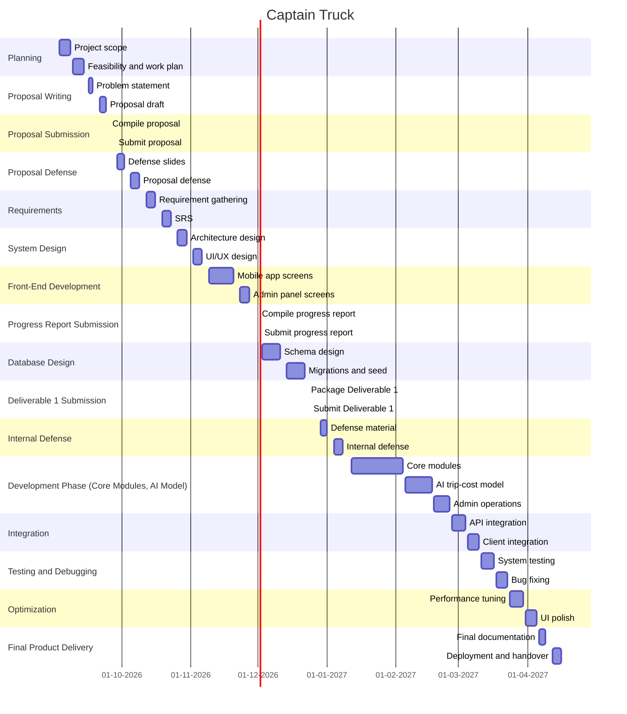

# 1.7. Gantt chart

The Captain Truck schedule runs from September 2026 to 17 April 2027. Each phase has the sub-tasks that sit inside it, with duration, start and finish, in the same layout as a project Gantt. 17 April 2027 is a Saturday, so the last day on the chart is 16 April 2027.

Black bars are summary tasks. Teal bars are the sub-tasks, labelled with the member who owns them (Umair, Ali, Shahzaib). The green line is 17 November 2026. Duration is every calendar day from the start date to the finish date. Dates are dd-mm-yyyy.

*Figure 1.7.1: Gantt Chart*

## Schedule

| ID | Task Name | Duration | Start | Finish |
|---:|---|---:|---|---|
| 1 | Captain Truck | 226 days | 03-09-2026 | 16-04-2027 |
| 2 | &nbsp;&nbsp;&nbsp;&nbsp;Planning | 12 days | 03-09-2026 | 14-09-2026 |
| 3 | &nbsp;&nbsp;&nbsp;&nbsp;&nbsp;&nbsp;&nbsp;&nbsp;Project scope | 6 days | 03-09-2026 | 08-09-2026 |
| 4 | &nbsp;&nbsp;&nbsp;&nbsp;&nbsp;&nbsp;&nbsp;&nbsp;Feasibility and work plan | 6 days | 09-09-2026 | 14-09-2026 |
| 5 | &nbsp;&nbsp;&nbsp;&nbsp;Proposal Writing | 9 days | 16-09-2026 | 24-09-2026 |
| 6 | &nbsp;&nbsp;&nbsp;&nbsp;&nbsp;&nbsp;&nbsp;&nbsp;Problem statement | 3 days | 16-09-2026 | 18-09-2026 |
| 7 | &nbsp;&nbsp;&nbsp;&nbsp;&nbsp;&nbsp;&nbsp;&nbsp;Proposal draft | 4 days | 21-09-2026 | 24-09-2026 |
| 8 | &nbsp;&nbsp;&nbsp;&nbsp;Proposal Submission | 4 days | 25-09-2026 | 28-09-2026 |
| 9 | &nbsp;&nbsp;&nbsp;&nbsp;&nbsp;&nbsp;&nbsp;&nbsp;Compile proposal | 1 day | 25-09-2026 | 25-09-2026 |
| 10 | &nbsp;&nbsp;&nbsp;&nbsp;&nbsp;&nbsp;&nbsp;&nbsp;Submit proposal | 1 day | 28-09-2026 | 28-09-2026 |
| 11 | &nbsp;&nbsp;&nbsp;&nbsp;Proposal Defense | 11 days | 29-09-2026 | 09-10-2026 |
| 12 | &nbsp;&nbsp;&nbsp;&nbsp;&nbsp;&nbsp;&nbsp;&nbsp;Defense slides | 4 days | 29-09-2026 | 02-10-2026 |
| 13 | &nbsp;&nbsp;&nbsp;&nbsp;&nbsp;&nbsp;&nbsp;&nbsp;Proposal defense | 5 days | 05-10-2026 | 09-10-2026 |
| 14 | &nbsp;&nbsp;&nbsp;&nbsp;Requirements | 12 days | 12-10-2026 | 23-10-2026 |
| 15 | &nbsp;&nbsp;&nbsp;&nbsp;&nbsp;&nbsp;&nbsp;&nbsp;Requirement gathering | 5 days | 12-10-2026 | 16-10-2026 |
| 16 | &nbsp;&nbsp;&nbsp;&nbsp;&nbsp;&nbsp;&nbsp;&nbsp;SRS | 5 days | 19-10-2026 | 23-10-2026 |
| 17 | &nbsp;&nbsp;&nbsp;&nbsp;System Design | 12 days | 26-10-2026 | 06-11-2026 |
| 18 | &nbsp;&nbsp;&nbsp;&nbsp;&nbsp;&nbsp;&nbsp;&nbsp;Architecture design | 5 days | 26-10-2026 | 30-10-2026 |
| 19 | &nbsp;&nbsp;&nbsp;&nbsp;&nbsp;&nbsp;&nbsp;&nbsp;UI/UX design | 5 days | 02-11-2026 | 06-11-2026 |
| 20 | &nbsp;&nbsp;&nbsp;&nbsp;Front-End Development | 19 days | 09-11-2026 | 27-11-2026 |
| 21 | &nbsp;&nbsp;&nbsp;&nbsp;&nbsp;&nbsp;&nbsp;&nbsp;Mobile app screens | 12 days | 09-11-2026 | 20-11-2026 |
| 22 | &nbsp;&nbsp;&nbsp;&nbsp;&nbsp;&nbsp;&nbsp;&nbsp;Admin panel screens | 5 days | 23-11-2026 | 27-11-2026 |
| 23 | &nbsp;&nbsp;&nbsp;&nbsp;Progress Report Submission | 2 days | 01-12-2026 | 02-12-2026 |
| 24 | &nbsp;&nbsp;&nbsp;&nbsp;&nbsp;&nbsp;&nbsp;&nbsp;Compile progress report | 1 day | 01-12-2026 | 01-12-2026 |
| 25 | &nbsp;&nbsp;&nbsp;&nbsp;&nbsp;&nbsp;&nbsp;&nbsp;Submit progress report | 1 day | 02-12-2026 | 02-12-2026 |
| 26 | &nbsp;&nbsp;&nbsp;&nbsp;Database Design | 20 days | 03-12-2026 | 22-12-2026 |
| 27 | &nbsp;&nbsp;&nbsp;&nbsp;&nbsp;&nbsp;&nbsp;&nbsp;Schema design | 9 days | 03-12-2026 | 11-12-2026 |
| 28 | &nbsp;&nbsp;&nbsp;&nbsp;&nbsp;&nbsp;&nbsp;&nbsp;Migrations and seed | 9 days | 14-12-2026 | 22-12-2026 |
| 29 | &nbsp;&nbsp;&nbsp;&nbsp;Deliverable 1 Submission | 2 days | 23-12-2026 | 24-12-2026 |
| 30 | &nbsp;&nbsp;&nbsp;&nbsp;&nbsp;&nbsp;&nbsp;&nbsp;Package Deliverable 1 | 1 day | 23-12-2026 | 23-12-2026 |
| 31 | &nbsp;&nbsp;&nbsp;&nbsp;&nbsp;&nbsp;&nbsp;&nbsp;Submit Deliverable 1 | 1 day | 24-12-2026 | 24-12-2026 |
| 32 | &nbsp;&nbsp;&nbsp;&nbsp;Internal Defense | 11 days | 29-12-2026 | 08-01-2027 |
| 33 | &nbsp;&nbsp;&nbsp;&nbsp;&nbsp;&nbsp;&nbsp;&nbsp;Defense material | 4 days | 29-12-2026 | 01-01-2027 |
| 34 | &nbsp;&nbsp;&nbsp;&nbsp;&nbsp;&nbsp;&nbsp;&nbsp;Internal defense | 5 days | 04-01-2027 | 08-01-2027 |
| 35 | &nbsp;&nbsp;&nbsp;&nbsp;Development Phase (Core Modules, AI Model) | 45 days | 12-01-2027 | 25-02-2027 |
| 36 | &nbsp;&nbsp;&nbsp;&nbsp;&nbsp;&nbsp;&nbsp;&nbsp;Core modules | 24 days | 12-01-2027 | 04-02-2027 |
| 37 | &nbsp;&nbsp;&nbsp;&nbsp;&nbsp;&nbsp;&nbsp;&nbsp;AI trip-cost model | 13 days | 05-02-2027 | 17-02-2027 |
| 38 | &nbsp;&nbsp;&nbsp;&nbsp;&nbsp;&nbsp;&nbsp;&nbsp;Admin operations | 8 days | 18-02-2027 | 25-02-2027 |
| 39 | &nbsp;&nbsp;&nbsp;&nbsp;Integration | 13 days | 26-02-2027 | 10-03-2027 |
| 40 | &nbsp;&nbsp;&nbsp;&nbsp;&nbsp;&nbsp;&nbsp;&nbsp;API integration | 7 days | 26-02-2027 | 04-03-2027 |
| 41 | &nbsp;&nbsp;&nbsp;&nbsp;&nbsp;&nbsp;&nbsp;&nbsp;Client integration | 6 days | 05-03-2027 | 10-03-2027 |
| 42 | &nbsp;&nbsp;&nbsp;&nbsp;Testing and Debugging | 13 days | 11-03-2027 | 23-03-2027 |
| 43 | &nbsp;&nbsp;&nbsp;&nbsp;&nbsp;&nbsp;&nbsp;&nbsp;System testing | 7 days | 11-03-2027 | 17-03-2027 |
| 44 | &nbsp;&nbsp;&nbsp;&nbsp;&nbsp;&nbsp;&nbsp;&nbsp;Bug fixing | 6 days | 18-03-2027 | 23-03-2027 |
| 45 | &nbsp;&nbsp;&nbsp;&nbsp;Optimization | 13 days | 24-03-2027 | 05-04-2027 |
| 46 | &nbsp;&nbsp;&nbsp;&nbsp;&nbsp;&nbsp;&nbsp;&nbsp;Performance tuning | 7 days | 24-03-2027 | 30-03-2027 |
| 47 | &nbsp;&nbsp;&nbsp;&nbsp;&nbsp;&nbsp;&nbsp;&nbsp;UI polish | 6 days | 31-03-2027 | 05-04-2027 |
| 48 | &nbsp;&nbsp;&nbsp;&nbsp;Final Product Delivery | 11 days | 06-04-2027 | 16-04-2027 |
| 49 | &nbsp;&nbsp;&nbsp;&nbsp;&nbsp;&nbsp;&nbsp;&nbsp;Final documentation | 4 days | 06-04-2027 | 09-04-2027 |
| 50 | &nbsp;&nbsp;&nbsp;&nbsp;&nbsp;&nbsp;&nbsp;&nbsp;Deployment and handover | 5 days | 12-04-2027 | 16-04-2027 |

## Mermaid

